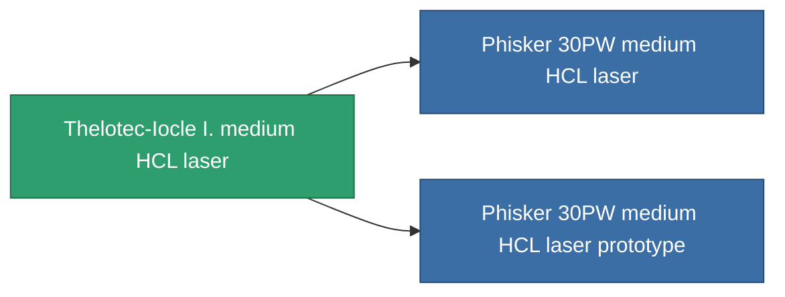

<!-- Generated by tools/generate from the live database (source: entitydefaults definition 1025, aggregatevalues via aggregatefields).
     Do not edit by hand; regenerate instead. -->

# Thelotec-Iocle I. medium HCL laser

|  |  |
|---|---|
| 定义 | `def_named2_longrange_medium_laser` |
| 阶级 | T3 |
| 耐久 | 100 |
| 容量 | 1 |
| 质量 | 650 |
| 分类 | Modules / Weapons |
| Tier line | [Tertzer medium HCL laser](/zh-CN/content/items/named1-longrange-medium-laser/) (T2) → **Thelotec-Iocle I. medium HCL laser** (T3) → [Phisker 30PW medium HCL laser](/zh-CN/content/items/named3-longrange-medium-laser/) (T4) |

## 统计

| 字段 | 值 |
|---|---|
| accuracy | 12 |
| core_usage | 21 |
| cpu_usage | 32 |
| cycle_time | 6k |
| damage_modifier | 1.25 |
| falloff | 10 |
| least_optimal | 12 |
| optimal_range | 36.5 |
| powergrid_usage | 235 |

<!-- production:generated -->
## 生产

**由组件 10个生产 ，研究等级 6** — 组装组件来制造它（完整列表见[配方](/zh-CN/content/recipes/)）:

**蓝图:** [Thelotec-Iocle I. medium HCL laser CT](/content/items/named2-longrange-medium-laser-cprg/)

<svg class="prod-card-icon" aria-hidden="true"><use href="#mi-grid"/></svg><a class="prod-card-name" href="/zh-CN/content/items/espitium/">Espitium</a>

需要: <b>50</b>

<svg class="prod-card-icon" aria-hidden="true"><use href="#mi-grid"/></svg><a class="prod-card-name" href="/zh-CN/content/items/hydrobenol/">Hydrobenol</a>

需要: <b>100</b>

<svg class="prod-card-icon" aria-hidden="true"><use href="#mi-robots"/></svg><a class="prod-card-name" href="/zh-CN/content/items/named1-longrange-medium-laser/">Tertzer medium HCL laser</a>

需要: <b>1</b>

<svg class="prod-card-icon" aria-hidden="true"><use href="#mi-grid"/></svg><a class="prod-card-name" href="/zh-CN/content/items/polynucleit/">Polynucleit</a>

需要: <b>100</b>

<svg class="prod-card-icon" aria-hidden="true"><use href="#mi-grid"/></svg><a class="prod-card-name" href="/zh-CN/content/items/prilumium/">Prilumium</a>

需要: <b>50</b>

<svg class="prod-card-icon" aria-hidden="true"><use href="#mi-crystal"/></svg><a class="prod-card-name" href="/zh-CN/content/items/robotshard-common-advanced/">Functional common fragment</a>

需要: <b>20</b>

<svg class="prod-card-icon" aria-hidden="true"><use href="#mi-crystal"/></svg><a class="prod-card-name" href="/zh-CN/content/items/robotshard-common-basic/">Damaged common fragment</a>

需要: <b>20</b>

<svg class="prod-card-icon" aria-hidden="true"><use href="#mi-crystal"/></svg><a class="prod-card-name" href="/zh-CN/content/items/robotshard-thelodica-advanced/">Functional thelodica fragment</a>

需要: <b>20</b>

<svg class="prod-card-icon" aria-hidden="true"><use href="#mi-crystal"/></svg><a class="prod-card-name" href="/zh-CN/content/items/robotshard-thelodica-basic/">Damaged thelodica fragment</a>

需要: <b>20</b>

<svg class="prod-card-icon" aria-hidden="true"><use href="#mi-grid"/></svg><a class="prod-card-name" href="/zh-CN/content/items/titanium/">Titanium</a>

需要: <b>100</b>

## 用于生产

**2个物品的组件** — 所有在制造中使用它的物品:

