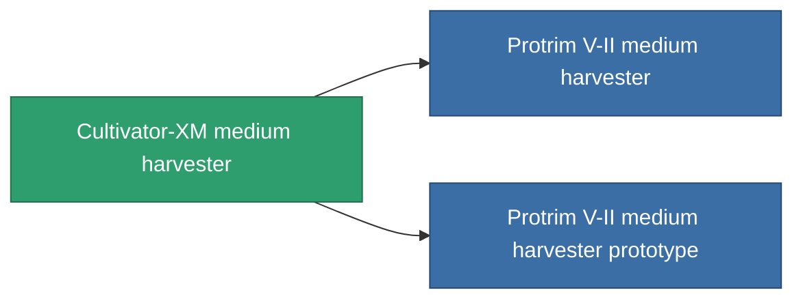

<!-- Generated by tools/generate from the live database (source: entitydefaults definition 811, aggregatevalues via aggregatefields).
     Do not edit by hand; regenerate instead. -->

# Cultivator-XM medium harvester

|  |  |
|---|---|
| 定义 | `def_named2_medium_harvester` |
| 阶级 | T3 |
| 耐久 | 100 |
| 容量 | 1.5 |
| 质量 | 1000 |
| 分类 | Modules / Harvesting |
| Tier line | [Standard medium harvester](/zh-CN/content/items/standard-medium-harvester/) (T1) → [MHA 900-'Sap' medium harvester](/zh-CN/content/items/named1-medium-harvester/) (T2) → **Cultivator-XM medium harvester** (T3) → [Protrim V-II medium harvester](/zh-CN/content/items/named3-medium-harvester/) (T4) |

## 统计

| 字段 | 值 |
|---|---|
| core_usage | 60 |
| cpu_usage | 52 |
| cycle_time | 11k |
| optimal_range | 3 |
| powergrid_usage | 160 |

<!-- production:generated -->
## 生产

**由组件 6个生产 ，研究等级 5** — 组装组件来制造它（完整列表见[配方](/zh-CN/content/recipes/)）:

**蓝图:** [Cultivator-XM medium harvester CT](/content/items/named2-medium-harvester-cprg/)

<svg class="prod-card-icon" aria-hidden="true"><use href="#mi-grid"/></svg><a class="prod-card-name" href="/zh-CN/content/items/axicol/">Cryoperine</a>

需要: <b>50</b>

<svg class="prod-card-icon" aria-hidden="true"><use href="#mi-grid"/></svg><a class="prod-card-name" href="/zh-CN/content/items/espitium/">Espitium</a>

需要: <b>50</b>

<svg class="prod-card-icon" aria-hidden="true"><use href="#mi-grid"/></svg><a class="prod-card-name" href="/zh-CN/content/items/named1-medium-harvester/">MHA 900-'Sap' medium harvester</a>

需要: <b>1</b>

<svg class="prod-card-icon" aria-hidden="true"><use href="#mi-crystal"/></svg><a class="prod-card-name" href="/zh-CN/content/items/robotshard-common-advanced/">Functional common fragment</a>

需要: <b>40</b>

<svg class="prod-card-icon" aria-hidden="true"><use href="#mi-crystal"/></svg><a class="prod-card-name" href="/zh-CN/content/items/robotshard-common-basic/">Damaged common fragment</a>

需要: <b>40</b>

<svg class="prod-card-icon" aria-hidden="true"><use href="#mi-grid"/></svg><a class="prod-card-name" href="/zh-CN/content/items/titanium/">Titanium</a>

需要: <b>300</b>

## 用于生产

**2个物品的组件** — 所有在制造中使用它的物品:

