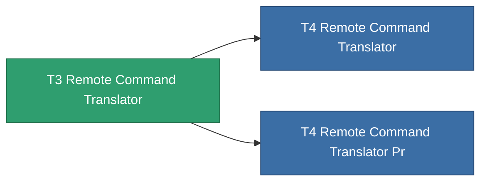

<!-- Generated by tools/generate from the live database (source: entitydefaults definition 8836, aggregatevalues via aggregatefields).
     Do not edit by hand; regenerate instead. -->

# T3 Remote Command Translator

|  |  |
|---|---|
| 定义 | `def_named2_remote_command_translator` |
| 阶级 | T3 |
| 耐久 | 100 |
| 容量 | 2.5 |
| 质量 | 1500 |
| 分类 | Modules / Remote control |
| Tier line | [Standard Remote Command Translator](/zh-CN/content/items/standard-remote-command-translator/) (T1) → [T2 Remote Command Translator](/zh-CN/content/items/named1-remote-command-translator/) (T2) → **T3 Remote Command Translator** (T3) → [T4 Remote Command Translator](/zh-CN/content/items/named3-remote-command-translator/) (T4) |

## 统计

| 字段 | 值 |
|---|---|
| core_usage | 11 |
| cpu_usage | 135 |
| cycle_time | 10k |
| drone_remote_command_translation_armor_max_modifier | 1.1 |
| drone_remote_command_translation_damage_modifier | 1.05 |
| drone_remote_command_translation_harvesting_amount_modifier | 1.05 |
| drone_remote_command_translation_mining_amount_modifier | 1.05 |
| drone_remote_command_translation_remote_repair_amount_modifier | 1.05 |
| drone_remote_command_translation_retreat | 0.001 |
| powergrid_usage | 67 |
| remote_control_bandwidth_max_modifier | 5 |
| remote_control_lifetime_modifier | 150k |
| remote_control_operational_range_modifier | 15 |

<!-- production:generated -->
## 生产

**由组件 8个生产** — 组装组件来制造它（完整列表见[配方](/zh-CN/content/recipes/)）:

**蓝图:** [T3 Remote Command Translator Cprg](/content/items/named2-remote-command-translator-cprg/)

<svg class="prod-card-icon" aria-hidden="true"><use href="#mi-grid"/></svg><a class="prod-card-name" href="/zh-CN/content/items/axicol/">Cryoperine</a>

需要: <b>125</b>

<svg class="prod-card-icon" aria-hidden="true"><use href="#mi-grid"/></svg><a class="prod-card-name" href="/zh-CN/content/items/axicoline/">Axicoline</a>

需要: <b>100</b>

<svg class="prod-card-icon" aria-hidden="true"><use href="#mi-grid"/></svg><a class="prod-card-name" href="/zh-CN/content/items/espitium/">Espitium</a>

需要: <b>300</b>

<svg class="prod-card-icon" aria-hidden="true"><use href="#mi-grid"/></svg><a class="prod-card-name" href="/zh-CN/content/items/hydrobenol/">Hydrobenol</a>

需要: <b>100</b>

<svg class="prod-card-icon" aria-hidden="true"><use href="#mi-grid"/></svg><a class="prod-card-name" href="/zh-CN/content/items/named1-remote-command-translator/">T2 Remote Command Translator</a>

需要: <b>1</b>

<svg class="prod-card-icon" aria-hidden="true"><use href="#mi-crystal"/></svg><a class="prod-card-name" href="/zh-CN/content/items/robotshard-common-advanced/">Functional common fragment</a>

需要: <b>80</b>

<svg class="prod-card-icon" aria-hidden="true"><use href="#mi-crystal"/></svg><a class="prod-card-name" href="/zh-CN/content/items/robotshard-common-basic/">Damaged common fragment</a>

需要: <b>80</b>

<svg class="prod-card-icon" aria-hidden="true"><use href="#mi-grid"/></svg><a class="prod-card-name" href="/zh-CN/content/items/titanium/">Titanium</a>

需要: <b>100</b>

## 用于生产

**2个物品的组件** — 所有在制造中使用它的物品:

