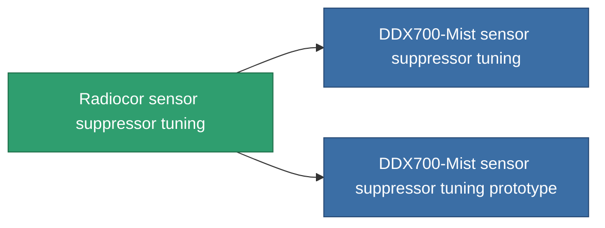

<!-- Generated by tools/generate from the live database (source: entitydefaults definition 4591, aggregatevalues via aggregatefields).
     Do not edit by hand; regenerate instead. -->

# Radiocor sensor suppressor tuning

|  |  |
|---|---|
| 定义 | `def_named2_sensor_supressor_booster` |
| 阶级 | T3 |
| 耐久 | 100 |
| 容量 | 0.5 |
| 质量 | 150 |
| 分类 | Modules / Sensors & scanning |
| Tier line | [Standard sensor suppressor tuning](/zh-CN/content/items/standard-sensor-supressor-booster/) (T1) → [DDX200-Veil sensor suppressor tuning](/zh-CN/content/items/named1-sensor-supressor-booster/) (T2) → **Radiocor sensor suppressor tuning** (T3) → [DDX700-Mist sensor suppressor tuning](/zh-CN/content/items/named3-sensor-supressor-booster/) (T4) |

## 统计

| 字段 | 值 |
|---|---|
| core_usage_sensor_dampener_modifier | 1.1 |
| cpu_usage | 55 |
| effect_enhancer_sensor_dampener_locking_range_modifier | 0.925 |
| effect_enhancer_sensor_dampener_locking_time_modifier | 1.165 |
| powergrid_usage | 20 |

<!-- production:generated -->
## 生产

**由组件 8个生产 ，研究等级 7** — 组装组件来制造它（完整列表见[配方](/zh-CN/content/recipes/)）:

**蓝图:** [Radiocor sensor suppressor tuning CT](/content/items/named2-sensor-supressor-booster-cprg/)

<svg class="prod-card-icon" aria-hidden="true"><use href="#mi-grid"/></svg><a class="prod-card-name" href="/zh-CN/content/items/espitium/">Espitium</a>

需要: <b>150</b>

<svg class="prod-card-icon" aria-hidden="true"><use href="#mi-grid"/></svg><a class="prod-card-name" href="/zh-CN/content/items/named1-sensor-supressor-booster/">DDX200-Veil sensor suppressor tuning</a>

需要: <b>1</b>

<svg class="prod-card-icon" aria-hidden="true"><use href="#mi-grid"/></svg><a class="prod-card-name" href="/zh-CN/content/items/prilumium/">Prilumium</a>

需要: <b>150</b>

<svg class="prod-card-icon" aria-hidden="true"><use href="#mi-crystal"/></svg><a class="prod-card-name" href="/zh-CN/content/items/robotshard-common-advanced/">Functional common fragment</a>

需要: <b>10</b>

<svg class="prod-card-icon" aria-hidden="true"><use href="#mi-crystal"/></svg><a class="prod-card-name" href="/zh-CN/content/items/robotshard-common-basic/">Damaged common fragment</a>

需要: <b>10</b>

<svg class="prod-card-icon" aria-hidden="true"><use href="#mi-crystal"/></svg><a class="prod-card-name" href="/zh-CN/content/items/robotshard-thelodica-advanced/">Functional thelodica fragment</a>

需要: <b>10</b>

<svg class="prod-card-icon" aria-hidden="true"><use href="#mi-crystal"/></svg><a class="prod-card-name" href="/zh-CN/content/items/robotshard-thelodica-basic/">Damaged thelodica fragment</a>

需要: <b>10</b>

<svg class="prod-card-icon" aria-hidden="true"><use href="#mi-grid"/></svg><a class="prod-card-name" href="/zh-CN/content/items/titanium/">Titanium</a>

需要: <b>50</b>

## 用于生产

**2个物品的组件** — 所有在制造中使用它的物品:

