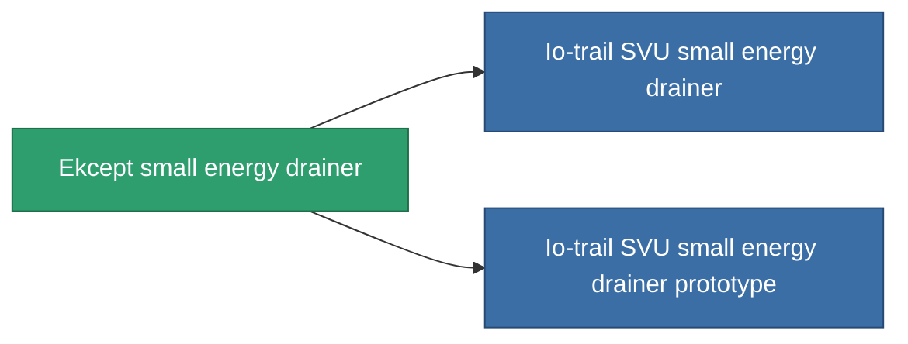

<!-- Generated by tools/generate from the live database (source: entitydefaults definition 745, aggregatevalues via aggregatefields).
     Do not edit by hand; regenerate instead. -->

# Ekcept small energy drainer

|  |  |
|---|---|
| 定义 | `def_named2_small_energy_vampire` |
| 阶级 | T3 |
| 耐久 | 100 |
| 容量 | 0.5 |
| 质量 | 100 |
| 分类 | Modules / Shield |
| Tier line | [Standard small energy drainer](/zh-CN/content/items/standard-small-energy-vampire/) (T1) → [Portio I. small energy drainer](/zh-CN/content/items/named1-small-energy-vampire/) (T2) → **Ekcept small energy drainer** (T3) → [Io-trail SVU small energy drainer](/zh-CN/content/items/named3-small-energy-vampire/) (T4) |
| 备注 | range = optimal_range *  energy_transferers_optimal_range_modifier    cel core -= energy_vampired_amount  sajat core += energy_vampired_amount    csak akkor mukodik ha a cel coreja nagyobb mint a tied. |

## 统计

| 字段 | 值 |
|---|---|
| core_usage | 5 |
| cpu_usage | 47 |
| cycle_time | 8k |
| energy_dispersion | 4 |
| energy_vampired_amount | 22 |
| falloff | 0 |
| optimal_range | 14 |
| powergrid_usage | 37 |

<!-- production:generated -->
## 生产

**由组件 10个生产 ，研究等级 4** — 组装组件来制造它（完整列表见[配方](/zh-CN/content/recipes/)）:

**蓝图:** [Ekcept small energy drainer CT](/content/items/named2-small-energy-vampire-cprg/)

<svg class="prod-card-icon" aria-hidden="true"><use href="#mi-grid"/></svg><a class="prod-card-name" href="/zh-CN/content/items/axicol/">Cryoperine</a>

需要: <b>100</b>

<svg class="prod-card-icon" aria-hidden="true"><use href="#mi-grid"/></svg><a class="prod-card-name" href="/zh-CN/content/items/axicoline/">Axicoline</a>

需要: <b>50</b>

<svg class="prod-card-icon" aria-hidden="true"><use href="#mi-grid"/></svg><a class="prod-card-name" href="/zh-CN/content/items/espitium/">Espitium</a>

需要: <b>100</b>

<svg class="prod-card-icon" aria-hidden="true"><use href="#mi-grid"/></svg><a class="prod-card-name" href="/zh-CN/content/items/hydrobenol/">Hydrobenol</a>

需要: <b>50</b>

<svg class="prod-card-icon" aria-hidden="true"><use href="#mi-grid"/></svg><a class="prod-card-name" href="/zh-CN/content/items/named1-small-energy-vampire/">Portio I. small energy drainer</a>

需要: <b>1</b>

<svg class="prod-card-icon" aria-hidden="true"><use href="#mi-crystal"/></svg><a class="prod-card-name" href="/zh-CN/content/items/robotshard-common-advanced/">Functional common fragment</a>

需要: <b>10</b>

<svg class="prod-card-icon" aria-hidden="true"><use href="#mi-crystal"/></svg><a class="prod-card-name" href="/zh-CN/content/items/robotshard-common-basic/">Damaged common fragment</a>

需要: <b>10</b>

<svg class="prod-card-icon" aria-hidden="true"><use href="#mi-crystal"/></svg><a class="prod-card-name" href="/zh-CN/content/items/robotshard-pelistal-advanced/">Functional pelistal fragment</a>

需要: <b>10</b>

<svg class="prod-card-icon" aria-hidden="true"><use href="#mi-crystal"/></svg><a class="prod-card-name" href="/zh-CN/content/items/robotshard-pelistal-basic/">Damaged pelistal fragment</a>

需要: <b>10</b>

<svg class="prod-card-icon" aria-hidden="true"><use href="#mi-grid"/></svg><a class="prod-card-name" href="/zh-CN/content/items/titanium/">Titanium</a>

需要: <b>100</b>

## 用于生产

**2个物品的组件** — 所有在制造中使用它的物品:

