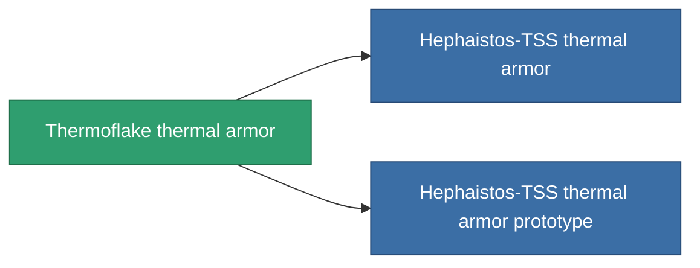

<!-- Generated by tools/generate from the live database (source: entitydefaults definition 715, aggregatevalues via aggregatefields).
     Do not edit by hand; regenerate instead. -->

# Thermoflake thermal armor

|  |  |
|---|---|
| 定义 | `def_named2_thrm_armor_hardener` |
| 阶级 | T3 |
| 耐久 | 100 |
| 容量 | 1 |
| 质量 | 100 |
| 分类 | Modules / Armor |
| Tier line | [Standard thermal armor](/zh-CN/content/items/standard-thrm-armor-hardener/) (T1) → [Lava-3T thermal armor](/zh-CN/content/items/named1-thrm-armor-hardener/) (T2) → **Thermoflake thermal armor** (T3) → [Hephaistos-TSS thermal armor](/zh-CN/content/items/named3-thrm-armor-hardener/) (T4) |

## 统计

| 字段 | 值 |
|---|---|
| core_usage | 13 |
| cpu_usage | 25 |
| cycle_time | 10k |
| effect_resist_thermal | 110 |
| powergrid_usage | 5 |
| resist_thermal | 25 |

<!-- production:generated -->
## 生产

**由组件 10个生产 ，研究等级 5** — 组装组件来制造它（完整列表见[配方](/zh-CN/content/recipes/)）:

**蓝图:** [Thermoflake thermal armor CT](/content/items/named2-thrm-armor-hardener-cprg/)

<svg class="prod-card-icon" aria-hidden="true"><use href="#mi-grid"/></svg><a class="prod-card-name" href="/zh-CN/content/items/alligior/">Alligior</a>

需要: <b>125</b>

<svg class="prod-card-icon" aria-hidden="true"><use href="#mi-grid"/></svg><a class="prod-card-name" href="/zh-CN/content/items/espitium/">Espitium</a>

需要: <b>50</b>

<svg class="prod-card-icon" aria-hidden="true"><use href="#mi-grid"/></svg><a class="prod-card-name" href="/zh-CN/content/items/isopropentol/">Isopropentol</a>

需要: <b>125</b>

<svg class="prod-card-icon" aria-hidden="true"><use href="#mi-tree"/></svg><a class="prod-card-name" href="/zh-CN/content/items/named1-thrm-armor-hardener/">Lava-3T thermal armor</a>

需要: <b>1</b>

<svg class="prod-card-icon" aria-hidden="true"><use href="#mi-crystal"/></svg><a class="prod-card-name" href="/zh-CN/content/items/robotshard-common-advanced/">Functional common fragment</a>

需要: <b>10</b>

<svg class="prod-card-icon" aria-hidden="true"><use href="#mi-crystal"/></svg><a class="prod-card-name" href="/zh-CN/content/items/robotshard-common-basic/">Damaged common fragment</a>

需要: <b>10</b>

<svg class="prod-card-icon" aria-hidden="true"><use href="#mi-crystal"/></svg><a class="prod-card-name" href="/zh-CN/content/items/robotshard-nuimqol-advanced/">Functional nuimqol fragment</a>

需要: <b>10</b>

<svg class="prod-card-icon" aria-hidden="true"><use href="#mi-crystal"/></svg><a class="prod-card-name" href="/zh-CN/content/items/robotshard-nuimqol-basic/">Damaged nuimqol fragment</a>

需要: <b>10</b>

<svg class="prod-card-icon" aria-hidden="true"><use href="#mi-grid"/></svg><a class="prod-card-name" href="/zh-CN/content/items/titanium/">Titanium</a>

需要: <b>100</b>

<svg class="prod-card-icon" aria-hidden="true"><use href="#mi-grid"/></svg><a class="prod-card-name" href="/zh-CN/content/items/vitricyl/">Vitricyl</a>

需要: <b>50</b>

## 用于生产

**2个物品的组件** — 所有在制造中使用它的物品:

