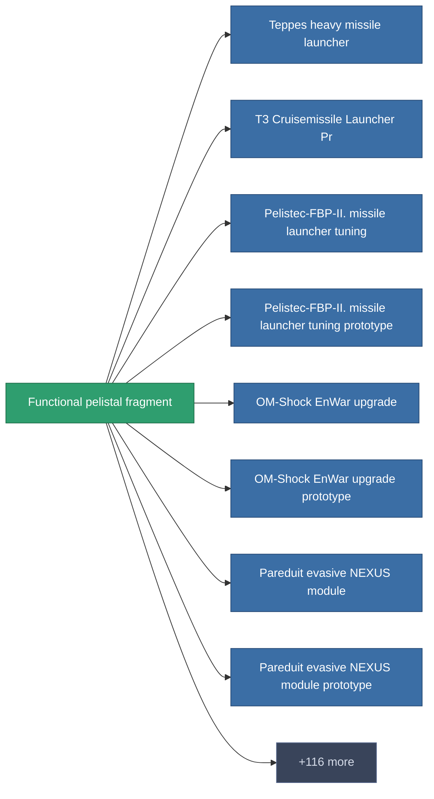

<!-- Generated by tools/generate from the live database (source: entitydefaults definition 1990, aggregatevalues via aggregatefields).
     Do not edit by hand; regenerate instead. -->

# Functional pelistal fragment

|  |  |
|---|---|
| 定义 | `def_robotshard_pelistal_advanced` |
| 阶级 | – |
| 耐久 | 100 |
| 容量 | 0.01 |
| 质量 | 1 |
| 分类 | Materials |

_无统计 — 此物品没有聚合值。_

<!-- production:generated -->
## 生产

**由组件 3个生产** — 组装组件来制造它（完整列表见[配方](/zh-CN/content/recipes/)）:

<svg class="prod-card-icon" aria-hidden="true"><use href="#mi-grid"/></svg><a class="prod-card-name" href="/zh-CN/content/items/isopropentol/">Isopropentol</a>

需要: <b>2</b>

<svg class="prod-card-icon" aria-hidden="true"><use href="#mi-grid"/></svg><a class="prod-card-name" href="/zh-CN/content/items/phlobotil/">Phlobotil</a>

需要: <b>2</b>

<svg class="prod-card-icon" aria-hidden="true"><use href="#mi-grid"/></svg><a class="prod-card-name" href="/zh-CN/content/items/vitricyl/">Vitricyl</a>

需要: <b>2</b>

## 用于生产

**124个物品的组件** — 使用它可以生产的内容示例（完整列表见[配方](/zh-CN/content/recipes/)）。

