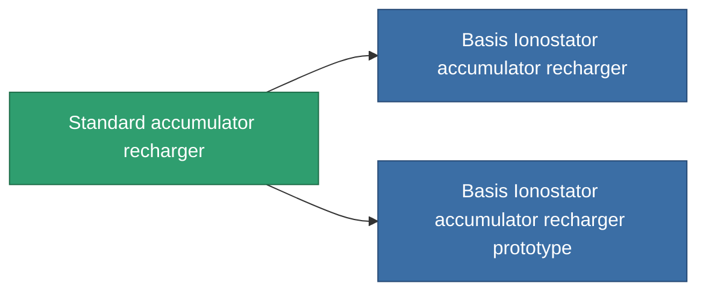

<!-- Generated by tools/generate from the live database (source: entitydefaults definition 41, aggregatevalues via aggregatefields).
     Do not edit by hand; regenerate instead. -->

# Standard accumulator recharger

|  |  |
|---|---|
| 定义 | `def_standard_core_recharger` |
| 阶级 | T1 |
| 耐久 | 100 |
| 容量 | 0.5 |
| 质量 | 100 |
| 分类 | Modules / Power |
| Tier line | **Standard accumulator recharger** (T1) → [Basis Ionostator accumulator recharger](/zh-CN/content/items/named1-core-recharger/) (T2) → [Duobar 300xs-'Othys' accumulator recharger](/zh-CN/content/items/named2-core-recharger/) (T3) → [Nyhna Filler accumulator recharger](/zh-CN/content/items/named3-core-recharger/) (T4) |

## 统计

| 字段 | 值 |
|---|---|
| core_recharge_time_modifier | 0.9 |
| cpu_usage | 25 |
| powergrid_usage | 2 |

<!-- production:generated -->
## 生产

**由组件 2个生产 ，研究等级 3** — 组装组件来制造它（完整列表见[配方](/zh-CN/content/recipes/)）:

**蓝图:** [Standard accumulator recharger CT](/zh-CN/content/items/standard-core-recharger-cprg/)

<svg class="prod-card-icon" aria-hidden="true"><use href="#mi-grid"/></svg><a class="prod-card-name" href="/zh-CN/content/items/axicol/">Cryoperine</a>

需要: <b>250</b>

<svg class="prod-card-icon" aria-hidden="true"><use href="#mi-grid"/></svg><a class="prod-card-name" href="/zh-CN/content/items/titanium/">Titanium</a>

需要: <b>150</b>

## 用于生产

**2个物品的组件** — 所有在制造中使用它的物品:

