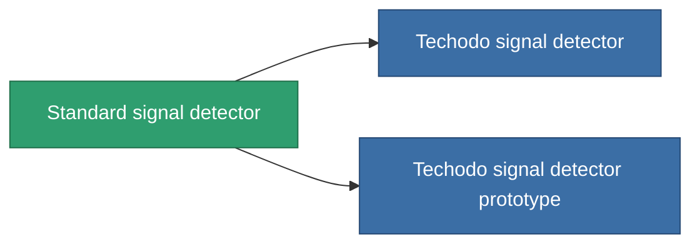

<!-- Generated by tools/generate from the live database (source: entitydefaults definition 2896, aggregatevalues via aggregatefields).
     Do not edit by hand; regenerate instead. -->

# Standard signal detector

|  |  |
|---|---|
| 定义 | `def_standard_detection_modul` |
| 阶级 | T1 |
| 耐久 | 100 |
| 容量 | 0.5 |
| 质量 | 250 |
| 分类 | Modules / Enhancements |
| Tier line | **Standard signal detector** (T1) → [Techodo signal detector](/zh-CN/content/items/named1-detection-modul/) (T2) → [MX-1 Dogon signal detector](/zh-CN/content/items/named2-detection-modul/) (T3) → ['Rogue' signal detector](/zh-CN/content/items/named3-detection-modul/) (T4) |

## 统计

| 字段 | 值 |
|---|---|
| core_usage | 180 |
| cpu_usage | 85 |
| cycle_time | 25k |
| effect_detection_strength_modifier | 20 |
| effect_stealth_strength_modifier | -20 |
| powergrid_usage | 5 |

<!-- production:generated -->
## 生产

**由组件 3个生产 ，研究等级 6** — 组装组件来制造它（完整列表见[配方](/zh-CN/content/recipes/)）:

**蓝图:** [Standard signal detector CT](/content/items/standard-detection-modul-cprg/)

<svg class="prod-card-icon" aria-hidden="true"><use href="#mi-grid"/></svg><a class="prod-card-name" href="/zh-CN/content/items/axicol/">Cryoperine</a>

需要: <b>450</b>

<svg class="prod-card-icon" aria-hidden="true"><use href="#mi-grid"/></svg><a class="prod-card-name" href="/zh-CN/content/items/plasteosine/">Plasteosine</a>

需要: <b>50</b>

<svg class="prod-card-icon" aria-hidden="true"><use href="#mi-grid"/></svg><a class="prod-card-name" href="/zh-CN/content/items/titanium/">Titanium</a>

需要: <b>200</b>

## 用于生产

**2个物品的组件** — 所有在制造中使用它的物品:

