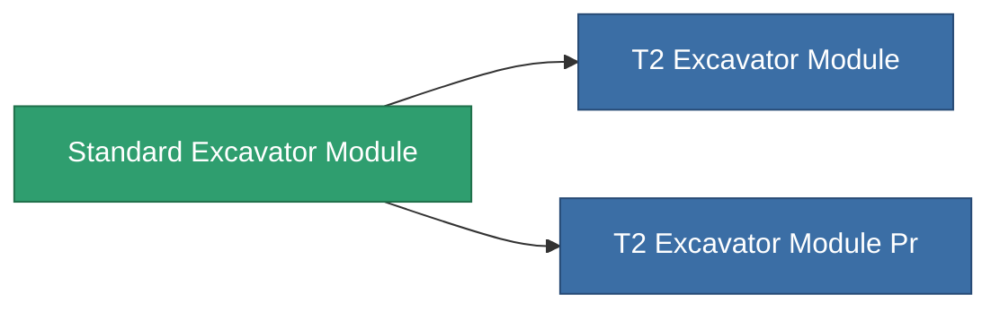

<!-- Generated by tools/generate from the live database (source: entitydefaults definition 8819, aggregatevalues via aggregatefields).
     Do not edit by hand; regenerate instead. -->

# Standard Excavator Module

|  |  |
|---|---|
| 定义 | `def_standard_excavator_module` |
| 阶级 | T1 |
| 耐久 | 100 |
| 容量 | 2.5 |
| 质量 | 2000 |
| 分类 | Modules / Harvesting |
| Tier line | **Standard Excavator Module** (T1) → [T2 Excavator Module](/zh-CN/content/items/named1-excavator-module/) (T2) → [T3 Excavator Module](/zh-CN/content/items/named2-excavator-module/) (T3) → [T4 Excavator Module](/zh-CN/content/items/named3-excavator-module/) (T4) |

## 统计

| 字段 | 值 |
|---|---|
| core_usage | 165 |
| cpu_usage | 450 |
| cycle_time | 180k |
| effect_excavator_harvesting_amount_modifier | 1.3 |
| effect_excavator_mining_amount_modifier | 1.3 |
| effect_excavator_stealth_strength_modifier | -30 |
| powergrid_usage | 1.35k |

<!-- production:generated -->
## 生产

**由组件 2个生产 ，研究等级 5** — 组装组件来制造它（完整列表见[配方](/zh-CN/content/recipes/)）:

**蓝图:** [Standard Excavator Module Cprg](/content/items/standard-excavator-module-cprg/)

<svg class="prod-card-icon" aria-hidden="true"><use href="#mi-grid"/></svg><a class="prod-card-name" href="/zh-CN/content/items/axicol/">Cryoperine</a>

需要: <b>1.6k</b>

<svg class="prod-card-icon" aria-hidden="true"><use href="#mi-grid"/></svg><a class="prod-card-name" href="/zh-CN/content/items/titanium/">Titanium</a>

需要: <b>2.4k</b>

## 用于生产

**2个物品的组件** — 所有在制造中使用它的物品:

