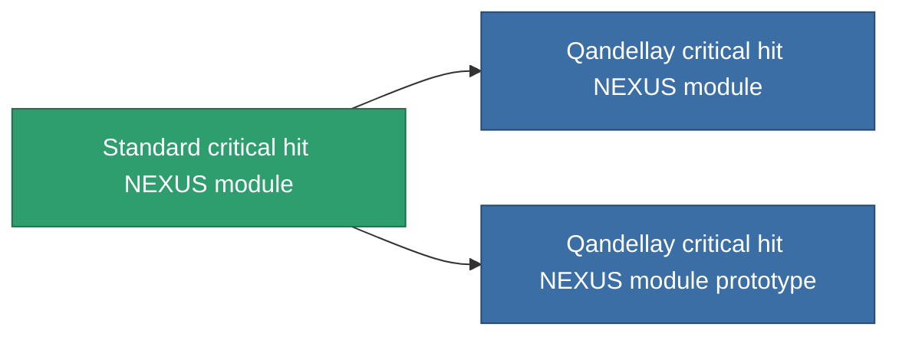

<!-- Generated by tools/generate from the live database (source: entitydefaults definition 2555, aggregatevalues via aggregatefields).
     Do not edit by hand; regenerate instead. -->

# Standard critical hit NEXUS module

|  |  |
|---|---|
| 定义 | `def_standard_gang_assist_precision_firing_module` |
| 阶级 | T1 |
| 耐久 | 100 |
| 容量 | 0.2 |
| 质量 | 50 |
| 分类 | Modules / Enhancements |
| Tier line | **Standard critical hit NEXUS module** (T1) → [Qandellay critical hit NEXUS module](/zh-CN/content/items/named1-gang-assist-precision-firing-module/) (T2) → [E-scope critical hit NEXUS module](/zh-CN/content/items/named2-gang-assist-precision-firing-module/) (T3) → [ZTW critical hit NEXUS module](/zh-CN/content/items/named3-gang-assist-precision-firing-module/) (T4) |
| 备注 | crit_chancet novel |

## 统计

| 字段 | 值 |
|---|---|
| core_usage | 35 |
| cpu_usage | 85 |
| cycle_time | 10k |
| default_effect_range | 100 |
| effect_critical_hit_chance_modifier | 0.02 |
| powergrid_usage | 35 |

<!-- production:generated -->
## 生产

**由组件 5个生产 ，研究等级 4** — 组装组件来制造它（完整列表见[配方](/zh-CN/content/recipes/)）:

**蓝图:** [Standard critical hit NEXUS module CT](/content/items/standard-gang-assist-precision-firing-module-cprg/)

<svg class="prod-card-icon" aria-hidden="true"><use href="#mi-grid"/></svg><a class="prod-card-name" href="/zh-CN/content/items/axicol/">Cryoperine</a>

需要: <b>250</b>

<svg class="prod-card-icon" aria-hidden="true"><use href="#mi-grid"/></svg><a class="prod-card-name" href="/zh-CN/content/items/axicoline/">Axicoline</a>

需要: <b>50</b>

<svg class="prod-card-icon" aria-hidden="true"><use href="#mi-grid"/></svg><a class="prod-card-name" href="/zh-CN/content/items/polynucleit/">Polynucleit</a>

需要: <b>50</b>

<svg class="prod-card-icon" aria-hidden="true"><use href="#mi-grid"/></svg><a class="prod-card-name" href="/zh-CN/content/items/prilumium/">Prilumium</a>

需要: <b>250</b>

<svg class="prod-card-icon" aria-hidden="true"><use href="#mi-grid"/></svg><a class="prod-card-name" href="/zh-CN/content/items/titanium/">Titanium</a>

需要: <b>50</b>

## 用于生产

**2个物品的组件** — 所有在制造中使用它的物品:

