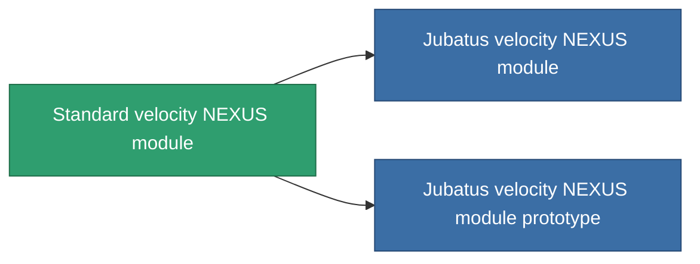

<!-- Generated by tools/generate from the live database (source: entitydefaults definition 873, aggregatevalues via aggregatefields).
     Do not edit by hand; regenerate instead. -->

# Standard velocity NEXUS module

|  |  |
|---|---|
| 定义 | `def_standard_gang_assist_speed_module` |
| 阶级 | T1 |
| 耐久 | 100 |
| 容量 | 0.2 |
| 质量 | 10 |
| 分类 | Modules / Enhancements |
| Tier line | **Standard velocity NEXUS module** (T1) → [Jubatus velocity NEXUS module](/zh-CN/content/items/named1-gang-assist-speed-module/) (T2) → [Iopis-II velocity NEXUS module](/zh-CN/content/items/named2-gang-assist-speed-module/) (T3) → [Contra velocity NEXUS module](/zh-CN/content/items/named3-gang-assist-speed-module/) (T4) |
| 备注 | speed 0.5% / extension lvl   |

## 统计

| 字段 | 值 |
|---|---|
| core_usage | 35 |
| cpu_usage | 85 |
| cycle_time | 10k |
| default_effect_range | 100 |
| effect_speed_max_modifier | 1.02 |
| powergrid_usage | 35 |

<!-- production:generated -->
## 生产

**由组件 3个生产 ，研究等级 4** — 组装组件来制造它（完整列表见[配方](/zh-CN/content/recipes/)）:

**蓝图:** [Standard velocity NEXUS module CT](/zh-CN/content/items/standard-gang-assist-speed-module-cprg/)

<svg class="prod-card-icon" aria-hidden="true"><use href="#mi-grid"/></svg><a class="prod-card-name" href="/zh-CN/content/items/axicol/">Cryoperine</a>

需要: <b>300</b>

<svg class="prod-card-icon" aria-hidden="true"><use href="#mi-grid"/></svg><a class="prod-card-name" href="/zh-CN/content/items/chollonin/">Chollonin</a>

需要: <b>300</b>

<svg class="prod-card-icon" aria-hidden="true"><use href="#mi-grid"/></svg><a class="prod-card-name" href="/zh-CN/content/items/titanium/">Titanium</a>

需要: <b>50</b>

## 用于生产

**2个物品的组件** — 所有在制造中使用它的物品:

