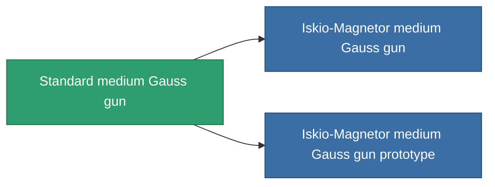

<!-- Generated by tools/generate from the live database (source: entitydefaults definition 67, aggregatevalues via aggregatefields).
     Do not edit by hand; regenerate instead. -->

# Standard medium Gauss gun

|  |  |
|---|---|
| 定义 | `def_standard_medium_railgun` |
| 阶级 | T1 |
| 耐久 | 100 |
| 容量 | 1 |
| 质量 | 500 |
| 分类 | Modules / Weapons |
| Tier line | **Standard medium Gauss gun** (T1) → [Iskio-Magnetor medium Gauss gun](/zh-CN/content/items/named1-medium-railgun/) (T2) → [Nuimtec-Midion AMS medium Gauss gun](/zh-CN/content/items/named2-medium-railgun/) (T3) → [Prompt medium Gauss gun](/zh-CN/content/items/named3-medium-railgun/) (T4) |

## 统计

| 字段 | 值 |
|---|---|
| accuracy | 13.5 |
| core_usage | 15 |
| cpu_usage | 32 |
| cycle_time | 6k |
| damage_modifier | 1.7 |
| falloff | 7.5 |
| least_optimal | 12 |
| optimal_range | 15 |
| powergrid_usage | 150 |

<!-- production:generated -->
## 生产

**由组件 3个生产 ，研究等级 4** — 组装组件来制造它（完整列表见[配方](/zh-CN/content/recipes/)）:

**蓝图:** [Standard medium Gauss gun CT](/zh-CN/content/items/standard-medium-railgun-cprg/)

<svg class="prod-card-icon" aria-hidden="true"><use href="#mi-grid"/></svg><a class="prod-card-name" href="/zh-CN/content/items/axicoline/">Axicoline</a>

需要: <b>100</b>

<svg class="prod-card-icon" aria-hidden="true"><use href="#mi-grid"/></svg><a class="prod-card-name" href="/zh-CN/content/items/polynitrocol/">Polynitrocol</a>

需要: <b>100</b>

<svg class="prod-card-icon" aria-hidden="true"><use href="#mi-grid"/></svg><a class="prod-card-name" href="/zh-CN/content/items/titanium/">Titanium</a>

需要: <b>100</b>

## 用于生产

**2个物品的组件** — 所有在制造中使用它的物品:

