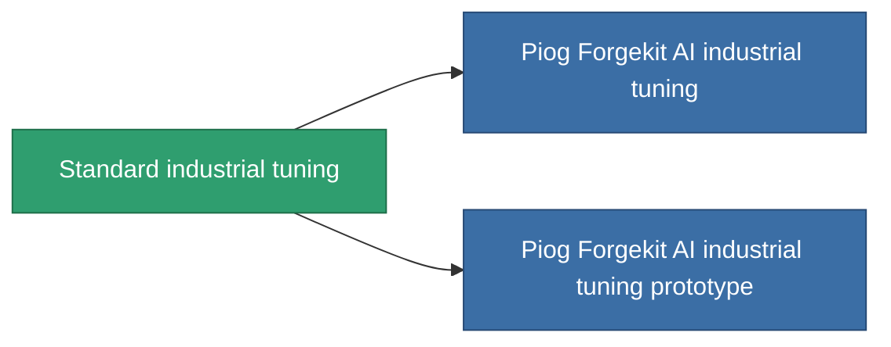

<!-- Generated by tools/generate from the live database (source: entitydefaults definition 56, aggregatevalues via aggregatefields).
     Do not edit by hand; regenerate instead. -->

# Standard industrial tuning

|  |  |
|---|---|
| 定义 | `def_standard_mining_upgrade` |
| 阶级 | T1 |
| 耐久 | 100 |
| 容量 | 1 |
| 质量 | 100 |
| 分类 | Modules / Enhancements |
| Tier line | **Standard industrial tuning** (T1) → [Piog Forgekit AI industrial tuning](/zh-CN/content/items/named1-mining-upgrade/) (T2) → [Fraktura SCV industrial tuning](/zh-CN/content/items/named2-mining-upgrade/) (T3) → [Piog Forgekit BW1 industrial tuning](/zh-CN/content/items/named3-mining-upgrade/) (T4) |

## 统计

| 字段 | 值 |
|---|---|
| cpu_usage | 35 |
| harvesting_amount_modifier | 1.05 |
| mining_amount_modifier | 1.05 |
| powergrid_usage | 20 |

<!-- production:generated -->
## 生产

**由组件 2个生产 ，研究等级 3** — 组装组件来制造它（完整列表见[配方](/zh-CN/content/recipes/)）:

**蓝图:** [Standard industrial tuning CT](/zh-CN/content/items/standard-mining-upgrade-cprg/)

<svg class="prod-card-icon" aria-hidden="true"><use href="#mi-grid"/></svg><a class="prod-card-name" href="/zh-CN/content/items/axicol/">Cryoperine</a>

需要: <b>200</b>

<svg class="prod-card-icon" aria-hidden="true"><use href="#mi-grid"/></svg><a class="prod-card-name" href="/zh-CN/content/items/titanium/">Titanium</a>

需要: <b>50</b>

## 用于生产

**2个物品的组件** — 所有在制造中使用它的物品:

