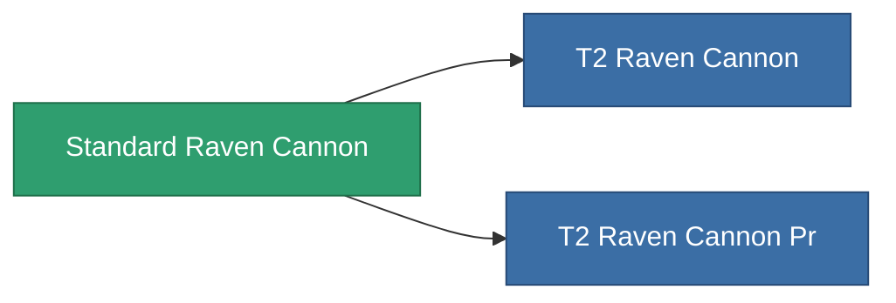

<!-- Generated by tools/generate from the live database (source: entitydefaults definition 1005, aggregatevalues via aggregatefields).
     Do not edit by hand; regenerate instead. -->

# Standard Raven Cannon

|  |  |
|---|---|
| 定义 | `def_standard_raven_cannon` |
| 阶级 | T1 |
| 耐久 | 100 |
| 容量 | 1.8 |
| 质量 | 1400 |
| 分类 | Modules / Weapons |
| Tier line | **Standard Raven Cannon** (T1) → [T2 Raven Cannon](/zh-CN/content/items/named1-raven-cannon/) (T2) → [T3 Raven Cannon](/zh-CN/content/items/named2-raven-cannon/) (T3) → [T4 Raven Cannon](/zh-CN/content/items/named3-raven-cannon/) (T4) |

## 统计

| 字段 | 值 |
|---|---|
| accuracy | 46 |
| core_usage | 1.8 |
| cpu_usage | 66.5 |
| cycle_time | 17k |
| damage_modifier | 1.65 |
| falloff | 40 |
| optimal_range | 38 |
| powergrid_usage | 285 |

<!-- production:generated -->
## 生产

**由组件 6个生产** — 组装组件来制造它（完整列表见[配方](/zh-CN/content/recipes/)）:

**蓝图:** [Standard Raven Cannon Cprg](/zh-CN/content/items/standard-raven-cannon-cprg/)

<svg class="prod-card-icon" aria-hidden="true"><use href="#mi-grid"/></svg><a class="prod-card-name" href="/zh-CN/content/items/alligior/">Alligior</a>

需要: <b>100</b>

<svg class="prod-card-icon" aria-hidden="true"><use href="#mi-grid"/></svg><a class="prod-card-name" href="/zh-CN/content/items/axicol/">Cryoperine</a>

需要: <b>200</b>

<svg class="prod-card-icon" aria-hidden="true"><use href="#mi-grid"/></svg><a class="prod-card-name" href="/zh-CN/content/items/biotichrin/">Biotichrin</a>

需要: <b>100</b>

<svg class="prod-card-icon" aria-hidden="true"><use href="#mi-grid"/></svg><a class="prod-card-name" href="/zh-CN/content/items/espitium/">Espitium</a>

需要: <b>50</b>

<svg class="prod-card-icon" aria-hidden="true"><use href="#mi-grid"/></svg><a class="prod-card-name" href="/zh-CN/content/items/specimen-sap-item-flux/">Specimen Sap Item Flux</a>

需要: <b>10</b>

<svg class="prod-card-icon" aria-hidden="true"><use href="#mi-grid"/></svg><a class="prod-card-name" href="/zh-CN/content/items/titanium/">Titanium</a>

需要: <b>100</b>

## 用于生产

**2个物品的组件** — 所有在制造中使用它的物品:

