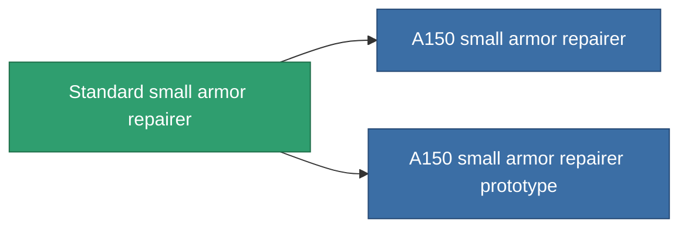

<!-- Generated by tools/generate from the live database (source: entitydefaults definition 18, aggregatevalues via aggregatefields).
     Do not edit by hand; regenerate instead. -->

# Standard small armor repairer

|  |  |
|---|---|
| 定义 | `def_standard_small_armor_repairer` |
| 阶级 | T1 |
| 耐久 | 100 |
| 容量 | 1 |
| 质量 | 250 |
| 分类 | Modules / Repair |
| Tier line | **Standard small armor repairer** (T1) → [A150 small armor repairer](/zh-CN/content/items/named1-small-armor-repairer/) (T2) → [Quissot's small armor repairer](/zh-CN/content/items/named2-small-armor-repairer/) (T3) → [Microforge Aestolar small armor repairer](/zh-CN/content/items/named3-small-armor-repairer/) (T4) |
| 备注 | armor_hp += repair_amount * armor_repair_amount_modifier  rof = cycle_time * armor_repair_cycle_time_modifier   |

## 统计

| 字段 | 值 |
|---|---|
| armor_repair_amount | 60 |
| core_usage | 65 |
| cpu_usage | 35 |
| cycle_time | 15k |
| powergrid_usage | 20 |

<!-- production:generated -->
## 生产

**由组件 5个生产 ，研究等级 2** — 组装组件来制造它（完整列表见[配方](/zh-CN/content/recipes/)）:

**蓝图:** [Standard small armor repairer CT](/content/items/standard-small-armor-repairer-cprg/)

<svg class="prod-card-icon" aria-hidden="true"><use href="#mi-grid"/></svg><a class="prod-card-name" href="/zh-CN/content/items/axicol/">Cryoperine</a>

需要: <b>25</b>

<svg class="prod-card-icon" aria-hidden="true"><use href="#mi-grid"/></svg><a class="prod-card-name" href="/zh-CN/content/items/chollonin/">Chollonin</a>

需要: <b>25</b>

<svg class="prod-card-icon" aria-hidden="true"><use href="#mi-grid"/></svg><a class="prod-card-name" href="/zh-CN/content/items/plasteosine/">Plasteosine</a>

需要: <b>100</b>

<svg class="prod-card-icon" aria-hidden="true"><use href="#mi-grid"/></svg><a class="prod-card-name" href="/zh-CN/content/items/statichnol/">Statichnol</a>

需要: <b>100</b>

<svg class="prod-card-icon" aria-hidden="true"><use href="#mi-grid"/></svg><a class="prod-card-name" href="/zh-CN/content/items/titanium/">Titanium</a>

需要: <b>50</b>

## 用于生产

**2个物品的组件** — 所有在制造中使用它的物品:

