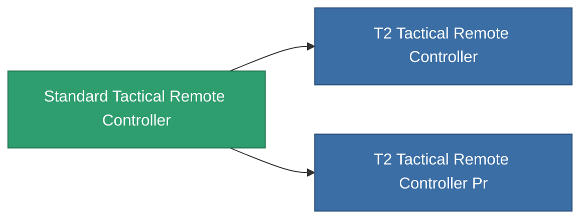

<!-- Generated by tools/generate from the live database (source: entitydefaults definition 8560, aggregatevalues via aggregatefields).
     Do not edit by hand; regenerate instead. -->

# Standard Tactical Remote Controller

|  |  |
|---|---|
| 定义 | `def_standard_tactical_remote_controller` |
| 阶级 | T1 |
| 耐久 | 100 |
| 容量 | 1 |
| 质量 | 1 |
| 分类 | Modules / Remote control |
| Tier line | **Standard Tactical Remote Controller** (T1) → [T2 Tactical Remote Controller](/zh-CN/content/items/named1-tactical-remote-controller/) (T2) → [T3 Tactical Remote Controller](/zh-CN/content/items/named2-tactical-remote-controller/) (T3) → [T4 Tactical Remote Controller](/zh-CN/content/items/named3-tactical-remote-controller/) (T4) |

## 统计

| 字段 | 值 |
|---|---|
| core_usage | 150 |
| cpu_usage | 63 |
| cycle_time | 10k |
| drone_amplification_accuracy_modifier | 1 |
| drone_amplification_armor_max_modifier | 1 |
| drone_amplification_core_max_modifier | 1 |
| drone_amplification_core_recharge_time_modifier | 1 |
| drone_amplification_cycle_time_modifier | 1 |
| drone_amplification_damage_modifier | 1 |
| drone_amplification_locking_time_modifier | 1 |
| drone_amplification_long_range_modifier | 1 |
| drone_amplification_reactor_radiation_modifier | 1 |
| drone_amplification_speed_max_modifier | 1 |
| powergrid_usage | 65 |
| remote_control_bandwidth_max | 0 |
| remote_control_lifetime | 180k |
| remote_control_operational_range | 20 |

<!-- production:generated -->
## 生产

**由组件 4个生产 ，研究等级 5** — 组装组件来制造它（完整列表见[配方](/zh-CN/content/recipes/)）:

**蓝图:** [Standard Tactical Remote Controller Cprg](/content/items/standard-tactical-remote-controller-cprg/)

<svg class="prod-card-icon" aria-hidden="true"><use href="#mi-grid"/></svg><a class="prod-card-name" href="/zh-CN/content/items/axicol/">Cryoperine</a>

需要: <b>250</b>

<svg class="prod-card-icon" aria-hidden="true"><use href="#mi-grid"/></svg><a class="prod-card-name" href="/zh-CN/content/items/axicoline/">Axicoline</a>

需要: <b>100</b>

<svg class="prod-card-icon" aria-hidden="true"><use href="#mi-grid"/></svg><a class="prod-card-name" href="/zh-CN/content/items/espitium/">Espitium</a>

需要: <b>50</b>

<svg class="prod-card-icon" aria-hidden="true"><use href="#mi-grid"/></svg><a class="prod-card-name" href="/zh-CN/content/items/titanium/">Titanium</a>

需要: <b>50</b>

## 用于生产

**2个物品的组件** — 所有在制造中使用它的物品:

