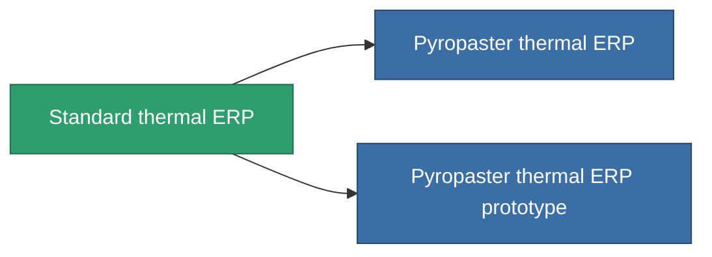

<!-- Generated by tools/generate from the live database (source: entitydefaults definition 3297, aggregatevalues via aggregatefields).
     Do not edit by hand; regenerate instead. -->

# Standard thermal ERP

|  |  |
|---|---|
| 定义 | `def_standard_thermal_kers` |
| 阶级 | T1 |
| 耐久 | 100 |
| 容量 | 1 |
| 质量 | 500 |
| 分类 | Modules / Enhancements |
| Tier line | **Standard thermal ERP** (T1) → [Pyropaster thermal ERP](/zh-CN/content/items/named1-thermal-kers/) (T2) → [DE-melt thermal ERP](/zh-CN/content/items/named2-thermal-kers/) (T3) → [Dyoriva thermal ERP](/zh-CN/content/items/named3-thermal-kers/) (T4) |

## 统计

| 字段 | 值 |
|---|---|
| chemical_damage_to_core_modifier | 0.2 |
| cpu_usage | 50 |
| explosive_damage_to_core_modifier | 0.1 |
| kinetic_damage_to_core_modifier | 0.1 |
| powergrid_usage | 15 |
| thermal_damage_to_core_modifier | 0.5 |

<!-- production:generated -->
## 生产

**由组件 5个生产 ，研究等级 5** — 组装组件来制造它（完整列表见[配方](/zh-CN/content/recipes/)）:

**蓝图:** [Standard thermal ERP CT](/zh-CN/content/items/standard-thermal-kers-cprg/)

<svg class="prod-card-icon" aria-hidden="true"><use href="#mi-grid"/></svg><a class="prod-card-name" href="/zh-CN/content/items/axicol/">Cryoperine</a>

需要: <b>200</b>

<svg class="prod-card-icon" aria-hidden="true"><use href="#mi-grid"/></svg><a class="prod-card-name" href="/zh-CN/content/items/isopropentol/">Isopropentol</a>

需要: <b>100</b>

<svg class="prod-card-icon" aria-hidden="true"><use href="#mi-grid"/></svg><a class="prod-card-name" href="/zh-CN/content/items/plasteosine/">Plasteosine</a>

需要: <b>100</b>

<svg class="prod-card-icon" aria-hidden="true"><use href="#mi-grid"/></svg><a class="prod-card-name" href="/zh-CN/content/items/titanium/">Titanium</a>

需要: <b>200</b>

<svg class="prod-card-icon" aria-hidden="true"><use href="#mi-grid"/></svg><a class="prod-card-name" href="/zh-CN/content/items/vitricyl/">Vitricyl</a>

需要: <b>200</b>

## 用于生产

**2个物品的组件** — 所有在制造中使用它的物品:

