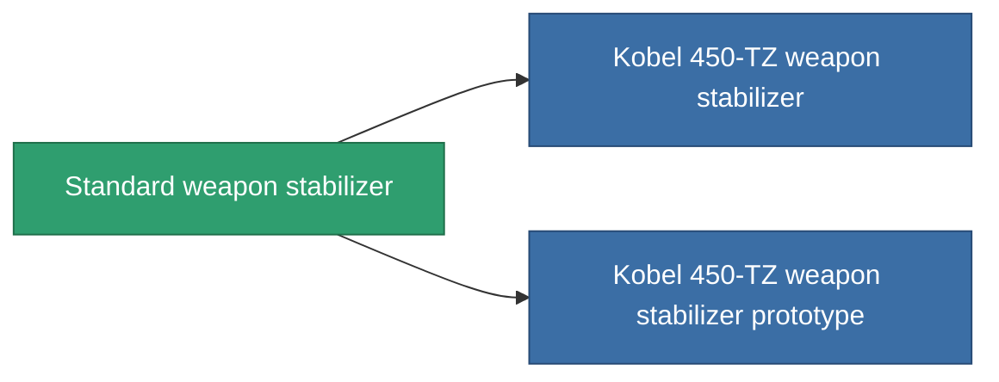

<!-- Generated by tools/generate from the live database (source: entitydefaults definition 3257, aggregatevalues via aggregatefields).
     Do not edit by hand; regenerate instead. -->

# Standard weapon stabilizer

|  |  |
|---|---|
| 定义 | `def_standard_weapon_stabilizer` |
| 阶级 | T1 |
| 耐久 | 100 |
| 容量 | 1 |
| 质量 | 500 |
| 分类 | Modules / Weapons |
| Tier line | **Standard weapon stabilizer** (T1) → [Kobel 450-TZ weapon stabilizer](/zh-CN/content/items/named1-weapon-stabilizer/) (T2) → [Sharpsy weapon stabilizer](/zh-CN/content/items/named2-weapon-stabilizer/) (T3) → [Kobel 300-XZ weapon stabilizer](/zh-CN/content/items/named3-weapon-stabilizer/) (T4) |

## 统计

| 字段 | 值 |
|---|---|
| accuracy_modifier | 0.9 |
| cpu_usage | 35 |
| explosion_radius_modifier | 0.9 |
| massiveness | -0.05 |
| powergrid_usage | 20 |

<!-- production:generated -->
## 生产

**由组件 3个生产 ，研究等级 4** — 组装组件来制造它（完整列表见[配方](/zh-CN/content/recipes/)）:

**蓝图:** [Standard weapon stabilizer CT](/zh-CN/content/items/standard-weapon-stabilizer-cprg/)

<svg class="prod-card-icon" aria-hidden="true"><use href="#mi-grid"/></svg><a class="prod-card-name" href="/zh-CN/content/items/axicol/">Cryoperine</a>

需要: <b>350</b>

<svg class="prod-card-icon" aria-hidden="true"><use href="#mi-grid"/></svg><a class="prod-card-name" href="/zh-CN/content/items/axicoline/">Axicoline</a>

需要: <b>150</b>

<svg class="prod-card-icon" aria-hidden="true"><use href="#mi-grid"/></svg><a class="prod-card-name" href="/zh-CN/content/items/titanium/">Titanium</a>

需要: <b>150</b>

## 用于生产

**2个物品的组件** — 所有在制造中使用它的物品:

