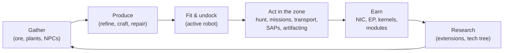

# 游戏中你可以做什么

所有玩家操作，按系统分类。命令名称是服务端标识符——客户端会在其自身的 UI 中呈现这些操作。各操作的详细说明位于各系统页面中。

游戏的核心循环：赚取并消费，沿层级阶梯不断攀升。

## 系统

| 系统 | 页面 | 涵盖内容 |
|---|---|---|
| 入门指南 | [getting-started](/zh-CN/features/getting-started/) | 创建/选择角色、首个机器人、账户基础 |
| 移动 | [movement](/zh-CN/features/movement/) | 区域、停泊、排队、传送、火花跳跃、传送门 |
| 采集 | [gathering](/zh-CN/features/gathering/) | 扫描、采集、资源收集 |
| 战斗 | [combat](/zh-CN/features/combat/) | 战斗、伤害类型、干扰、警报、击杀报告、SOS |
| NPC 与 PVE 狩猎 | [npcs](/zh-CN/features/npcs/) | NPC 等级与阵营、弱点、刷新类型、TAP、战术 |
| 探索 | [exploration](/zh-CN/features/exploration/) | 神器与遗迹 |
| 机器人与装配 | [robots](/zh-CN/features/robots/) | 选择机器人、模块、弹药、预设方案、涂装 |
| 模块与装配 | [modules](/zh-CN/features/modules/) | 模块家族与装配规则概要 |
| 火花 | [sparks](/zh-CN/features/sparks/) | 火花授权、切换、能力加成 |
| 研究 | [research](/zh-CN/features/research/) | 扩展（技能树）、EP、科技树 |
| 角色 | [character](/zh-CN/features/character/) | 角色窗口：扩展标签页（技能树）与火花 |
| 生产 | [production](/zh-CN/features/production/) | 生产线、精炼、修理、再加工、原型、CPRG |
| 市场与交易 | [market](/zh-CN/features/market/) | 市场订单、直接交易、物品商店、信用点 |
| 团体 | [groups](/zh-CN/features/groups/) | 公司、联盟、帮派（舰队） |
| 动力基站 | [pbs](/zh-CN/features/pbs/) | PBS 结构、领地、连接 |
| 任务 | [missions](/zh-CN/features/missions/) | 野外任务、代理人、终端 |
| 运输 | [transport](/zh-CN/features/transport/) | 在基地之间运送物品 |
| 物品与库存 | [items](/zh-CN/features/items/) | 容器、堆叠、物品名称、兑换码、礼包 |
| 社交 | [social](/zh-CN/features/social/) | 邮件、频道、好友、声望、黄页、新闻、投票 |
| 入侵 | [intrusion](/zh-CN/features/intrusion/) | NPC 据点突袭模式 |
| 前哨站与 SAP | [outposts](/zh-CN/features/outposts/) | 前哨站所有权、稳定性、四种 SAP 类型 |
| 近距探测器 | [probes](/zh-CN/features/probes/) | 区域监控探测器 |
| 服务器与参考 | [server](/zh-CN/features/server/) | 服务器信息、排行榜、参考数据、购买 |
| 常见问题 | [faq](/zh-CN/features/faq/) | 教程、阵营选择、起步步骤、术语表 |
| 背景设定 | [lore](/zh-CN/features/lore/) | 世界观：尼亚、尼亚人、辛迪加 |
| 客户端与 PC 设置 | [client-setup](/zh-CN/features/client-setup/) | 运行客户端、多开、UI 缩放 |

### 参考

| 页面 | 涵盖内容 |
|---|---|
| [客户端 UI 概览](/zh-CN/features/ui/) | EVE 风格界面：顶栏、部署/停泊按钮、操作分类、未停泊状态面板，以及本 wiki 中使用的约定 |

实体属性表位于自动生成的 [Content](/content/) 部分。

## 完整操作清单

### 入门与账户

| 操作 | 命令 |
|---|---|
| 创建角色 | `characterCreate` |
| 选择（扮演）角色 | `characterSelect` |
| 删除角色 | `characterDelete` |
| 重命名角色 | `characterRename` |
| 检查名称是否可用 | `characterCheckNick` |
| 请求初始机器人 | `requestStarterRobot` |
| 请求初始箱子 | `requestInfiniteBox` |
| 新角色设置数据 | `characterWizardData` |
| 查看我的个人资料 | `characterGetMyProfile` |
| 查看其他角色的个人资料 | `characterGetProfiles` |
| 搜索角色 | `characterSearch` |
| 列出角色 | `characterList` |
| 获取/设置角色设置 | `characterSettingsGet`, `characterSettingsSet` |
| 设置头像 | `characterSetAvatar` |
| 设置心情消息 | `characterSetMoodmessage` |
| 为角色设置私密备注 | `characterSetNote` / `characterGetNote` |
| 设置/清除主基地 | `characterSetHomeBase`, `characterClearHomeBase` |
| 在自有角色之间转移信用点 | `characterTransferCredit` |
| 阻止/允许角色交易 | `characterSetBlockTrades` |
| 修改账户邮箱/密码 | `changeSessionEmail`, `changeSessionPassword` |
| 查看活动 EP 历史 | `accountEpForActivityHistory` |
| 查看账户交易历史 | `accountGetTransactionHistory` |
| 登出/连接管理 | `signOut`, `connectionStart`, `connectionEnd`, `ping`, `quit`, `isOnline`, `transferData`, `welcome` |
| 谁在线 | `getCharactersOnline`, `getAccountsWithCharacters` |
| 角色历史记录 | `characterNickHistory`, `characterCorporationHistory`, `characterTransactionHistory`, `characterListNpcDeath` |

### 移动与区域

| 操作 | 命令 |
|---|---|
| 在基地/PBS 停泊 | `dock` |
| 离泊 | `undock` |
| 强制停泊（紧急） | `forceDock` |
| 查看区域进入队列 | `zoneGetQueueInfo` |
| 设置队列长度偏好 | `zoneSetQueueLength` |
| 取消排队等待 | `zoneCancelEnterQueue` |
| 获取区域信息 | `getZoneInfo` |
| 列出区域的扇区 | `zoneSectorList` |
| 列出区域建筑 | `zoneGetBuildings` |
| 发送 SOS（呼叫救援） | `zoneSOS` |
| 列出可用传送 | `teleportList` |
| 使用传送 | `teleportUse` |
| 传送到区域对象 | `teleportToZoneObject` |
| 列出传送频道 | `teleportGetChannelList` |
| 查询全服传送频道 | `teleportQueryWorldChannels` |
| 列出火花充能 | `sparkList` |
| 切换当前火花 | `sparkChange` |
| 移除火花 | `sparkRemove` |
| 解锁火花 | `sparkUnlock` |
| 列出/设置/使用/删除火花传送 | `sparkTeleportList`, `sparkTeleportSet`, `sparkTeleportUse`, `sparkTeleportDelete` |
| 重命名传送门 | `gateSetName` |
| 基地信息/所有权/设施/我在基地的物品 | `baseGetInfo`, `baseGetOwnershipInfo`, `baseListFacilities`, `baseGetMyItems` |
| 设置基地停泊权限 | `baseSetDockingRights` |

### 采集与扫描

| 操作 | 命令 |
|---|---|
| 扫描区域（矿石/植物/可部署扫描） | `zoneUploadScanResult` |
| 列出我的矿物扫描结果 | `mineralScanResultList` |
| 从扫描结果创建物品 | `mineralScanResultCreateItem` |
| 删除扫描结果 | `mineralScanResultDelete` |
| 在容器之间移动扫描结果 | `mineralScanResultMove` |
| 从物品上传扫描数据 | `mineralScanResultUploadFromItem` |
| 统计区域内物品数量（可见性检查） | `itemCountOnZone`, `itemCount` |
| 自助终端：查看/提交物品 | `kioskInfo`, `kioskSubmitItem` |
| 使用物品（通用——含可采集物） | `useItem` |

### 战斗

| 操作 | 命令 |
|---|---|
| 开启/关闭战斗警报 | `alarmStart`（警报结束由服务端驱动） |
| 查看我的击杀报告 | `getMyKillReports` |
| 查看我的排行榜 | `getMyHighScores` |
| 查看服务器排行榜 | `getHighScores` |

### 机器人与装配

| 操作 | 命令 |
|---|---|
| 选择当前机器人 | `selectActiveRobot` |
| 清空机器人（卸载全部） | `robotEmpty` |
| 获取机器人信息 | `getRobotInfo` |
| 获取机器人装配信息 | `getRobotFittingInfo` |
| 装备模块 | `equipModule` |
| 移除模块 | `removeModule` |
| 交换模块 | `changeModule` |
| 装备弹药 | `equipAmmo` |
| 交换弹药 | `changeAmmo` |
| 卸下弹药 | `unEquipAmmo` |
| 设置机器人涂装 | `setRobotTint` |
| 保存/列出/应用/删除装配预设 | `fittingPresetSave`, `fittingPresetList`, `fittingPresetApply`, `fittingPresetDelete` |

### 研究（扩展与科技树）

| 操作 | 命令 |
|---|---|
| 列出扩展分类 | `extensionCategoryList` |
| 获取所有扩展 | `extensionGetAll` |
| 列出已学扩展 | `extensionLearntList` |
| 列出前置条件 | `extensionPrerequireList` |
| 用点数购买扩展 | `extensionBuyForPoints` |
| 购买 EP 加成 | `extensionBuyEpBoost` |
| 获取可用点数 | `extensionGetAvailablePoints` |
| 获取点数参数 | `extensionGetPointParameters` |
| 扩展历史 | `extensionHistory` |
| 移除一级扩展 | `extensionRemoveLevel` |
| 重置角色扩展 | `extensionResetCharacter` |
| 释放锁定的 EP | `extensionFreeLockedEp` |
| 查看活动 EP 每日日志 | `epForActivityDailyLog` |
| 获取研究等级 | `getResearchLevels` |
| 科技树：研究节点 | `techTreeResearch` |
| 科技树：解锁节点 | `techTreeUnlock` |
| 科技树：捐赠 | `techTreeDonate` |
| 科技树：信息/日志 | `techTreeInfo`, `techTreeGetLogs` |

### 生产

| 操作 | 命令 |
|---|---|
| 列出生产线 | `productionLineList` |
| 启动生产线 | `productionLineStart` |
| 校准生产线 | `productionLineCalibrate` |
| 设置生产线轮次 | `productionLineSetRounds` |
| 删除生产线 | `productionLineDelete` |
| 查询生产线下一轮 | `productionQueryLineNextRound` |
| 取消生产 | `productionCancel` |
| 精炼（查询+执行） | `productionRefine`, `productionRefineQuery` |
| 修理（查询+执行） | `productionRepair`, `productionRepairQuery` |
| 再加工（查询+执行） | `productionReprocess`, `productionReprocessQuery` |
| 研究组件（查询+执行） | `productionResearch`, `productionResearchQuery` |
| 原型（启动+查询） | `productionPrototypeStart`, `productionPrototypeQuery` |
| 合并研究套件（执行+查询） | `productionMergeResearchKitsMulti`, `productionMergeResearchKitsMultiQuery` |
| 锻造 CPRG（执行+查询） | `productionCPRGForge`, `productionCPRGForgeQuery` |
| CPRG 信息 | `productionCPRGInfo` |
| 从生产线获取 CPRG（获取+查询） | `productionGetCPRGFromLine`, `productionGetCPRGFromLineQuery` |
| 生产保险：购买/列出/查询/删除 | `productionInsuranceBuy`, `productionInsuranceList`, `productionInsuranceQuery`, `productionInsuranceDelete` |
| 列出生产组件 | `productionComponentsList` |
| 设施信息/描述 | `productionFacilityInfo`, `productionFacilityDescription` |
| 正在进行的生产（我的/公司的） | `productionInProgress`, `productionInProgressCorporation` |
| 生产历史 | `productionHistory` |
| 生产服务器信息 | `productionServerInfo` |

### 市场与交易

| 操作 | 命令 |
|---|---|
| 创建卖单 | `marketCreateSellOrder` |
| 创建买单 | `marketCreateBuyOrder` |
| 修改订单 | `marketModifyOrder` |
| 取消物品/订单 | `marketCancelItem` |
| 直接购买物品 | `marketBuyItem` |
| 列出市场物品 | `marketItemList` |
| 列出我可购买的物品 | `marketAvailableItems` |
| 列出范围内物品 | `marketItemsInRange` |
| 列出我的市场物品 | `marketGetMyItems` |
| 市场信息 | `marketGetInfo` |
| 平均价格（市场/定义/全局） | `marketGetAveragePrices`, `marketGetDefinitionAveragePrice`, `marketGlobalAveragePrices` |
| 修改市场税率/查看税率日志 | `marketTaxChange`, `marketTaxLogList` |
| 开始交易 | `tradeBegin` |
| 设置/撤回我的报价 | `tradeSetOffer`, `tradeRetractOffer` |
| 接受交易 | `tradeAccept` |
| 取消交易 | `tradeCancel` |
| 交易完成/状态 | `tradeFinished`, `tradeState` |
| 物品商店：列出/购买 | `itemShopList`, `itemShopBuy` |
| 向其他角色转移信用点 | `characterTransferCredit` |

### 团体（公司、联盟、帮派）

| 操作 | 命令 |
|---|---|
| 创建公司 | `corporationCreate` |
| 申请加入/邀请加入公司 | `corporationApply`, `corporationCharacterInvite` |
| 接受申请/列出申请 | `corporationAcceptApplication`, `corporationListApplications` |
| 我的申请：列出/删除 | `corporationListMyApplications`, `corporationDeleteMyApplication` |
| 删除申请（官员操作） | `corporationDeleteApplication` |
| 回复邀请 | `corporationInviteReply` |
| 离开/取消离开 | `corporationLeave`, `corporationCancelLeave` |
| 移除成员/设置成员角色 | `corporationRemoveMember`, `corporationSetMemberRole` |
| 放弃我的所有角色 | `corporationDropRoles` |
| 将成员设为中立 | `corporationSetMembersNeutral` |
| 公司信息/我的信息/搜索 | `corporationInfo`, `corporationGetMyInfo`, `corporationSearch` |
| 公司声望/声誉 | `corporationGetMyStandings`, `corporationGetReputation` |
| 向公司捐赠/从公司支出 | `corporationDonate`, `corporationPayOut` |
| 转移公司信用点 | `corporationTransfer` |
| 重命名/设置颜色/设置信息 | `corporationRename`, `corporationSetColor`, `corporationSetInfo` |
| 获取代理人 | `corporationGetDelegates` |
| CEO 接管状态/自荐 CEO | `corporationCEOTakeOverStatus`, `corporationVolunteerForCEO` |
| 公司投票：发起/设置议题/列出/投票/删除 | `corporationVoteStart`, `corporationVoteSetTopic`, `corporationVoteList`, `corporationVoteCast`, `corporationVoteDelete` |
| 公告板：发起/列出/新条目/发布/审核/删除 | `corporationBulletinStart`, `corporationBulletinList`, `corporationBulletinNewEntries`, `corporationBulletinEntry`, `corporationBulletinModerate`, `corporationBulletinDelete`, `corporationBulletinEntryDelete`, `corporationBulletinDetails` |
| 机库：租用/缴纳租金/租金价格/关闭 | `corporationRentHangar`, `corporationHangarPayRent`, `corporationHangarRentPrice`, `corporationHangarClose` |
| 机库：列出（全部/在基地） | `corporationHangarListAll`, `corporationHangarListOnBase` |
| 机库：文件夹（创建/删除） | `corporationHangarFolderCreate`, `corporationHangarFolderDelete` |
| 机库：设置权限/设置名称 | `corporationHangarSetAccess`, `corporationHangarSetName` |
| 机库日志：列出/设置/清除 | `corporationHangarLogList`, `corporationHangarLogSet`, `corporationHangarLogClear` |
| 公司文档：配置/创建/列出/打开/删除/转移/租用/监控/取消监控/更新正文/注册列表/注册设置 | `corporationDocumentConfig`, `corporationDocumentCreate`, `corporationDocumentList`, `corporationDocumentOpen`, `corporationDocumentDelete`, `corporationDocumentTransfer`, `corporationDocumentRent`, `corporationDocumentMonitor`, `corporationDocumentUnmonitor`, `corporationDocumentUpdateBody`, `corporationDocumentRegisterList`, `corporationDocumentRegisterSet` |
| 历史记录：日志/成员角色/公司角色/角色/名称/交易 | `corporationLogHistory`, `corporationMemberRoleHistory`, `corporationRoleHistory`, `corporationNameHistory`, `corporationTransactionHistory` |
| 联盟信息/默认设置/角色历史 | `allianceGetMyInfo`, `allianceGetDefaults`, `allianceRoleHistory` |
| 帮派（舰队）：创建/删除/信息 | `gangCreate`, `gangDelete`, `gangInfo` |
| 帮派：邀请/回复/踢出/离开 | `gangInvite`, `gangInviteReply`, `gangKick`, `gangLeave` |
| 帮派：设置领袖/设置角色 | `gangSetLeader`, `gangSetRole` |

### 动力基站（PBS）与领地

| 操作 | 命令 |
|---|---|
| 获取 PBS 网络 | `PBSGetNetwork` |
| PBS 节点信息 | `PBSNodeInfo` |
| 重命名 PBS 节点 | `PBSRenameNode` |
| 建立/断开 PBS 连接 | `PBSMakeConnection`, `PBSBreakConnection` |
| 设置连接权重 | `PBSSetConnectionWeight` |
| 设置 PBS 在线状态 | `PBSSetOnline` |
| 设置 PBS 效果 | `PBSSetEffect` |
| 检查部署（我能否在此部署？） | `PBSCheckDeployment` |
| 列出我的领地 | `PBSGetTerritories` |
| 设置领地可见性 | `PBSSetTerritoryVisibility` |
| 设置声望限制 | `PBSSetStandingLimit` |
| 设置增援偏移 | `PBSSetReinforceOffset` |
| 获取/设置报销信息 | `PBSGetReimburseInfo`, `PBSSetReimburseInfo` |
| 向 PBS 投喂物品 | `PBSFeedableInfo`, `PBSFeedItems` |
| 设置基地解构 | `PBSSetBaseDeconstruct` |
| PBS 日志 | `PBSGetLog` |

### 任务

| 操作 | 命令 |
|---|---|
| 开始任务 | `missionStart` |
| 从区域开始任务 | `missionStartFromZone` |
| 中止任务 | `missionAbort` |
| 交付（任务交付） | `missionDeliver` |
| 任务数据/选项/补给 | `missionData`, `missionGetOptions`, `missionGetSupply` |
| 列出任务代理人 | `missionListAgents` |
| 列出我进行中的任务 | `missionListRunning` |
| 任务日志 | `missionLogList` |
| 为任务添加参与者 | `missionPlayerAddsParticipant` |
| 野外终端信息 | `fieldTerminalInfo` |

### 运输（物品运送）

| 操作 | 命令 |
|---|---|
| 提交运输 | `transportAssignmentSubmit` |
| 接受运输（作为承运者） | `transportAssignmentTake` |
| 列出运输 | `transportAssignmentList` |
| 列出运输内容 | `transportAssignmentListContent` |
| 运输的容器信息 | `transportAssignmentContainerInfo` |
| 交付运输 | `transportAssignmentDeliver` |
| 取回我的运输 | `transportAssignmentRetrieve` |
| 取消/放弃运输 | `transportAssignmentCancel`, `transportAssignmentGiveUp` |
| 运输是否进行中？ | `transportAssignmentRunning` |
| 运输日志 | `transportAssignmentLog` |

### 物品与库存

| 操作 | 命令 |
|---|---|
| 列出容器 | `listContainer` |
| 打包物品（装入包/箱） | `packItems` |
| 解包物品 | `unpackItems` |
| 堆叠物品 | `stackItems`, `stackTo`, `stackSelection` |
| 拆分堆叠数量 | `unStackAmount` |
| 在容器之间移动物品 | `relocateItems` |
| 丢弃物品 | `trashItems` |
| 重命名物品 | `setItemName` |
| 使用物品 | `useItem` |
| 使用抽奖物品 | `useLotteryItem` |
| 兑换码：列出/兑换/激活 | `redeemableItemList`, `redeemableItemRedeem`, `redeemableItemActivate` |
| 礼包：列出/兑换 | `goodiePackList`, `goodiePackRedeem` |
| 打开礼物 | `giftOpen` |
| 报销物品 | `ReimburseItem` |

### 社交

| 操作 | 命令 |
|---|---|
| 邮件：列出/打开/发送/删除/新邮件数/已用文件夹/移至文件夹/删除文件夹 | `mailList`, `mailOpen`, `mailSend`, `mailDelete`, `mailNewCount`, `mailUsedFolders`, `mailMoveToFolder`, `mailDeleteFolder` |
| 群发邮件（公司）：发送/列出/打开/删除/新邮件数 | `massMailSend`, `massMailList`, `massMailOpen`, `massMailDelete`, `massMailNewCount` |
| 好友：发送/回复/确认/删除/拉黑/列出 | `socialFriendRequest`, `socialFriendRequestReply`, `socialConfirmPendingFriendRequest`, `socialDeleteFriend`, `socialBlockFriend`, `socialGetMyList` |
| 聊天频道：创建/加入/离开/发言 | `channelCreate`, `channelJoin`, `channelLeave`, `channelTalk` |
| 频道：列出（全部/我的） | `channelList`, `channelMyList`, `channelListAll` |
| 频道：踢出/封禁/解封/角色/静音/密码/主题/通知 | `channelKick`, `channelBan`, `channelRemoveBan`, `channelModifyMemberRole`, `channelGlobalMute`, `channelGetMutedCharacters`, `channelGetBannedMembers`, `channelSetPassword`, `channelSetTopic`, `channelNotification` |
| 私聊 | `chat` |
| 声望：列出/历史 | `standingList`, `standingHistory` |
| 设置声望（允许时） | `setStanding` |
| 默认声望（联盟/公司） | `getStandingForDefaultAlliances`, `getStandingForDefaultCorporations` |
| 黄页：获取/提交/删除/搜索 | `yellowPagesGet`, `yellowPagesSubmit`, `yellowPagesDelete`, `yellowPagesSearch` |
| 新闻：分类/列出/新消息数 | `newsCategory`, `getNews`, `freshNewsCount` |
| 投票：查看/回答 | `pollGet`, `pollAnswer` |

### 入侵

| 操作 | 命令 |
|---|---|
| 提交 SAP 物品 | `intrusionSAPSubmitItem` |
| 获取 SAP 物品信息 | `intrusionSAPGetItemInfo`, `intrusionSAPItemInfo` |
| 设置防御阈值 | `intrusionSetDefenseThreshold` |
| 设置据点效果加成 | `intrusionSiteSetEffectBonus` |
| 升级设施 | `intrusionUpgradeFacility` |
| 据点信息 | `getIntrusionSiteInfo` |
| 日志：我的/公共/我的据点/稳定性 | `getIntrusionLog`, `getIntrusionPublicLog`, `getIntrusionMySitesLog`, `getIntrusionStabilityLog` |
| 稳定性加成阈值 | `getStabilityBonusThresholds` |
| 设置据点消息 | `setIntrusionSiteMessage` |

### 近距探测器

| 操作 | 命令 |
|---|---|
| 列出我的探测器 | `proximityProbeList` |
| 探测器注册信息 | `proximityProbeGetRegistrationInfo` |
| 为探测器设置注册 | `proximityProbeRegisterSet` |
| 移除探测器注册 | `proximityProbeRemove` |
| 命名探测器 | `proximityProbeSetName` |

### 服务器与参考

| 操作 | 命令 |
|---|---|
| 服务器信息 | `serverInfoGet`, `systemInfo` |
| 排行榜（服务器/我的） | `getHighScores`, `getMyHighScores` |
| 裂隙列表 | `getRifts` |
| 参考数据：效果/枚举/实体默认值/聚合字段/定义配置/距离 | `getEffects`, `getEnums`, `getEntityDefaults`, `getAggregateFields`, `getDefinitionConfigUnits`, `getDistances` |
| 物品摘要（客户端参考数据） | `getItemSummary` |
| 列出服务器命令（客户端参考） | `getCommands` |
| 商店：列出商品/开始交易/完成交易 | `steamGetProducts`, `steamStartTransaction`, `steamFinishTransaction` |