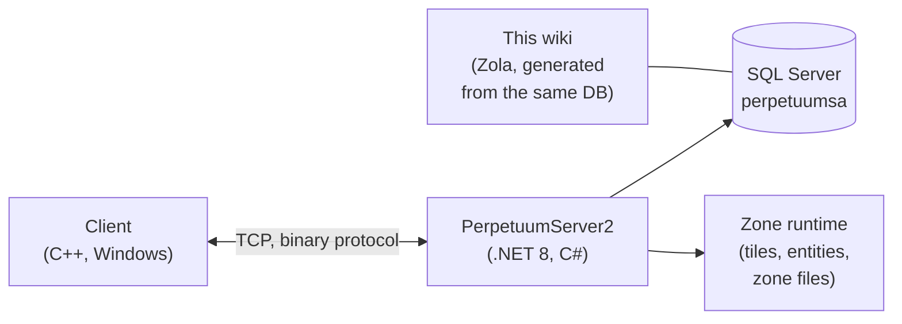

# 开发者主页

从开发者/运维的角度，概述游戏的整体运作方式。
专门的深入页面正在编写中——目前此页作为导航概览。

## 组成部分

- **客户端** — Perpetuum 游戏客户端（Windows；运行方式参见[客户端与 PC 设置](/zh-CN/features/client-setup/)，包括 Linux）。通过二进制 TCP 协议与服务器通信；每个玩家操作都是一条具名的*命令*（与本 wiki 在[操作清单](/zh-CN/features/#wan-zheng-cao-zuo-qing-dan)中使用的名称相同）。
- **服务器（PerpetuumServer2）** — C#/.NET 8 代码库。单个进程运行整个服务器：连接层、游戏逻辑（机器人、区域、任务、市场、生产、研究）以及区域运行时（逐帧更新每个区域的瓦片世界：地形、实体、传送点）。
- **数据库** — SQL Server，数据库 `perpetuumsa`。包含静态游戏内容（实体默认值、配方、扩展、科技树、商店、传送点描述）和所有动态状态（角色、机器人、容器、市场、区域状态）。
- **区域文件** — 区域是瓦片网格（海拔层 + 控制层，每瓦片 2 字节），以 `.gbf` 归档形式分发，可按区域编辑；参见[区域文件格式](/zh-CN/formats/zone-files/)。
- **参考数据** — 客户端在启动时从服务器下载属性表（参见[服务器与参考数据](/zh-CN/features/server/)）。

## 运行方式

- 服务器通过 Docker Compose 与 SQL Server 一起运行（`perpetuumserver2` 项目）；本 wiki 的生成器读取的就是该数据库容器。
- 静态内容通过 **plantrules** 规则文件进行验证；本 wiki 的 C# 生成器（`make generate`）运行在同一生态系统中，读取同一个数据库，因此本站上所有生成的表格都反映实时服务器数据。
- 本 wiki 上的区域传送点地图是从游戏本身使用的同一海拔层渲染的。

## 下一步

- **[格式](/zh-CN/formats/)** — 开发者字段参考：每个属性字段的存储方式（数据库列、规则文件键、二进制层字节）和消费方式，附带实例。
- **[服务器与参考数据](/zh-CN/features/server/)** — 元系统：服务器信息、排行榜、客户端下载的参考数据以及游戏内商店。

> 更多开发者页面（协议、区域生命周期、部署）正在规划中——此页是它们的入口。