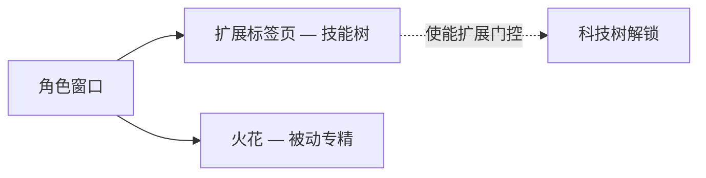

# 角色

**角色窗口**（顶栏 → **角色**，左上角）是你角色成长的核心所在：包含个人资料、信用点、**扩展**（技能）和设置。本页所有内容均按角色独立计算——一个账户可以拥有多个角色，每个角色都有各自独立的技能树。界面位置参见[客户端界面概览](/zh-CN/features/ui/)。

## 扩展

**扩展标签页**是角色的技能树：按角色独立计算的技能等级，用于解锁玩法和调整属性——最重要的是驾驶机器人类型所需的**使能扩展**。第 1 级消耗信用点，之后每升一级消耗扩展点数（EP），前置条件会门控升级路径。

- [主要分类](/content/extensions/#categories) — 15 个分类一览：哪些分类会解锁哪些分类（点击方块可跳转到对应卡片）
- [按分类查看扩展](/content/extensions/#table) — 所有扩展：等级、价格、加成、前置条件
- EP 与科技树的运作方式：[研究](/zh-CN/features/research/)

## 火花

你的**火花**是安装在角色上的纳米机器人专精——激活期间，其加成效果会应用于你驾驶的每一台机器人。切换火花需要消耗费用；授权会门控更高级的专精线。详情参见[火花](/zh-CN/features/sparks/)。