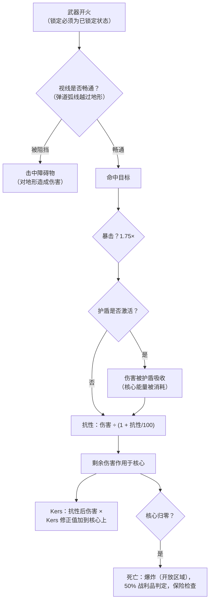

# 战斗

战斗发生在**区域内**，使用你当前激活的机器人。你可以与其他玩家（PvP）、NPC 以及敌对结构体作战。本页涵盖服务器端已确认的机制；详细的伤害/配置交互请参阅[机器人与配置](/zh-CN/features/robots/)。

> UI 位置遵循[客户端 UI 概览](/zh-CN/features/ui/)：你机器人的**护盾/装甲/船体**和**能量**显示在未停泊状态面板上。战斗中的目标锁定和武器控制尚未详细记录。

## 进入战斗

- 你只能在**未停泊**状态下战斗——你就是你当前激活的机器人。
- 在开放（PvP）区域中向其他玩家发射攻击性武器会在攻击者身上触发**PvP 标记**。回击或对已被标记的玩家使用支援模块也会在你身上触发标记。标记持续 **5 分钟**（`effect_pvp` 定义，300,000 毫秒），每次新的攻击行为都会刷新。
- 标记生效期间：
  - 你**无法使用传送**（包括移动传送），且
  - 你**无法正常停泊**——唯一的出路是**强制停泊**，它刻意不受标记限制。

## 你可以攻击的目标

- **其他玩家的机器人**（PvP）。
- **NPC**——区域 NPC 被组织为**群体**（具有共享行为的编组）。
- 区域内的**敌对结构体/可部署物**。

## 当你的机器人被摧毁时

你的机器人被**摧毁**，一个**战利品容器**出现在它死亡的位置。战利品按物品逐个判定，每次判定概率为 50%：

| 物品 | 结果 |
|---|---|
| 每个已配置的**模块** | 50% 概率掉落**损坏**状态（可修复）；否则被摧毁 |
| 每个模块中装载的**弹药** | 50% 概率掉落（仅当模块掉落时） |
| **货物**（包裹/箱子） | 内容物作为战利品掉落，包裹本身被摧毁 |
| 货物中的其他**可堆叠物品** | 50% 概率掉落，数量随机减少（其余被摧毁） |
| 你的**涂装/着色** | 50% 概率作为涂装物品掉落 |
| **机器人本身** | 被摧毁——除非它有生效的**保险**，此时赔付以信用点形式支付给你（机器人仍然消失） |

**保险**（在基地的保险设施购买，需停泊——参见[生产 → 保险](/zh-CN/features/production/)）为机器人提供 **15 天**保障（加上延期奖励天数）。每个机器人有内容定义的**费用**和**赔付**（`insuranceprices` 表——67 个机器人定义）；费用可通过延期奖励降低，并从你的公司钱包中支付。初始机器人无法购买保险。你可以同时持有 1 +（延期奖励）个机器人的保险。

被击杀后你将**没有激活的机器人**。要重新回到游戏中，你可以：

- **选择另一个**你拥有的、具有所需启用扩展的机器人，或
- 停泊时**申请一个初始机器人**——但被击杀后有短暂锁定：**被玩家击杀锁定 3 分钟，被 NPC 击杀锁定 1 分钟**。如果是 **NPC** 击杀了你，基地还会在你返回时自动赠送一个**免费初始机器人**。

## 逃脱

当战斗形势不利时：

- **强制停泊**——紧急出口。立即将你从区域中拉出并停泊在主基地（TMA），即使在战斗中途也是如此。
- **SOS**——另一种退出方式：在正常的（7 秒）脱离延迟后停泊在当前基地。

两者都是你的安全网；强制停泊是"我快死了"按钮。

## 目标锁定、射程与命中

- **先锁定。** 武器只能对*已锁定*的目标开火——且必须等锁定完成。锁定一个目标需要你的机器人的**锁定时间**（以毫秒为单位的属性）；在锁定进行中开火会被拒绝。你可以同时保持多个锁定（受**最大锁定目标数**属性限制），但只有一个为*主目标*，某些武器只能对主目标开火。
- **最佳射程 + 衰减。** 在武器的**最佳射程**内，你造成全额伤害。超出后，伤害在**衰减**距离内平滑递减——在衰减中点约为半额伤害，在衰减边缘为零。超出最佳射程 + 衰减后，你完全无法造成伤害。
- **爆炸范围 vs. 目标特征值。** 枪械不会"未命中"：枪械的**精度**属性作为爆炸半径使用，目标**特征值**小于该半径时按比例减少伤害。导弹*可以*完全未命中（未命中概率来自机器人的导弹精度属性），但命中时会产生**爆炸半径**的爆炸——与枪械类似，小目标受到的爆炸伤害更少。
- **暴击。** 每次射击判定你的**暴击率**；暴击将整次命中乘以 1.75×，且每次命中还有 ±10% 的随机浮动。
- **视线。** 弹道沿直线飞行，地形、障碍物和植物会阻挡它们。导弹飞行弧线可以越过低矮掩体——但弧线有限，高地仍然会阻挡。
- **你自己的护盾会阻挡你自己的武器。** 当你的护盾激活时，你的武器无法开火。

### 伤害类型

弹药携带伤害：每种弹药都有一个或多个伤害类型的数值——通常是一个主要类型加一个较小的次要类型（导弹弹药为爆炸加动能或化学，激光晶体为热能加化学，轨道炮弹为动能加热能）。类型如下：

| 类型 | 说明 |
|---|---|
| **化学** | 枪械和激光弹药的常见成分 |
| **动能** | 轨道炮、弹丸和导弹弹药 |
| **热能** | 激光、部分弹丸弹药 |
| **爆炸** | 导弹 |
| **毒素** | 部分枪械弹药；仅对植物和地形造成伤害 |
| **电击** | 特殊效果（如灼烧器）——**穿透护盾** |

传入伤害按类型被目标的**抗性**减少：50% 抗性将伤害减少 50/(50+100) ≈ 33%。抗性仅作用于*穿透*护盾后的伤害——护盾先吸收，消耗的是护盾能量：命中越重，消耗的能量越多。**Kers** 模块允许某种伤害类型的一部分在抗性之后直接燃烧护盾能量。[自适应合金](/zh-CN/features/modules/#mo-kuai-jia-zu) 将你的抗性重新分配至实际正在攻击你的伤害类型。

## 探测、隐蔽与速度

- **探测 vs. 隐蔽。** 你可以在一定范围内看到单位，该范围随你的**探测**属性增大、随目标的**隐蔽**属性减小——大约为 100 m × 探测 ÷ 隐蔽。已锁定你的单位对你始终可见，无论其隐蔽值如何。隐蔽模块会暂时提高你自己的隐蔽值（参见[模块](/zh-CN/features/modules/)）；地雷使用独立的探测范围。
- **干扰场（Blob）。** 某些单位和结构体会释放*干扰场*。当你站在发射器半径内时，你单位上的干扰场等级上升；在你的两个干扰场阈值属性之间，它会**增加你的锁定时间**（最高为基础值的 6 倍）并**降低你的锁定范围和传感器强度**（最低降至一半）。
- **速度。** 最高速度随质量下降：速度 = 基础值 ×（设计质量 ÷ 实际质量）——你配置的每一吨额外模块、装甲和货物都会让你变慢。
- **减速（Demob）。** 蛛网效果会降低目标的最高速度。效果强度随目标的**质量等级**缩放——更重的单位被减速得更厉害，所以大型慢速目标感受最明显。

## 警报

**警报**由**警报开关**（任务相关结构体）在区域中触发。启动后：

- 它运行一段固定的**警报持续时间**（由任务设定；默认较短）。
- 你必须**保持在开关范围内**整个持续期间——每隔几秒检查一次，离开范围会取消警报。
- 你同一时间只能有**一个警报在运行**。

警报与任务内容绑定——参见[任务](/zh-CN/features/missions/)。

## 击杀报告

你的战斗历史以**击杀报告**形式提供：

- 按**时间窗口**筛选。
- 按**角色**筛选：作为**受害者**、**攻击者**或**击杀者**。

使用它们来回顾你是如何死亡的或你摧毁了谁。

## 最高分

- **服务器最高分**——全服最佳成绩。
- **我的最高分**——你的个人最佳。

## 实用提示

- **不要随意送死**——机器人被摧毁意味着你需要重新配置或重新申请期间的停机时间。
- **强制停泊是即时的**——如果你打不过，立即前往 TMA；之后可以重新配置。
- **PvP 标记锁定传送**——规划你的逃脱路线；你无法从战斗中闪现出去。
- **警报是信号**——活跃警报意味着该区域有任务事件正在进行。

<!--
开发者备注：2026 年根据后端源码重写；未复用任何社区维基文本。
已验证对照：
- 锁定：Zones/Locking/LockHandler.cs（锁定时间以毫秒为单位，来自
  AggregateField.locking_time；MaxLockedTargetsProperty；一个主锁定；
  锁定状态 Inprogress -> Locked），Zones/Locking/Locks/Lock.cs，
  Zones/Locking/LockValidator.cs（死亡/不可锁定/超出范围验证）；
  ZoneSession.cs（武器使用已有锁定 ID；发射锁定未完全完成的武器会触发
  LockIsInProgress——没有开火时自动锁定）。
- 伤害：Modules/Weapons/Damage.cs（CalculateDamages：暴击 = 攻击者.
  CriticalHitChance，CRITICALHIT_MOD 1.75，随机 0.9-1.1；衰减 =
  cos(x*PI)/2+0.5，其中 x=(距离-最佳射程)/衰减；超出最佳射程+衰减后为零；
  爆炸修正 = 目标.SignatureRadius/爆炸半径，钳制在 0..1；
  毒素排除在单位伤害之外），Modules/Weapons/WeaponAmmo.cs（每种类型的伤害值
  在弹药上：damage_chemical/thermal/kinetic/explosive/toxic；
  枪械对植物额外添加 damage_toxic）。
- 武器：Modules/Weapons/FirearmWeaponModule.cs（CheckAccuracy 始终为 false——
  枪械从未未命中；WithExplosionRadius(Accuracy)——精度即爆炸半径），
  Modules/Weapons/MissileWeaponModule.cs（rnd > robot.MissileHitChance 时未命中；
  missile_miss 属性），WeaponModule.cs（护盾激活 => ShieldIsActive 错误；
  开火前进行视线检查）。
- 抗性：Units/Unit.cs GetResistByDamageType = resist/(resist+100)；
  Zones/DamageProcessors/DamageProcessor.cs（护盾先吸收，从核心支付：
  coreDamage = damage * AbsorbtionModifier；电击伤害穿透为核心伤害；
  kers = damage * 类型 kers 修正值，乘以 (sin(core/coreMax*PI)/2)+0.5，
  加到目标核心上）；
  EffectModules/ShieldGeneratorModule.cs（AbsorbtionModifier =
  max(SigRadius/shieldRadius,1)/shieldAbsorbtion）。
- 伤害类型：Modules/Weapons/DamageType.cs——化学、动能、热能、爆炸、毒素、
  电击（无"地震"；导弹伤害为爆炸型）。电击仅由 ScorcherModule.cs 产生。
- 探测：Units/Unit.Visibility.cs（IsDetected：范围 = 100/max(1,
  target.StealthStrength)*max(1, DetectionStrength)；锁定你的单位始终可见；
  地雷探测范围独立）；stealth_strength 属性包含
  effect_stealth_strength_modifier（隐蔽模块提高隐蔽值）。
- 速度：Units/UnitProperties/SpeedMaxProperty.cs（speed_max * Mass/ActualMass；
  无畏舰 => 0.05；质量等级/无人机/高速公路效果修正）。
- 减速：Modules/EffectModules/WebberModule.cs（effect_demobilizer；效果
  属性 = 模块值 + target.Massiveness，钳制在 1.0——更重的目标受到完整效果；
  远程蛛网额外要求视线；通过最佳射程修正进行精度检查）。
- 干扰场：Zones/Blobs/BlobHandler.cs（发射器在 BlobEmissionRadius 内提高
  干扰场等级；在 blob_level_low/high 之间修正值缩放：
  locking_time 修正 -5，即锁定时间 ×(1+5*m)——满干扰场时最高为基础值 6 倍，
  max_targeting_range *0.5，sensor_strength *0.5）。
- 视线：Zones/LineOfSight.cs（射线检测 vs 地形阻挡，含 Plant 标志；
  导弹弹道弧线：40 米内最大振幅 16 米）；
  Zones/Terrains/BlockingFlags.cs（Obstacle/Plant/Decor/Island 阻挡）。
与已摄入页面的修正："地震"伤害类型不存在（存在的是爆炸型）；
"枪械损失伤害而非未命中"已验证（精度 = 爆炸半径）；
开火时自动锁定不在后端中（必须先创建并完成锁定）；
"干扰"（发射/最小/峰值、发射器、异常退化）在此后端中无对应——
仅在 Services/RiftSystem/Rift.cs 中有一条评论——该章节已移除；
护盾"吸收"基于核心能量，电击伤害可穿透。
开发者文件：Zones/Locking/*；Zones/Locks 通过 Zones/Locking/Locks/*；
Modules/Weapons/*.cs；Zones/DamageProcessors/*.cs；Units/Unit.Visibility.cs；
Units/Unit.cs；Units/UnitProperties/SpeedMaxProperty.cs；
Modules/EffectModules/ShieldGeneratorModule.cs, WebberModule.cs,
StealthModule.cs；Modules/ScorcherModule.cs；Zones/Blobs/*.cs；
Zones/LineOfSight.cs；Zones/ZoneSession.cs（锁定/开火数据包处理）。
此前已验证（保持不变）：PvP 标记 = effect_pvp 300000 ms
（effect_pvp 定义），由攻击/仇恨/支援触发（Player.cs
ApplyPvPEffect）；阻止传送 + 正常停泊（CantDockThisState），ForceDock.cs
无 PvP 检查；死亡战利品 50% 判定（Player.cs OnUnitDeath，
Services/Looting/LootHelper.cs DROP_CHANCE 0.5）；保险（InsuraceFacility.cs，
InsuranceHelper.cs，insuranceprices 67 个定义）；初始机器人锁定 3 分钟 PvP /
1 分钟 NPC；警报（Zone/AlarmStart.cs，AlarmSwitch.cs）；击杀报告
（GetMyKillReports.cs）；最高分（GetHighScores.cs / GetMyHighScores.cs）。
-->