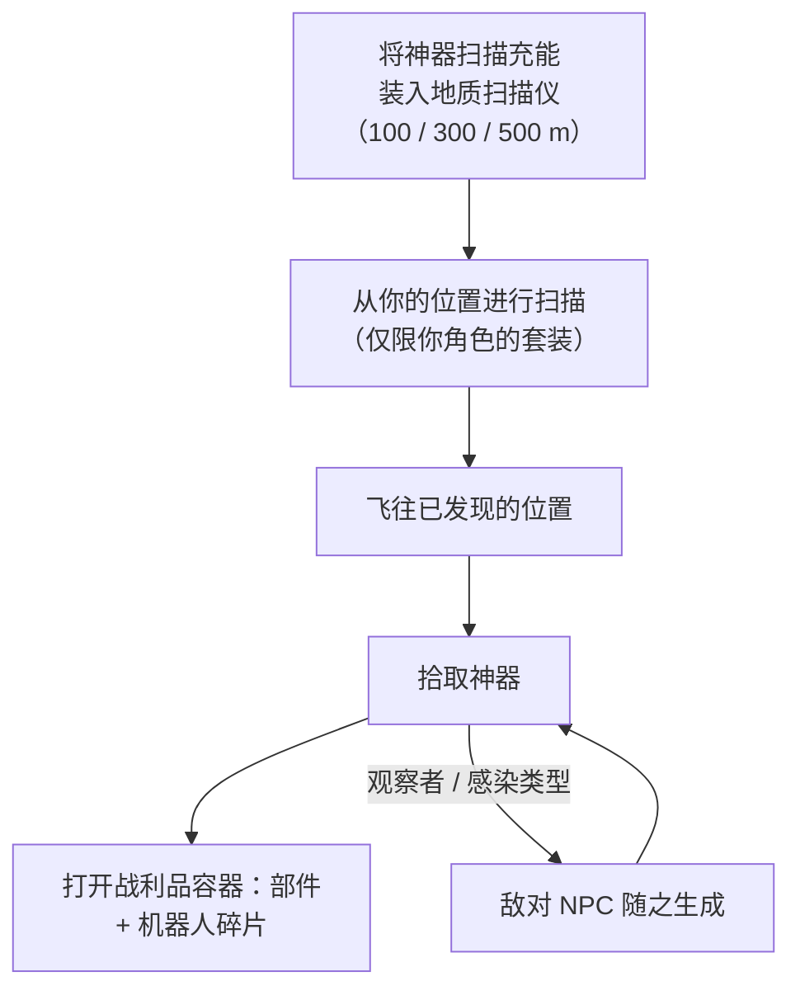

# 探索（神器与遗迹）

探索是在地形中发现隐藏的价值——在任何等级下都是强大的单人活动。它有两种形式：**神器**，属于个人且隐藏；**遗迹**，公开且存在竞争。

## 神器采集

神器是**按角色**存在的点位：服务器为每个岛屿上的每个角色维护独立的神器集合，因此你发现的神器只属于你。在扫描之前它们是不可见的。

1. 将**神器扫描充能**装入地质扫描仪模块。有三种不同扫描范围的充能等级（100 / 300 / 500 m）。
2. 从你的机器人位置进行扫描——扫描仪会返回范围内神器的位置（地质扫描仪的精度属性会缩小报告位置的误差范围）。
3. 飞往已发现的位置并拾取神器；该位置会生成一个**战利品容器**。

两件事使神器采集既是战斗活动也是采集活动：

- 某些神器类型**会与你一起生成 NPC**——"观察者"和"感染"变体在神器被发现的那一刻就会吸引敌对单位，因此请驾驶能战斗的机器人。
- 战利品按神器类型随机生成：模块部件（装甲板、硬化器、发电机、维修器……）和**机器人碎片**——各阵营专属的研究/生产材料，这正是神器采集成为核心工业职业的原因。

神器类型按等级划分（1–3 级，更高等级掉落更多战利品），并存在中立和各阵营变体。

## 遗迹猎取

遗迹是**开放世界**的：区域会在随机位置生成遗迹（大约 90 分钟的重生周期，带随机分布），它们是有光束的可见物体，谁先拾取谁就获得战利品。战利品是 NIC 加上**机器人碎片**的随机掉落，根据遗迹等级和岛屿价值等级进行缩放——与神器采集产出的碎片相同。

遗迹类型按岛屿划分等级（1–3 级，不同等级有不同的 EP 值），并存在中立、各阵营和工业变体。某些遗迹与[前哨站](/zh-CN/features/outposts/)绑定——SAP 活动会生成专属遗迹，存活时间最长可达 12 小时——在开放 PvP 岛屿上，生成点位于争夺地带，所以要做好遇到其他猎手的准备。

## 任务也会为此付费

[任务](/zh-CN/features/missions/)也会让你执行神器采集工作，此时你会直接获得报酬，物品归雇主所有而非进入你的背包。

<!--
基于服务器后端从零撰写，2026-09-27：
Zones/Artifacts/Repositories/ZoneArtifactRepository.cs（按角色的神器
数据行），Zones/Scanning/Scanners/Scanner.Artifact.cs（扫描范围 + 精度），
Zones/Artifacts/Generators/Loot/（按类型的随机战利品），
Services/Relics/RelicManagers/ZoneRelicManager.cs（约 1.5 小时重生 + 随机
窗口）和 SAPRelic.cs（12 小时存活期），
artifacttypes/artifactloot/relictypes/relicloot 数据表，
ammo_artifact_scan_a/b/c（扫描范围 100/300/500）。
本页早期版本改编自 Open Perpetuum 社区维基（perpetuum.miraheze.org），
现已完全基于后端源码重写；未复用任何原文。
-->