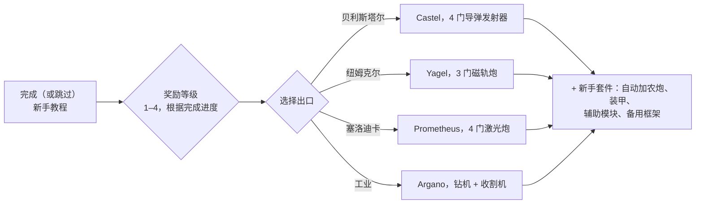

# 常见问题

## 我可以跳过新手教程吗？

你可以提前离开训练区，但这将放弃完成教程所获得的奖励。当角色退出教程时，服务器会：

- 发放**初始 NIC**，并根据你在教程中达到的**每个奖励等级**提供额外奖金（共有四个奖励等级），
- 将你加入所选种族和学院对应的**默认公司**，
- 授予你的**初始扩展**（技能）和你的**火花**，
- 创建你的**初始机器人**，将你停靠在纽弗吉尼亚（New Virginia）停靠基地并将其设为你的**母港（home base）** — 即你的机器人被摧毁后的重生地点，
- 将你的**奖励物品**放入该停靠基地的公共容器中，并向你发送一封欢迎邮件。

## 如何完成新手教程？

按顺序完成各项任务；客户端的**新手清单（Rookie Checklist）**（顶部栏的帮助菜单）会追踪这些任务，并可固定在底部栏。你的完成进度决定了你的奖励等级，进而决定退出时获得的奖励阶梯 — 1 级退出仅获得第一阶奖励，全部完成则获得全部四个等级的奖励。

## 每个出口会给我什么？

你的选择决定了三件事：你驾驶的**初始机器人**、你获得的**奖励物品**，以及你进入的**默认公司与初始技能**。除此之外的一切 — 任何技能、任何机器人、任何阵营的装备 — 之后都可以通过 EP 和 NIC 进行训练与购买，因此这一选择只是初始套件，而非永久绑定。

| 出口 | 初始机器人（已装配） | 奖励主题 |
|---|---|---|
| **贝利斯塔尔（Pelistal）** | Castel — 四门导弹发射器 | 导弹 + 自动加农炮 |
| **纽姆克尔（Nuimqol）** | Yagel — 三门磁轨炮 | 磁轨炮弹药 + 自动加农炮 |
| **塞洛迪卡（Thelodica）** | Prometheus — 四门激光炮 | 激光晶体 + 自动加农炮 |
| **工业（Industrial）** | Argano — 两部钻机、一部收割机、一个采矿探测器 | 采矿、收割与神器扫描弹药 |

每个出口还包括一套配有弹药的小型自动加农炮、装甲与辅助模块（装甲维修器、传感器增强器或质量缩减器、核心充能器、伤害加成器）、第二个（空）框架，以及在最高奖励等级下获得的防爆墙炸弹胶囊（wall-bomb capsule）。

## 离开教程后我该做什么？

几乎所有活动都能赚取用于学习技能的 EP 和购买装备的 NIC：

- 采矿、收割植物、搜寻神器 — 并在[市场](/zh-CN/features/market/)上出售战利品。
- 猎杀 NPC 并出售[战利品](/zh-CN/features/npcs/)。
- 收集或购买材料并[制造](/zh-CN/features/production/)物品。
- 执行[任务](/zh-CN/features/missions/) — 终端或前哨站提供的任何任务都可以由你一人在开放世界中完成。

刚接触开放世界 PvP？请先阅读[快速入门中的生存指南](/zh-CN/features/getting-started/#survival)。

## 我可以重返训练区吗？

不能。训练区专为新角色设计，一旦离开就无法再次进入。如果你想重新阅读任务目标，帮助菜单中的新手清单仍可查看，你也可以随时创建另一个角色并将其保留在教程中作为测试沙盒。

## 缩写与术语

聊天频道、市场挂单和装配方案中常见的简写。大多数术语都有自己的专属页面（在需要处提供了链接） — 物品名称可在网站搜索中查找。

| 术语 | 含义 |
|---|---|
| **EP** | [扩展点数（Extension Points）](/zh-CN/features/research/#ep-sources) — 用于升级[扩展（技能）](/zh-CN/features/character/#extensions)的账号级货币（获取规则请参阅[研究页面](/zh-CN/features/research/#ep-sources)）。 |
| **NIC** | 尼亚信用点（Nian Credit） — 游戏内货币（角色的 `credit` 余额）。 |
| **CT** | [CPRG — 校准程序](/zh-CN/features/production/#cprg-calibration-programs) — 生产线在制造前进行校准所需的程序（每种物品一个，具有材料/时间效率属性）。 |
| **Proto** | 原型物品（Prototype） — 模块/机器人的高阶变体，在[原型设施](/zh-CN/features/production/#the-item-lifecycle-the-circular-process)中制造（消耗上一阶的样品；参见[阶层进阶](/zh-CN/features/production/#tier-progression)）。 |
| **LWF** | 轻型框架（Lightweight frame） — 降低质量的装甲模块（客户端命名为“……轻型框架”，例如 *Niani 轻型框架*）。以牺牲装甲为代价减轻机器人重量。 |
| **TP / tele** | [传送（Teleport）](/zh-CN/features/movement/) — 在固定点之间或向已部署的移动传送装置快速旅行。 |
| **SAP** | 服务接入点（Service Access Point） — 前哨站[稳定性](/zh-CN/features/outposts/)活动。 |
| **Stab** | 武器稳定器（Weapon Stabilizer） — 提升武器命中精度。 |
| **Demob** | 减速器（Demobilizer） — 减慢其他机器人（及其模块）速度的模块。 |
| **EWar** | 电子战（Electronic Warfare）模块（干扰、传感器抑制、隐形）。 |
| **EnWar** | 能量战（Energy Warfare）模块（核心注能器、能量抽取器、中和器、能量传输器）。 |
| **Tuning** | 调谐模块（Tuning） — 客户端中增强其他模块的升级模块名称 — 武器伤害加成器、采矿与收割机的*工业调谐*、装甲维修调谐等。 |
| **MK2** | 机器人的升级改型（`_mk2` 框架） — 更高的容量，拥有独立的研究路线。 |

机器人级别遵循客户端内的分类 — 请参阅[机器人级别](/zh-CN/content/robots/#robot-classes)下的说明。

<!--
Written from scratch against the server backend, 2026-09-27:
Zones/Teleporting/Strategies/TrainingExitStrategy.cs (exit rewards, NIC,
corporation, extensions, spark, starter robot, home base, reward items),
Zones/Training/Reward/TrainingReward*.cs + trainingrewards/robottemplates
(reward levels 1-4, per-race starter packs and items),
Robots/Robot.Properties.cs (race ids 1=Pelistal, 2=Nuimqol, 3=Thelodica, 5=industrial).
An earlier version of this page was adapted from the Open Perpetuum
community wiki (perpetuum.miraheze.org) and has been fully rewritten from
backend sources; no text was reused.
-->
