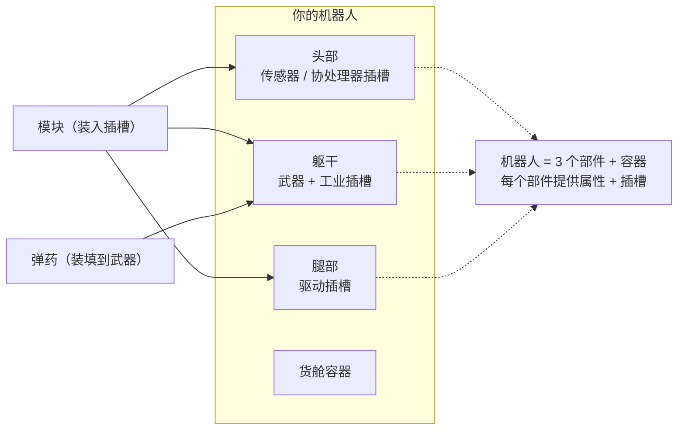

# 装配

装配是指将**模块**装入机器人的组件插槽，以及将**弹药**装填到武器中。所有装配操作**仅限停泊状态**——你无法在区域内进行装配。

> 界面位置参见[客户端界面概览](/zh-CN/features/ui/)（顶栏的**装备**分类）。以下机制已对照服务器确认。

## 装配模块

机器人拥有多个**组件**（武器、护盾、装甲、驱动、传感器等），每个组件都有一组**插槽**。

- **装备模块** — 从容器中取出一个模块，装入特定组件的插槽。模块类型必须对该机器人类别的该插槽有效。如果插槽已被占用，现有模块将返回容器。
- **交换模块** — 在同一组件的两个插槽之间移动模块。
- **移除模块** — 将模块从插槽中取出，放回容器。

服务器会在每次变更后重新计算机器人的属性（模块会影响未停泊状态面板上显示的数值——参见[战斗](/zh-CN/features/combat/)）。

## 装填弹药

- **装填弹药** — 将兼容的弹药装入一个已激活的（武器）模块。该模块必须**接受该弹药类型**，且装填量不超过模块的**弹药容量**。之前已装填的弹药会先返回容器。
- **更换弹药** — 将已装填的弹药更换为另一种兼容类型。
- **卸下弹药** — 将已装填的弹药返回容器。

## 装配预设

**预设**是已保存的装配方案，可以快速重新应用：

- **保存** — 将当前机器人的装配方案以名称保存。
- **列表** — 查看已保存的预设。
- **应用** — 从容器中将预设加载到（另一台）机器人上。
- **删除** — 移除一个已保存的预设。

预设非常适合在战斗后重新装配，或在不同角色之间切换时使用。

## 实用提示

- **区域内无法装配** — 以上所有操作都需要你处于停泊状态。
- **先启用扩展** — 未研究的机器人类别无法选择或驾驶。
- **弹药必须匹配武器** — 不兼容的弹药定义会被拒绝。
- **重新打包的机器人无法使用** — 选择或装配机器人之前必须先解包。
- **使用预设快速重新装配** — 保存一套已验证的装备方案，损失后直接应用。

## 插槽分类

机器人的组件（头部、躯干、腿部）提供**插槽**，每个插槽携带一组分类标志。模块只有在其自身标志是插槽标志的**子集**时才能装入该插槽。标志分类包括：

`small`、`medium`、`large`、`turret`、`missile`、`melee`、`industrial`、
`ew_and_engineering`、`specialized`（专用插槽仅接受专用模块），以及结构性的 `head` / `chassis` / `leg` 插槽。

模块还可以被限制为仅适用于特定机器人，部分模块带有**唯一**标志，意味着同一时间只能装配一个该类型的模块。各模块的属性效果详见生成的[机器人表格](/content/robots/)。