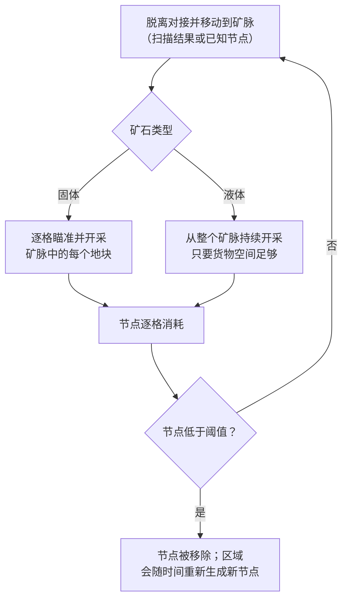
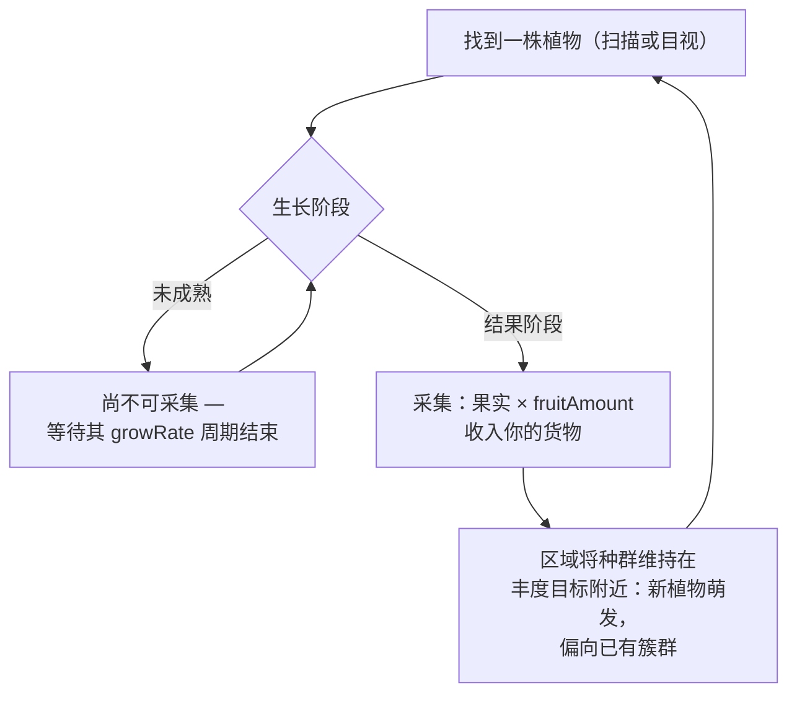
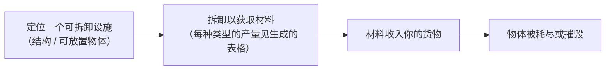

# 采集与扫描

游戏中的资源来自区域内的三个来源：**矿脉**、**植物**和**可拆卸设施**。本页介绍每种来源的工作方式以及采集循环的流程。

> UI 位置参见[客户端 UI 概览](/zh-CN/features/ui/)：扫描和采集操作位于**未对接操作**列表中（在区域内时位于右上角）。每种资源类型的产量数据见生成的表格：[内容 → 矿石](/content/ores/)和[内容 → 植物](/content/plants/)。以下机制已对照服务器实现确认。

## 基本循环

1. **脱离对接**并移动到区域内（参见[移动](/zh-CN/features/movement/)）。
2. 使用机器人的**扫描模块**扫描该区域。
3. **采集** — 开采矿石、采摘植物果实或拆卸可拆卸设施。
4. **对接**并将货物交付至基地容器。

## 矿脉

- 矿石以**矿脉（节点）**的形式存在于地面中，散布在区域内。
- 要发现并记录矿脉，需要在当前激活的机器人上装备**地质扫描模块**。
  扫描会生成一个**扫描结果**；然后你需要**上传**它，将其存储在你的
  个人矿物扫描列表中。
- 你存储的扫描结果可以**列出、移动、删除或转换为物品**
  （用于加工/生产的"矿物扫描"物品）。

- 矿脉是**有限的**：每个节点包含有限的总量。当节点被开采至低于阈值时
  会被移除，区域会**随时间重新生成新节点**，直到达到配置的最大数量。
  节点的放置方式以及植物种群的维持方式 — 以实际区域为例 — 详见
  [区域 → 生成](/zones/generation/)。
- **固体矿石与液体矿石。** 固体矿石逐格消耗 — 你需要瞄准并开采矿脉中的
  每个地块，直到其被清空。液体矿石从整个矿脉中抽取，因此只要你有货物空间，
  采矿机就可以持续运行。这种便利性正是液体矿石价值较低的原因：
  开采所需的技巧和注意力更少。

### 植物与矿石属性一览

矿石和植物的行为由每种类型的规则数据驱动。对玩家重要的字段：

| 字段 | 游戏中的含义 |
|---|---|
| `fertility` | 该类型的丰度 — 值越高，区域会维持越多的该类型 |
| `growRate` | 植物在每个阶段需要经历多少个生长周期才能推进（值越高 = 越慢） |
| `spreading` | 该类型是否以簇状（群体）生长还是分散生长 |
| `killDistance` | 同类型两株植物之间的最小间距 |
| `slope` / `minSlope` | 植物可生长的地面坡度 |
| `allowedAltitudeLow/High` | 植物可生长的海拔范围 |
| `allowedWaterLevelLow/High` | 距海岸的距离范围（形成沿海植被） |
| `fruitingState` | 植物必须达到的生长阶段才能产出（可采集） |
| `fruitDefinition` / `fruitAmount` | 植物的产出物及基础产量 |
| `maxAmount` | 加工区域内该类型数量的上限 |
| `health` | 每个生长阶段的生命值（较高阶段可能更坚韧） |
| `damageScale` | 植物的伤害抗性 |
| `playerSeeded` | 该植物仅存在于玩家种植的位置 |
| `onlyOnUnprotectedZone` | 仅在未受保护（beta/gamma 级）区域生长 |

完整的逐字段参考（类型、默认值、存储方式以及区域 tick 如何使用它们）
见[格式 → 植物字段](/zh-CN/formats/plant-fields/)。

## 植物

- 植物**随时间生长**，经历一系列阶段。每个阶段需要一定数量的
  生长周期（`growRate`）后植物才会随机推进到下一阶段。
- 植物**只有达到结果阶段才会产出果实** — 未成熟的植物不可采集。
- 区域会将植物种群维持在**丰度目标**附近：如果某片土地的种植密度
  低于其丰度水平，新植物会萌发；所选类型会权衡每个物种的 `fertility`，
  而 `spreading` 会使新生长偏向已有的簇群。

- 某些植物是**玩家播种的**（仅存在于玩家花园中），某些是
  **仅限未受保护区域**的。
- 植物可以被**损伤和杀死**；其 `health` 和 `damageScale` 决定了
  这有多难。

## 可拆卸设施

可拆卸设施是放置在区域内的物体（结构方面参见[电力基站](/zh-CN/features/pbs/)）。
其中一些可以被**拆卸**以获取材料。拆卸规则和每种类型的产量
见生成的表格：[内容 → 矿石](/content/ores/)和[内容 → 植物](/content/plants/)。

## 服务亭

**服务亭**是一种任务相关结构：你需要在范围内**提交物品**给它，
作为任务的一部分。它本身不是采集来源 — 参见[任务](/zh-CN/features/missions/)。

## 实用提示

- **扫描需要模块** — 未装备地质扫描模块则无法获得扫描结果。
- **扫描结果属于你** — 它们按角色存储，不会共享。
- **矿石节点会重生，但很慢** — 如果某区域已空，矿脉已经消失，
  而非隐藏。重新生成会恢复节点数量，但不会立即完成。
- **只采集成熟的** — 结果阶段的植物给出完整产量；较年轻的阶段
  不产出任何东西。

<!-- TODO: only the client UI flow remains (scan screen, harvest interaction, cargo UI) —
     needs a running client. Per-type ore yields are at /content/ores/ and plant fruit
     definitions at /content/plants/ (generated from the live DB).
     Developer notes: Zone/ZoneUploadScanResult.cs (GeoScannerModule required);
     MineralScanResult*.cs (per-character repository);
     Zones/Terrains/Materials/Plants/PlantRule.cs (all plant rule fields);
     Zones/Terrains/NatureCube.cs (GrowPlants, fertility/spreading/killDistance logic);
     Zones/Terrains/Materials/Minerals/MineralLayer.cs (ore node lifecycle);
     Zone/UseItem.cs + UseItemVisitor.cs (IUsableItem harvest path);
     Zone/KioskSubmitItem.cs (mission item submission, range-limited). -->