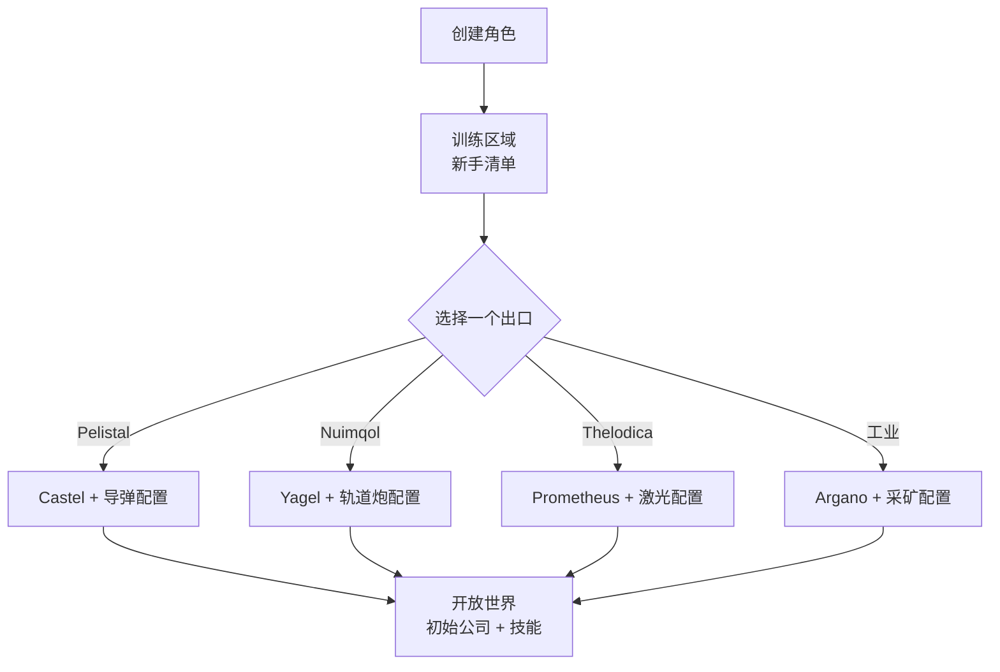

# 快速入门

本页介绍初始步骤：创建角色、获取你的第一台机器人，以及你早期会接触到的角色级设置。

> 界面位置请参考[客户端界面概览](/zh-CN/features/ui/)。以下机制已对照服务器实现确认。

## 获取游戏

Perpetuum 在 [Steam](https://store.steampowered.com/app/223410/Perpetuum/) 上免费游玩。

  <a class="steam-card-link" href="https://store.steampowered.com/app/223410/Perpetuum/" target="_blank" rel="noopener">
    
    Perpetuum on Steam — 免费游玩
  </a>

## 先看视频

来自 Open Perpetuum 项目的指南。点击卡片即可在此播放。

  

    
    &#9654;
    
Perpetuum Online 教程演示 + 扩展建议及更多内容。

  

  

    
    &#9654;
    
辛迪加职业指南 — 遗物制作

  

  

    
    &#9654;
    
Open Perpetuum 教程 — 如何运行多个客户端

  

## 创建角色

- 创建前可以**检查名称是否可用**（`characterCheckNick`）。
- **创建角色** — 角色将绑定到你的账户。一个账户可以拥有多个角色；同一时间只能操控一个。
- **选择角色**即可开始游戏。切换角色会取消当前角色的选中状态。
- 之后可以**重命名**角色（名称必须可用）。
- 可以**删除**不再使用的角色。

## 你的第一台机器人

- **停靠在基地**时，可以**申请初始机器人**（基地设施 — 参见[客户端界面概览](/zh-CN/features/ui/)了解基地操作的位置）。
  - 基地必须有初始机器人库存 — 在热门基地可能会耗尽，届时申请将失败。
  - 每个角色申请初始机器人之间有**5 分钟冷却时间**。
  - 新机器人将交付到基地的公共容器中。

- 停靠时还可以**申请"无限箱"**：一个添加到你的库存中的特殊容器，费用为 **5,000 信用点**。这是一个便利容器，并非免费资源来源。

## 角色设置 {#character-settings}

- **头像** — 你的角色外观。
- **心情消息** — 显示给其他玩家的一句简短文字。
- **私人备注** — 仅你自己能在某个角色上看到的备注。
- **主基地** — 设置或清除你的主基地；当游戏需要把你放到安全位置时，这里是你的默认停靠点。
- **设置** — 每个角色的偏好设置（获取/设置）。
- **禁止交易** — 为角色开启或关闭交易功能。
- **信用点** — 在你自己的角色之间转移信用点；查看交易历史。
- **账户等级** — 修改会话邮箱/密码，查看账户的交易历史和 EP 活动历史。

## 离开 / 重新进入

- **登出**结束会话；**选择角色**重新开始。
- 如果服务器将你踢出（例如强制送回基地），你会以停靠状态重新出现 — 参见[移动](/zh-CN/features/movement/)。

## 教程

新角色从训练区域开始，带有一份**新手清单** — 完成它：涵盖基础内容，并发放多台带有模块和弹药的机器人。你可以跳过（脱离停靠并步行到派系出口），但会失去奖励，且之后无法再回到训练区域。四个派系出口分别提供什么，见[常见问题](/zh-CN/features/faq/)。

## 生存

Perpetuum 是一个风险与回报并存的沙盒游戏，当你的机器人被摧毁时你就会失去它 — 无论是否停靠、被玩家还是 NPC 击杀 — 然后你会在[主基地](#character-settings)重新出现（如果你空手到达，可以在那里申请一台免费初始机器人）。以下几条规则可以让损失保持在可承受范围内：

- **只投入你能承受损失的资源。** 脱离停靠就是一笔赌注：如果机器人被击毁，它及其搭载的模块都会消失（或被掠夺）。出发前，确保这个损失是可以承受的。
- **了解区域。** 受保护（PvE）岛屿对玩家安全；开放 PvP 岛屿则是自由混战，没有犯罪/惩罚系统。参见[区域](/zones/)查看地图。
- **了解 NPC。** 橙色标记只在被挑衅时才会攻击；红色标记在接近时就会主动攻击。逃跑并脱离视线范围可以消除仇恨。参见[NPC 与 PvE 狩猎](/zh-CN/features/npcs/)。
- **要降低风险，而不仅仅是接受风险。** 穿着你最好的 T4 配置机甲去开放 PvP 岛屿，这就是机甲阵亡的原因。几趟就能回本的廉价可替换装备，胜过需要二十趟才能回本的昂贵机器人。
- **建立可持续的循环。** 无论你做什么 — 任务、采集、狩猎、生产、运输 — 都有人为此支付 NIC。保持备用资产，让糟糕的一天不会让你的收入归零。

## 接下来做什么

1. 选择你的初始机器人，学习[机库与配置](/zh-CN/features/robots/)界面。
2. 脱离停靠并移动到区域中 — 参见[移动](/zh-CN/features/movement/)。
3. 扫描地面并开始采集资源 — 参见[采集](/zh-CN/features/gathering/)。
4. 研究你的第一个扩展 — 参见[研究](/zh-CN/features/research/)。
5. 选择一个职业 — [常见问题](/zh-CN/features/faq/)中有菜单。

<!-- TODO(Phase 1): verify client UI flow (account creation screen, character wizard).
     UI model: see features/ui.md (EVE-style, project-provided).
     Developer notes: Perpetuum.RequestHandlers.Characters/* (CharacterCreate,
     CharacterSelect, CharacterRename, CharacterSetHomeBase, ...);
     RequestStarterRobot (5-minute cooldown, base stock), RequestInfiniteBox
     (5000 credits, docked-only). -->