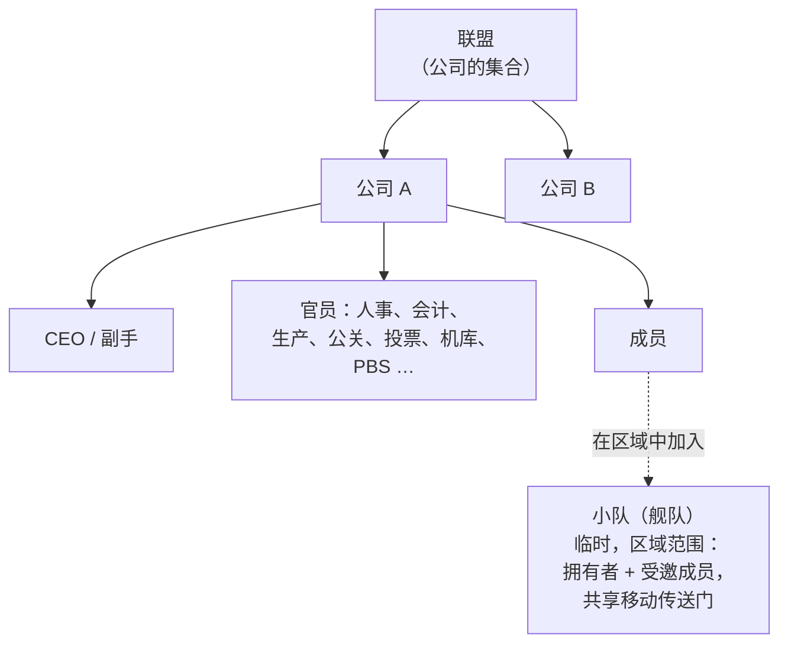

# 组织

共有三种组织形式：**公司**（你的主要组织）、**联盟**（公司的集合）和**小队**（用于区域活动的临时舰队）。

> 界面位置遵循[客户端界面概览](/zh-CN/features/ui/)（左上角的**公司**按钮；**公司仓库**分类；小队有独立窗口）。以下机制已与服务端确认。

## 公司

### 加入与退出
- **创建**公司 — 需要基础公司管理扩展（1 级）以及 **250,000 NIC** 的创建费用。你需要选择正式名称、一个**短 ID**（最多 6 个字符，显示在地形上以标识你的成员）以及**税率** — 从成员收入（尤其是任务报酬）中自动划入公司账户的比例。
- **申请**加入，或**邀请**角色加入。
- **审批申请** / **查看申请列表**（官员权限）。
- **回复**你收到的邀请。
- **退出**，或**取消**待处理的退出。
- **移除成员**、**设置成员角色**、**放弃自己的角色**，或将成员设为中立。

### 角色
公司具有角色层级体系。角色决定了你能做什么 — 例如解锁公司科技树节点、管理机库或编辑 PBS（参见 [pbs](/zh-CN/features/pbs/)）。服务端定义的角色（`CorporationRole`）：

- **CEO** — 完全控制权。
- **副 CEO** — 二把手。
- **人事经理** — 成员管理（申请/邀请/移除）。
- **公司代表** / **联盟代表** — 代表组织行事。
- **会计** — 公司资金。
- **生产经理** — 公司生产。
- **投票管理员** — 投票。
- **公关经理** — 公共关系 / 公告。
- **机库访问权限（低 / 中 / 高 / 安全）** — 分级机库权限，配有对应的**机库移除**权限等级和**机库操作员**角色。
- **查看 PBS / 编辑 PBS** — 查看或修改公司的 PBS 结构。
- **科技树查看 / 解锁** — 查看或解锁公司的科技树。

几个典型的权限门槛：成员操作（申请/邀请/移除、设置角色）需要 **CEO / 副手 / 人事经理**；公告和公关需要 **CEO / 副手 / 公关经理**；公司资金和设施升级需要 **CEO / 副手 / 会计**（生产额外需要**生产经理**）；PBS 部署需要 **CEO / 副手 / 编辑 PBS**。

你可以查看自己和其他成员的**角色历史**。机库空间是租赁的（默认服务器配置：每 7 天 50,000 信用点）。

### 信息与搜索
- **公司信息 / 我的信息** — 详细信息和你的成员身份。
- **搜索**公司。
- **声望 / 声誉** — 你公司的声望和声誉。
- **代表** — 代表公司行事的角色。

### 资金
- **捐赠**到公司钱包。
- **支出**公司资金。
- 在钱包之间**转账**。

### 外观与资料
- **重命名**、**设置颜色**、**设置信息**（公开资料）。
- **标志** — 最多 5 个符号，来自固定集合，每个可编辑（大小、透明度、图层）；只有有权限的成员才能创建或修改。
- **名称历史** — 过去的名称。

### CEO
- **竞选 CEO**，或查看 **CEO 接管状态**。
- **实际接管流程**：当 CEO 离线超过 **30 天**后，副手可以发起接管 — 一个 **48 小时倒计时**开始，并在公司窗口中公告。CEO 或任何其他副手都可以立即**否决**（如果 CEO 仍然不登录，否决不会阻止下一次尝试）。如果倒计时归零，该副手将成为拥有完整权限的 CEO。

### 投票
公司可以发起**投票**：
- **发起**投票、**设置议题**、**列出**投票、**投票**、**删除**投票。

## 公告板
由公司管理的公告栏：
- **创建**、**列出**条目、查看**新条目**、**发布**条目、**审核**（编辑/移除他人的条目）以及查看**详情**。

## 公司机库（仓库）
基地中的共享公司存储区域：
- **租赁**机库分区、**支付租金**、查看**租金价格**、**关闭**。
- **列出**内容（全部，或特定基地上的）。
- **文件夹** — 创建/删除子文件夹。
- **设置访问权限**（谁可以使用）和**设置名称**。
- **日志** — 查看、设置和清除机库的访问日志。

注意：你**不能从公司机库中选择机器人**作为你的活动机器人（参见 [robots](/zh-CN/features/robots/)）。

## 公司文档
公司共享的、带版本控制的文本文档系统。有两种文档类型：

- **PBS 规划** — 公司 PBS 网络的规划/蓝图。
- **地形改造项目** — 地形修改项目记录。

操作：**创建**、**列出**、**打开**、**更新正文**（带版本控制）、**删除**、**转移**所有权、**续租**（延长有效期）、**监控** / **取消监控**（获取变更通知），以及**注册列表**（最多 25 名成员）控制谁可以编辑该文档。

## 联盟

联盟将公司组合在一起：
- **我的联盟信息**、**默认联盟**和**联盟角色历史**。
- 声望可以针对联盟（参见 [social](/zh-CN/features/social/)）。

## 小队（舰队）

**小队**是用于区域活动的临时群体（例如共享移动传送门或一起战斗）：
- **创建**、**删除**、**信息**。
- **邀请**、**回复**邀请、**踢出**、**退出**。
- **设置队长**、**设置角色**。

小队成员身份对**移动传送门**很重要 — 只有拥有者或小队成员才能使用（参见 [movement](/zh-CN/features/movement/)）。

## 实用提示

- **角色决定权限** — 大多数官员操作（申请、机库、PBS、投票）需要正确的角色。
- **公司科技是共享的** — 为公司解锁使用共享点数和倍率（参见 [research](/zh-CN/features/research/)）。
- **机库是仓库，不是发射台** — 你不能从机库中登出到机器人。
- **小队是临时的** — 用于区域活动，而非作为永久组织。
- **声望跟随你的公司** — 你公司的声望影响宇宙如何对待你（参见 [social](/zh-CN/features/social/)）。

<!-- TODO: only the corp UI remains (window layout, role picker).
     Confirmed: CorporationRole enum (21 roles incl. hangar access/remove tiers
     low/medium/high/secure, viewPBS/editPBS, TechTreeList/TechTreeUnlock, delegates);
     permission gates sampled from handlers (membership CEO/Deputy/HRManager;
     bulletin CEO/Deputy/PRManager; money+facility upgrades CEO/Deputy/Accountant;
     production +ProductionManager; PBS CEO/Deputy/editPBS); documents = pbsPlan(1) +
     terraformProject(2) (CorporationDocumentType.cs), versioned, rent extends validity,
     monitor for change notifications, register list max 25 (MAX_REGISTERED_MEMBERS).
     Developer notes: Corporations/* (apply/invite/accept, roles, leave, info, money,
     votes, bulletin, hangar, documents, histories, CEO); AllianceGetMyInfo.cs /
     AllianceGetDefaults.cs / AllianceRoleHistory.cs; Gangs/* (create/invite/kick/leave,
     leader/role). SelectActiveRobot.cs forbids corp-hangar robots. -->