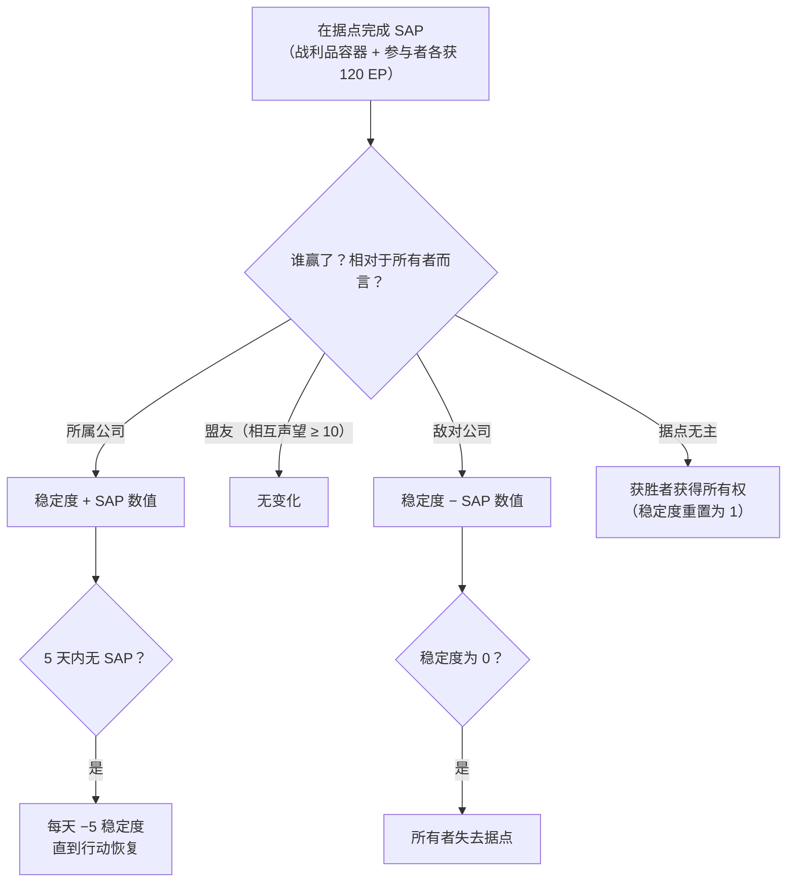

# 入侵

**入侵**是一种围绕 **NPC 据点** 构建的模式——由玩家控制或可争夺的据点，拥有
**稳定度**、**防御**和**设施**。你投入物品、提升防御并升级设施，以控制据点并从中获利。

> "入侵"在客户端中的名称尚待确认。UI 位置参见
> [客户端 UI 概览](/zh-CN/features/ui/)。以下机制已对照服务器端确认。

## 据点与稳定度

- **据点信息** — 入侵据点的详细信息。
- **稳定度** — 据点的核心属性，取值范围为 **0 到 150**。新所有者初始值为
  **1**。稳定度驱动一切：
  - **奖励阈值**（内容，`intrusionsitestabilitythreshold`）：设施奖励
    在稳定度 **20 / 60 / 80** 时解锁；一组光环效果（入侵核心、
    探测、地质扫描、收割器、工业、伪装、采矿、维修、信号——每项
    1–3 级，外加组合 4 级效果）在 **10、20、40、50、70、80 和
    100** 时分级解锁；**停泊权**在 **50** 时解锁；防御节点上限在 **40** 时提升。
  - **生产点数** = `稳定度 / 10`（上限 15）——用于升级设施的货币
    （每级消耗 1 点）。
  - **衰减**：若 **5 天**内没有成功的 SAP，据点将开始每天
    损失 **5 点稳定度**，直到再次采取行动。
  - **失去**：稳定度降至 **0** 时，所有者将失去该据点（据点变为
    无主状态）。
- **稳定度日志** — 查看据点稳定度的变化记录。

### 谁影响稳定度

稳定度变化来自已完成的 **SAP**（见下文）和系统衰减。效果
取决于 *谁* 相对于当前所有者赢得了 SAP：

- **所有者获胜** → 稳定度 **增加** SAP 的数值。
- **盟友获胜**（相互声望 ≥ 10）→ **无变化**。
- **敌对公司获胜** → 稳定度 **减少** SAP 的数值。
- **无主据点** → 第一个玩家公司获胜者 **获得所有权**（稳定度
  重置为 1）。

## SAP（站点攻击点）

**SAP** 是在据点生成的临时目标。完成它会在 SAP 位置掉落一个 **战利品
容器**，改变稳定度，并向每位参与角色支付 **120 EP**。**NPC 邪教徒也会争夺 SAP**
——如果他们先达到分数要求，该 SAP 将计为你的失败。共有四种 SAP 类型：

| SAP | 完成方式 | 稳定度数值 |
|---|---|---|
| **主动黑客** | 对 SAP 使用黑客模块（最多 120 次模块使用） | +15 |
| **被动黑客** | 在 SAP 范围 5 内停留 **8 分钟** | +10 |
| **摧毁** | 将 SAP 打至摧毁（NPC 伤害也计入） | +15 |
| **样本处理** | 提交 **5–6 个 SAP 样本**（每批 2–3 个，冷却 1.5 分钟，范围 7） | +15 |

- **提交 SAP 物品** — 在区域内，向样本处理型 SAP 提交样本。
- **SAP 物品信息** — 查看 SAP 物品数据（自己的和通用的）。

SAP 样本是该模式的消耗品；它们同时具有大量核心价值，因此也可用作
[PBS 反应堆燃料](/zh-CN/features/pbs/)。

## 防御与效果

- **设置防御阈值** — 配置据点的防御阈值（据点自动防御何时启动）。
- **设置效果奖励** — 设置据点的光环/效果奖励配置（来自稳定度解锁的光环组）。
- **升级设施** — 提升据点设施等级：消耗 **1 生产点数**
  （即 10 点稳定度），仅限 CEO / 副官 / 会计操作，有最高等级上限。
- **设置据点公告** — 为据点设置一条公开公告。

## 日志

- **我的入侵日志** — 你的入侵活动记录。
- **公开日志** — 公开入侵动态。
- **我的据点日志** — 你的据点上的活动记录。
- **稳定度日志** — 稳定度变化（见上文）。

## 实用提示

- **稳定度是核心属性** — 它决定奖励等级的解锁、产生升级货币，
  也是敌方 SAP 所削减的对象。
- **SAP 是争夺目标** — NPC 邪教徒与你竞速；失去一个 SAP 会损失稳定度。
- **不要让据点闲置** — 5 天内没有成功的 SAP 就会开始每日衰减。
- **日志记录一切** — 利用我的/公开/稳定度日志来追踪各据点的动态。

<!-- TODO: only the in-client name for "intrusion" and the UI remain.
     Confirmed: stability 0-150, start 1 (Outpost.cs constants); bonus thresholds from
     intrusionsitestabilitythreshold (facility 20/60/80; aura effects 50-74 at tiers
     10/20/40/50/70/80/100; docking rights 50; defense nodes 40); production points =
     stability/10, facility upgrade costs 1 point, CEO/Deputy/Accountant; decay -5/day
     after 5 days idle (OutpostDecay.cs); owner-win +, ally (standing>=10) 0,
     hostile -; unowned -> winner takes it; stability 0 -> ownership lost; 120 EP per
     SAP participant (EP_WINNER, EpForActivityType.Intrusion); 4 SAP types: active
     hacking (120 module uses, +15), passive (8 min in range 5, +10), destruction
     (kill it, +15), specimen processing (5-6 specimens in 2-3 batches, 1.5 min cd,
     range 7, +15; siegeitems table: def_specimen_sap_item 2-3); SAP increase values
     from entitydefaults #increase option; NPC sap guard/invade units contest SAPs.
     Developer notes: Intrusion/IntrusionSAPSubmitItem.cs (SpecimenProcessingSAP,
     zone submit), IntrusionSAPGetItemInfo.cs / IntrusionSapItemInfo.cs,
     IntrusionSetDefenseThreshold.cs, IntrusionSiteSetEffectBonus.cs,
     IntrusionUpgradeFacility.cs, SetIntrusionSiteMessage.cs; GetIntrusionSiteInfo.cs,
     GetIntrusionLog.cs / GetIntrusionPublicLog.cs / GetIntrusionMySitesLog.cs /
     GetIntrusionStabilityLog.cs, GetStabilityBonusThresholds.cs;
     EventProcessors/AffectOutpostStability.cs; Zones/Intrusion/Outpost.cs,
     OutpostDecay.cs, SAP.cs + *SAP.cs subclasses. -->