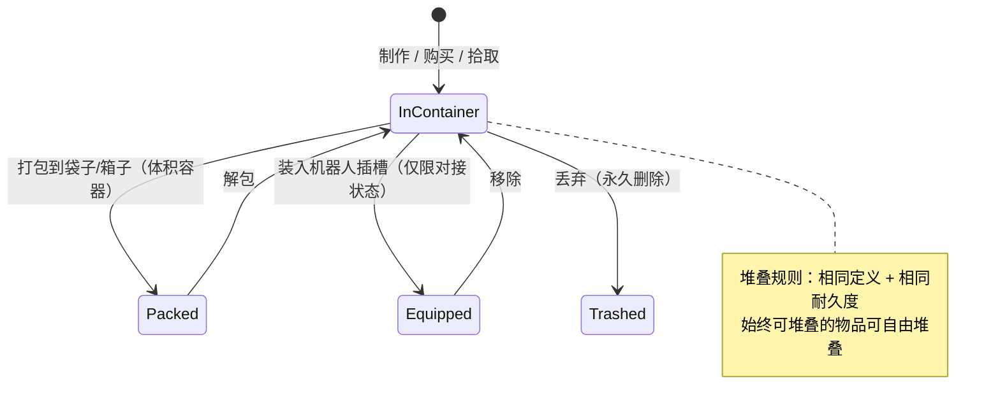

# 物品与库存

你的**库存**是一组**容器**（基地公共容器、机器人容器、袋子/箱子等）。本页介绍如何操作容器内的物品。

> 界面位置参见[客户端界面概览](/zh-CN/features/ui/)。以下机制已对照服务器确认。

## 容器

- **列出容器** — 查看容器内容。
- **转移物品** — 在可访问的容器之间移动物品。

访问规则适用：某些容器（公司机库、机器人库存、系统容器）受限 — 参见[机器人](/zh-CN/features/robots/)和[群组](/zh-CN/features/groups/)。

## 打包与解包

- **打包物品** — 将物品放入袋子/箱子（"体积容器"）中以紧凑携带。
- **解包物品** — 将物品从袋子/箱子中取出。

打包也是**机器人**压缩存储/运输的方式：服务器会剥离其动态状态和组件，并标记为*已重新打包*。机器人只有在**未受损**、**未被选中**、**未投保**且**库存为空**时才能被打包。解包会重建并修复机器人。只有内容中标记为*可重新打包*的物品才能被打包；已重新打包的机器人在解包前无法被选中或装配（参见[机器人](/zh-CN/features/robots/)）。

## 堆叠

许多物品可以堆叠。堆叠操作：

- **堆叠物品** / **堆叠到** / **堆叠选中** — 将同类型物品合并为一个堆叠（或将一个堆叠移到另一个上）。
- **拆分数量** — 从堆叠中拆分出指定数量。

服务器仅合并具有**相同定义和相同耐久度**的物品。标记为*始终可堆叠*的物品（矿石、弹药、大多数原材料）可自由堆叠；标记为*不可堆叠*的物品永远不能堆叠；其余物品**仅在已重新打包**（已打包）状态下可以堆叠 — 因此未打包的、受损的装备保持独立。

## 命名与使用

- **重命名物品** — 为物品设置自定义名称。
- **使用物品** — 激活可用物品（上下文相关；在区域内也可以与区域对象交互 — 参见[采集](/zh-CN/features/gathering/)）。
- **使用抽奖物品** — 打开/激活抽奖类物品。

## 丢弃与补偿

- **丢弃物品** — 丢弃物品（永久删除）。
- **补偿物品** — 管理员/工作人员补偿流程：创建物品并赋予角色，记录到交易日志。玩家不会直接调用此功能。

## 特殊物品

- **兑换码** — 列出、**兑换**或**激活**兑换码物品（代码/授权）。
- **礼包** — 列出并**兑换**礼包（物品捆绑包）。
- **打开礼物** — 礼物包含一个从服务器全局掉落池中随机抽取的**随机**物品（弹药、原始矿石、等离子体、研究套件、模块、胶囊、油漆、增益器 — 共 221 种可能定义，每种有各自的数量范围）。

## 实用提示

- **访问权限按容器划分** — 你只能操作你拥有或被授权的容器。
- **打包以携带更多** — 袋子/箱子让你紧凑地搬运大量物品。
- **堆叠节省空间** — 合并同类物品；拆分以取出恰好需要的数量。
- **丢弃是永久的** — 已删除的物品无法恢复。
- **兑换码/礼包为一次性** — 兑换会消耗代码/物品。
- **已打包的机器人处于惰性状态** — 在选中或装配前先解包。
- **仅已打包的物品可堆叠** — 如果同类物品无法合并，先打包（或修复）它们。

<!-- TODO: 仅剩库存界面待完成。
     已确认：堆叠规则（Item.cs CanStackTo：相同 ED + 相同耐久度；AttributeFlags
     alwaysStackable/nonStackable；其余必须已重新打包）；打包规则（ItemPacker.cs：
     机器人必须未受损、未被选中、未投保、库存为空；repackable
     标志）；解包重建 + 修复（ItemUnpacker.cs）；礼物 = 从
     giftloots 随机抽取（221 种定义：弹药 x1500-2000，epriton/fluxore x600-1000，反应堆等离子体
     x10-20k，研究套件，油漆，胶囊，named3 模块，增益器，重铸代币）；
     礼包基于活动（GoodiePackRedeem：campaignID + indy 选择）；
     ReimburseItem = 管理员工具（opp_reimburselog）。AttributeFlags 位位置：
     nonStackable=10, alwaysStackable=11, repackable, consumable=24, deployable=23。
     开发者笔记：ListContainer.cs; RelocateItems.cs; PackItems.cs / UnpackItems.cs;
     StackTo.cs / StackSelection.cs / UnstackAmount.cs; SetItemName.cs; UseItem.cs /
     UseLotteryItem.cs; TrashItems.cs; ReimburseItem.cs (PbsReimburseRequestHander.cs);
     RedeemableItemList.cs / RedeemableItemRedeem.cs / RedeemableItemActivate.cs;
     GoodiePackList.cs / GoodiePackRedeem.cs; GiftOpen.cs. 容器访问：
     ContainerAccess / ContainerAccessChecker.cs. -->