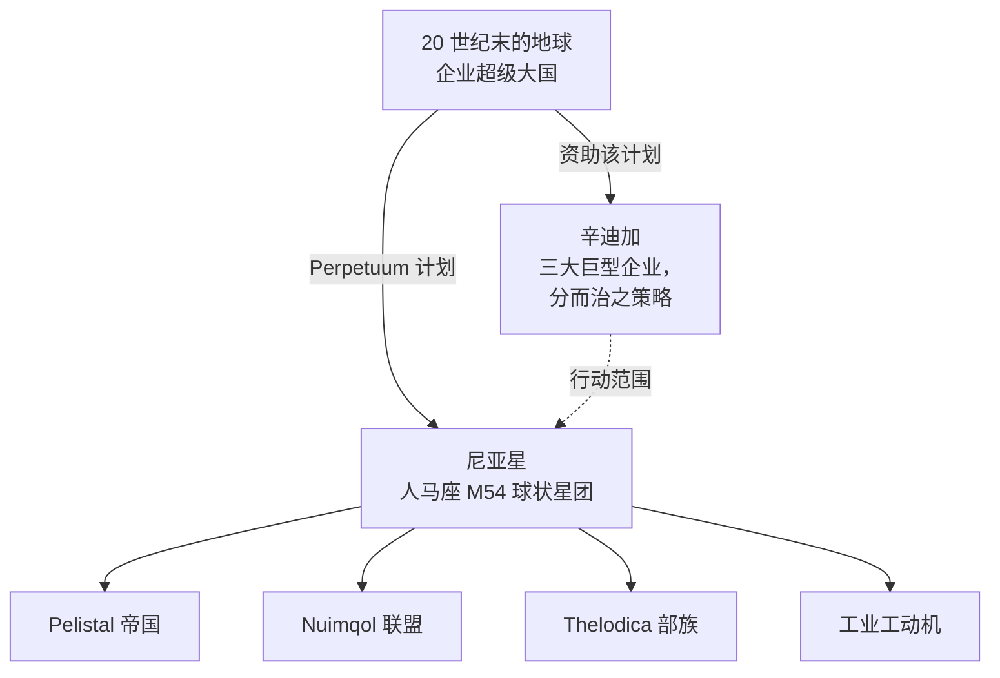

# 背景故事

## 尼亚星的发现

地球 20 世纪末的技术繁荣——互联网、医疗 IT 融合、太空探索——打破了旧有的物理和心理边界。通讯与贸易变得更加快捷廉价，各大企业巨头成长为其所在区域事实上的政府。

在这样的世界中，人类发现了人马座 M54 球状星团中的**尼亚星**（这也是该计划标志的来源）。尼亚星围绕一对双星中的一颗运行——是该恒星系统中的第四颗行星——且惊人地与地球相似：表面平均温度约为 19 °C，大气密度接近地球。但有两个奇特之处使其与众不同：其海洋对任何电力驱动的事物都是无法逾越的屏障——行星密集的地核与快速自转使其始终带有电荷——且地表仅约 17% 为陆地，快速的板块构造运动不断将其撕裂成岛屿。然而在这些陆地上，生命繁荣生长。

## 尼亚人

尼亚的居民颠覆了“生命形式”的常规概念：这是一种合成物种，其外形与我们的机器人并无二致，但组织成了各自独立、技术高度发达的**社会**——每一个都拥有自己的工业、军事和文化。对极度渴求能源的地球而言，最重要的成就是他们的**能源生产技术**。

三个外星种族在其领地的岛链上为最终胜利而战——**Pelistal 帝国**、**Nuimqol 联盟**和 **Thelodica 部族**——其间夹杂着零星分布的工动机**工业**人口（这正是你在游戏中作为 [NPC](/zh-CN/features/npcs/) 遇到的四个群体）。

## 辛迪加

Perpetuum 计划的主要投资者是**辛迪加**——由地球上最强大的三家巨型企业组成的联盟，每家企业在地表运营各自的行动范围：

| 企业 | 领地 |
|---|---|
| **Truhold-Markson** | 北美消费工业巨头；正向日渐衰落的 **Pelistal** 领地推进。 |
| **ICS — 企业安全学会** | 欧洲-俄罗斯联合会；在叛乱的 **Nuimqol** 领土内展开行动。 |
| **Asintec** | 亚洲工业霸主及其高科技邻邦；正向 **Thelodica 部族** 发起全面进攻。 |

其策略正是古老的*分而治之*：保持三个领域的势力平衡，让外星力量互相攻伐而不是团结一致。人类“特工（Agent）”在地表工作——收割尼亚人的能源资源，研究他们的技术，并维持辛迪加所期望的秩序。

这正是你的用武之地。

<!--
开发者说明：2026 年根据正典设定以原创文字重新撰写。
早期版本改写自 Open Perpetuum 社区 wiki（perpetuum.miraheze.org: Discovery of Nia, Nia, Syndicate）；该文本已被完全替换，未被重用。
与后端的一致性：三个外星种族 + 工业与 NPC 种族相匹配（见 /zh-CN/features/npcs/）；企业名称与区域缩写相匹配（zone_ICS、zone_ASI、zone_TM —— /zones/ 中的 Beta 级区域以其巨型企业命名）。
-->
