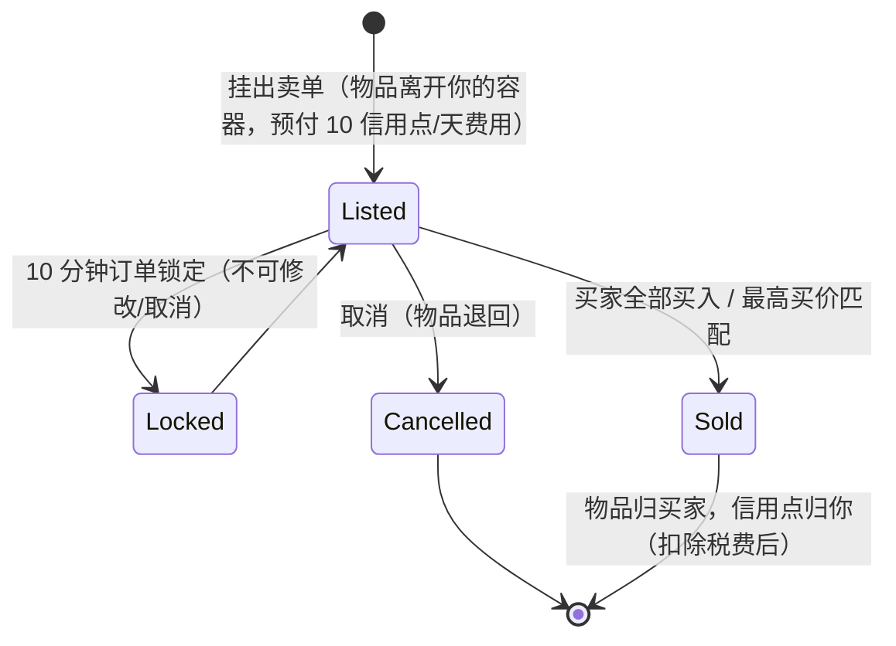

# 市场与交易

**市场**是你在基地买卖物品的场所。所有市场操作均为**仅限停靠**（你在当前停靠的基地进行交易）。

> 界面位置参见[客户端界面概览](/zh-CN/features/ui/)（顶部栏的**市场**分类）。以下机制已对照服务器确认。

## 市场订单

你可以在当前基地的市场挂出两种订单：

### 卖单
将物品挂出出售。
- 选择**物品**、**数量**、**单价**和**持续时间**（以天为单位，最少 1 天）。
- 物品将从你的容器中取出（如果出售的是堆叠物品的一部分，则会拆分）。
- **上架费** — 你需要预付 `10 信用点 × 持续时间`（可通过*市场交易手续费*扩展降低）；费用归入基地中央银行（区域利润池）。
- **价格保护** — 启用后，你的定价必须在物品**14 天平均价格**的 **±30%** 范围内；超出区间的价格将被拒绝。*（此保护功能在当前服务器上处于**禁用**状态。）*
- **订单锁定** — 订单挂出后 **10 分钟**内不可修改或取消。
- **订单数量** — 你最多可持有 1 +（*市场卖单专家*扩展）个未完成的卖单（买单有独立的计数器）。
- **仅限我的公司** — 你可以将卖单限制为仅你的公司成员可见（仅适用于非默认公司）。
- 根据情况从你的**个人**或**公司**钱包中支付。

### 买单
挂出一个以指定价格购买物品的常设订单。
- 当出现匹配的卖单时，市场会自动成交。

### 订单管理
- **修改订单** — 更改价格/数量/持续时间。
- **取消物品 / 订单** — 撤回（物品退回你的容器）。
- **我的物品** — 查看你未完成的订单。
- **最高买价匹配** — 卖单可以路由到已有的买单。

## 直接购买

- **购买物品** — 立即购买市场上已有的物品（无需常设订单）。

## 浏览市场

- **物品列表 / 可购买物品 / 范围内物品** — 浏览在售物品。
- **市场信息** — 关于该基地市场的详细信息。
- **平均价格** — 市场均价、按定义均价和**全局**均价。这些是价格保护的依据。

## 市场税

- **修改市场税** — 设置市场的税率。只有**PBS 基地市场**由玩家控制；其他所有地方适用固定默认税率。
- **税收日志** — 查看税率变更记录。

税费从**卖方**在市场销售中获得的金额中扣除。默认税率为 **12%**（卖方获得售价的 88%）；税率可通过*市场交易税*扩展降低，在玩家控制的市场中，PBS 所有者也可以设置自定义税率。

## 玩家间直接交易

**交易**是两个已停靠角色之间的点对点交换：

- **开始交易** — 与另一名玩家开始交易会话。
- **设置 / 撤回我的报价** — 在你的这一侧放入物品/信用点。
- **接受** — 双方都接受后，交换原子性地完成。
- **取消** — 中止交易。
- **交易完成 / 状态** — 完成状态和当前状态。

角色可以**阻止交易**（参见[快速入门](/zh-CN/features/getting-started/)）。

## 物品商店

**物品商店**是基地中的固定价格商家（非玩家驱动）。完整目录（所有物品、数量、每种货币的价格、声望要求）生成于[物品商店](/content/shop/)。

- **列表** — 查看商店出售的物品。
- **购买** — 用信用点购买物品。

## 转移信用点

- **转移信用点** — 在你自己的角色之间转移（参见[快速入门](/zh-CN/features/getting-started/)）。

## 实用提示

- **一切仅限停靠** — 你无法在区域中进行交易。
- **将 12% 的税费纳入定价** — 卖方默认获得挂牌价的 88%（高税 PBS 市场上更低）。
- **上架费是预付的** — 长时间上架即使第一天就卖出，成本也更高。
- **仅限公司的订单**是在公司内部转移物资而不公开曝光的方式。
- **交易是原子性的** — 双方都必须接受，否则什么都不会发生。
- **税率变化影响实际成本** — 将市场税率纳入你的定价。

<!-- TODO: 仅剩客户端界面（市场和交易屏幕流程）。
     已确认：MarketInfoService(0.3, 10, false) 注册于
     PerpetuumBootstrapper.cs -> 14 天均价的 ±30% 区间（MARKET_AVERAGE_DAYSBACK
     14），费用 10 信用点/天（Market.MARKET_FEE），此服务器上 CheckAveragePrice=false；
     DEFAULT_MARKET_TAX = 0.12（卖方获得 88%），玩家控制税率仅在
     PBSDockingBase 市场上（MarketTaxHelper）；订单提交后 10 分钟内锁定不可修改/取消
     （MARKET_CANCEL_TIME）；订单数量 = 1 + 专家扩展加成；
     费用预付至基地中央银行。 -->
     开发者笔记：Markets/MarketCreateSellOrder.cs（停靠、价格保护对比均价、
     仅限公司、拆分堆叠、公司钱包），MarketCreateBuyOrder.cs，
     MarketModifyOrder.cs，MarketCancelItem.cs，MarketBuyItem.cs，MarketItemList.cs，
     MarketAvailableItems.cs，MarketItemsInRange.cs，MarketGetMyItems.cs，
     MarketGetAveragePrices.cs / MarketGetDefinitionAveragePrice.cs /
     MarketGlobalAveragePrices.cs，MarketTaxChange.cs / MarketTaxLogList.cs；
     Trade*.cs（开始/报价/接受/取消，原子性）；ItemShopList.cs / ItemShopBuy.cs；
     CharacterTransferCredit.cs。 -->