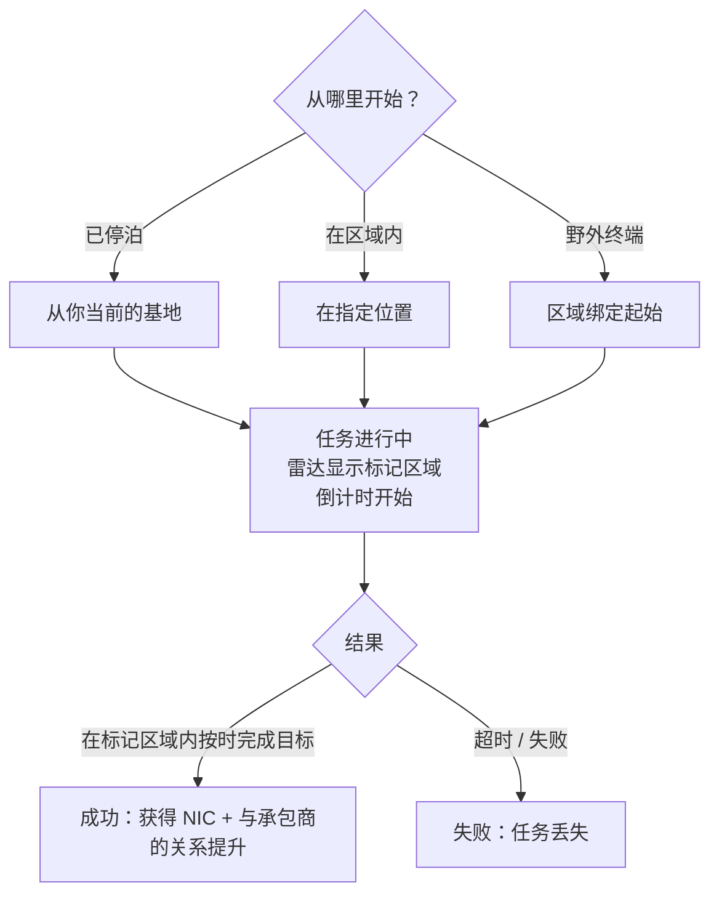

# 任务

**任务**是你在区域中接取的结构化目标——交付物品、打击目标、使用设施。它们是你推进进度、获取奖励以及驱动大量区域内容（警报、信息亭和部分 PBS/运输钩子都与任务相关）的方式。

> 界面位置参见[客户端界面概览](/zh-CN/features/ui/)。以下机制已对照服务器确认。

## 开始任务

你通过选择一个**类别**和一个**等级**（等级会被限制在有效范围内），在某个**位置**开始任务：

- 如果你处于**停泊**状态，任务从你当前基地的位置开始。
- 如果你**在区域内**，你需要明确指定位置。
- 任务也可以直接从**区域**开始（区域绑定起始）或从**野外终端**开始。

并非每个类别/等级在所有地方都可用——可用性由内容驱动。完整的任务列表（类型、类别、等级、持续时间、奖励费用和奖励物品）在[任务](/content/missions/)中生成。

## 任务的作用

任务同时服务于两个目的：赚取 NIC，以及建立你与发布方（承包商）公司之间的**关系**。更好的关系是在该公司终端获得**更高设施比率**的关键因素——生产和其他设施运行对你来说将变得更便宜、更快速。关系也可能*下降*：某些任务与另一家公司的利益冲突，任务简报中会注明何时会因此损失声望。

- **训练任务**——简单，为新手高亮显示；全部完成，奖励是不错的早期注入。
- **常规任务**分为三种类型：
  - *战斗*——侦察（扫描敌方机器人）、赏金猎杀（在标记圆圈内击杀目标）、摧毁与回收（击杀 + 取回 + 交付）、侦察与回收、特殊赏金（难以到达的目标）。
  - *工业*——地质勘探（用正确的电荷扫描矿物）、采集、矿物开采、专业开采（有守卫的挖掘点——带上武装支援）。
  - *后勤*——运输（在终端之间交付包裹）和取回（通过危险地带运送大型包裹——需要护送）。
- 不存在所谓的**安全任务**：如果你在路线上看到敌人且缺乏自卫装备，在损失一切之前先寻求帮助。
- **目标仅在标记区域内有效**——任务地图会在雷达上用红色圆圈标出；在其他地方的击杀和扫描不计入。错过截止时间则任务立即失败。
- **私人运输合同**——由辛迪加运营的系统（任务窗口的第二个标签页），玩家发布容器让其他玩家在终端之间运输，设有固定奖励和运输者需缴纳的**抵押品**（成功则退还，容器被毁则损失；中途放弃仅退还一半）。保持容器足够小，确保有人能实际携带。

## 任务数据与选项

- **任务数据**——任务的详细信息。
- **任务选项**——任务可用的选择/变体。
- **任务补给**——任务涉及的补给品。
- **起始物品**——任务开始时携带的物品。

## 执行任务

- **列出进行中的任务**——你当前正在执行的任务。
- **中止**——取消你正在执行的任务。
- **添加参与者**——将另一个角色加入任务（多人任务）。
- **任务日志**——任务的事件日志。

## 交付

- **交付**——完成一个交付目标。这可以在**停泊**状态（在基地）或**在区域内**（在特定位置/eid）完成，具体取决于任务。

## 代理人

- **列出代理人**——可用的任务代理人（发布任务的 NPC/派系）。

## 野外终端

- **野外终端信息**——检查区域内的野外终端（一种可以开始或服务任务的设施）。

## 实用提示

- **任务是连接组织**——警报、信息亭和部分设施都是任务对象（参见[采集](/zh-CN/features/gathering/)和[战斗](/zh-CN/features/combat/)）。
- **多人协作**——你可以添加参与者来合作完成任务。
- **交付上下文很重要**——某些交付需要你处于停泊状态，某些需要你在区域位置。
- **等级会被限制**——请求超出范围的等级会被修正，而非报错。
- **中止是你的退路**——如果任务变得不利，就中止它。

## 任务设施

任务通过**设施**锚定在区域中。服务器实现了以下类型：

| 设施 | 功能 |
|---|---|
| **简单开关** | 即时交互——靠近后任务目标即完成 |
| **警报开关** | 定时任务——在范围内停留一段时间（来自任务选项），每 2 秒检查一次 |
| **物品补给** | 类似警报开关的定时机制，然后**将物品生成到你的机器人容器中** |
| **信息亭** | **物品提交**点——将任务所需的物品交给任务 |

<!-- TODO: the full mission list, categories, level ranges and rewards are generated at
     /content/missions/. Verified: mission structure types
     (MissionEngine/MissionStructures: SimpleSwitch, AlarmSwitch, ItemSupply, Kiosk);
     verify the mission UI.
     Developer notes: Missions/MissionStart.cs (category, level clamp, docked vs zone
     location), Missions/MissionDeliver.cs (docked vs zone delivery), MissionAbort.cs,
     MissionData.cs / MissionGetOptions.cs / MissionGetSupply.cs / MissionStartItems.cs,
     MissionListRunning.cs / MissionListAgents.cs / MissionLogList.cs,
     MissionPlayerAddsParticipant.cs, FieldTerminalInfo.cs, MissionStartFromZone.cs;
     Services/MissionEngine/* (MissionProcessor, mission structures incl. AlarmSwitch,
     Kiosk). -->