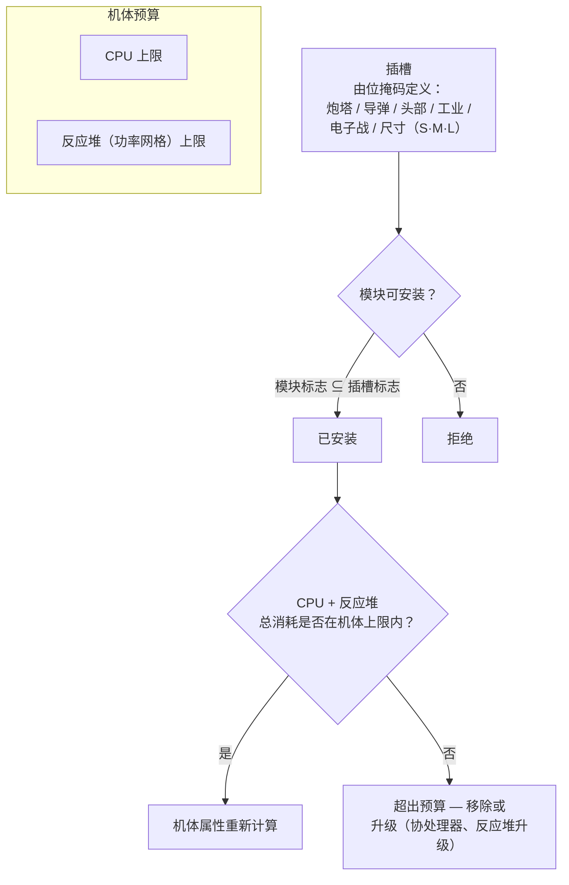

# 模块与装配

"买机器人只是买了个底盘。"给它装上模块，才能让它成为你需要的样子。*装配*既指模块配置（"把你的装配方案发我看看"），也指它所消耗的 CPU/反应堆预算。

## 插槽与资源

每个机器人的机体拥有一组固定的**插槽**，由其底盘决定。每个插槽由位掩码定义类型——炮塔、导弹发射器、头部、工业、电子战/工程、尺寸（小/中/大）——只有当模块自身的类型掩码是插槽掩码的子集时，才能装入该插槽。因此，炮塔型底盘上的炮塔插槽可以安装小、中*或*大型炮塔模块，但导弹发射器永远装不进炮塔插槽。头部模块（协处理器、调谐模块）和底盘/腿部模块（装甲板、框架）占用各自专用的插槽。

每个模块都会从机体消耗**CPU**和**反应堆**（功率网格）——所有已安装模块的总消耗必须同时低于这两项上限，部分模块还会按周期消耗**蓄能器**（核心）。剩余容量即为装配窗口中显示的*可用输出*。各等级底盘的大致规模（T1/T2/T3 示例）：

| 机体类别 | CPU | 反应堆 | 示例 |
|---|---:|---:|---|
| 小型爬行者 | ~250 | ~140 | Castel |
| 轻型机甲 | ~480 | ~300 | Waspish |
| 重型机甲 | ~1 100 | ~1 000 | Tyrannos |
| 步行者 | ~3 200+ | ~1 100+ | Gropho |

容量不足时：**CPU**——协处理器模块（例如 T3 协处理器提供 +20% CPU）或 T2 模块变体（消耗更低）。**反应堆**——反应堆升级（例如 T3 提供 +20% 反应堆输出）或反应堆密封（降低辐射，同时也能保护你免受能量战攻击——见下文）。

## 模块家族

各型号的具体数值见[物品目录](/content/)和[格式参考](/zh-CN/formats/)；以下是家族总览。

### 武器与弹药

四种武器技术，各有其专属弹药和距离特性：

| 武器 | 弹药 | 距离特性 | 备注 |
|---|---|---|---|
| **枪械** | 子弹 | 短射程，衰减极大 | 弹丸*永不脱靶*——但其"精度"表现为区域半径，因此小型目标在宽散布下仍会受到减伤。 |
| **磁轨（轨道炮）** | 弹丸 | 中射程，衰减陡峭 | 高冲击速度；能量消耗大。 |
| **激光** | 能量电池 | 长射程 | 最耗能量；集中光束。 |
| **导弹** | 导弹 | 长射程 | 命中与否由*机器人*的命中判定属性决定，而非距离。伤害随目标尺寸相对于爆炸半径的比例缩放——大型导弹打小型目标伤害大幅降低。 |

伤害随距离按平滑余弦曲线衰减：在最佳射程处为全额伤害，在最佳射程 + 衰减距离处降为零（见[伤害衰减](/zh-CN/features/combat/#shang-hai-lei-xing)）。

弹药是调整伤害的关键：主伤害 + 副伤害类型可针对目标进行微调（见[伤害类型](/zh-CN/features/combat/#shang-hai-lei-xing)）——代价是相比纯主伤害弹药，总伤害略有降低。

炮塔分为小/中/大型；**尺寸需与机器人匹配**（小型机器人用小模块，机甲和重型用中/大型）。

### 防御

- **装甲板**——主要生命值池；装甲归零时机器人爆炸。**LWF**（轻型框架）装甲板以耐久换速度：T2 LWF 装甲板将装甲乘以约 0.73，但提供 +19% 速度、−0.2 信号特征和 −0.2 质量。
- **护盾发生器**——由蓄能器供能的屏障，在装甲之前吸收伤害。护盾消耗*你自己的核心*来吸收：一次本应造成 100 点伤害的攻击，在 2× 护盾下消耗 50 核心而非 100 装甲。护盾激活期间你自己的武器无法开火。吸收质量随护盾半径相对于你的信号特征的比例缩放——大型护盾配小型机体效果最佳。
- **装甲修复**——主动修复模块（小/中/大型）；**远程装甲修复**可作用于已锁定目标（友军或 PBS），但射程较短且周期更长。
- **装甲硬化器**——按伤害类型提供被动抗性点数（化学/动能/热能/爆炸变体）。
- **自适应合金**——被动模块，会*学习*所受伤害的构成，并将固定抗性池重新分配至你被命中最多的伤害类型。
- **规避/机动**——降低信号特征的模块和 NEXUS（见下文）使目标变小：减少范围效果伤害，且更难被锁定。

### 能量

- **反应堆**——持续输出上限；反应堆升级提高上限，反应堆密封降低辐射（减少所受能量战伤害，代价是少量反应堆输出）。
- **蓄能器（核心）**——驱动模块周期的爆发能量储备。随时间充能（底盘 `core_recharge_time`，T1 爬行者约 120 ms）；**蓄能器充电器**可加速充能。
- **能量注入器（核心助推器）**——消耗一次充能，瞬间将蓄能器补满。
- **能量传输器**——将核心以光束形式从你的机器人传输至已锁定的友军（玩家无法向 NPC 传输）。

### 电子

- **传感器增强器**——被动，自身：缩短你的锁定时间并延长锁定范围。
- **远程传感器增强器**——主动，目标：对已锁定的友军施加相同增益，持续约 10.5 秒。
- **协处理器**——提高机体 CPU 上限（T1 +10% … T3 +20%）。
- **武器稳定器**——提升武器精度（缩小有效区域半径）并略微减轻质量。
- **调谐模块**（头部插槽）——为特定模块家族提供固定加成：伤害调谐（T3 时每个武器家族 +25% 伤害）、采矿升级（T3 时 +10% 采矿和采集）、装甲修复器升级（T3 时 +16% 修复、−8% 周期）。

### 电子战（EWar）

让敌人又盲又聋：

- **传感器干扰器**——范围减益：延长目标的锁定时间并削减其锁定范围，持续约 5.5 秒。仅当你的 ECM 强度超过目标（随机化的）传感器强度时才生效。
- **传感器压制器**——即时效果：在 ECM 判定成功时重置目标*所有*锁定。
- **ECCM**——自身增益，持续 20 秒：提高传感器强度和锁定抗性，并*解除*受 ECM 影响的减益（干扰器、减速网）。
- **神经干扰器**——重置**所有**约 1.65 km 范围内玩家的锁定。恐慌按钮。

反制手段：传感器强度（底盘属性）、ECCM，以及保持距离。

### 隐身与探测

- **隐身模块**——约 10.5 秒隐身；消耗随你的信号特征半径缩放（机体越大，核心消耗越快）。
- **目标标记器**——约 10.5 秒减益，剥离目标的隐身强度。
- **探测模块**——被动提升你的探测强度。

探测强度与隐身强度决定你能否看到（并锁定）一个隐身目标——见[探测与遮蔽](/zh-CN/features/combat/#tan-ce-yin-bi-yu-su-du)。

### 能量战（EnWar）

吸取或切断敌人的能量：

- **吸取器（能量吸血鬼）**——从已锁定目标吸取核心并加入你自己的蓄能器。
- **中和器**——效果相同，但被吸取的核心会被销毁。
- 两者均会被目标的**反应堆辐射**削弱——密封是有效的反制手段。
- **减速器（减速网）**——对目标施加约 5.5 秒减速；效果随目标质量缩放（重型机体减速幅度更小），且对超出模块最佳射程的目标无效。
- **灼烧器**——一种*连锁*最多 5 个目标的电击武器，以穿透伤害同时打击护盾和装甲。

### 工业

- **钻头**（小/大）和**采集器**（小/大）——采集模块；产量、周期时间和蓄能器消耗是关键属性。采矿可获得 EP（有每日上限和液态惩罚）。
- **地质扫描仪**——以探测器的精度扫描周围的矿场；结果是地下资源的地图（见[采集](/zh-CN/features/gathering/)）。
- **挖掘机**——光环模块：提升附近单位的采矿/采集产量（T3：+50%），代价是失去隐身。
- **地形改造**（伽马区域）——地形锁定，可抬升、降低或平整地面（最大半径 5 m）并生长墙体植物；见[区域章节](/zones/zone-gamma-z106/)。
- **远程控制器**——炮塔和无人机的"牵引绳"：每个控制器模块携带带宽（可控制数量）、操作范围和无人机寿命（按等级 5–10 分钟）。变体：战术型（伤害/周期）、突击型（伤害）、支援型（远程修复）、工业型（采矿/采集无人机）、猎手型。**远程指令翻译器**模块可放大无人机的伤害、装甲、采矿产量和修复输出（T3：各 +7.5%），并可扩展控制器的带宽。

### NEXUS

网络化扩展利用系统：**军团增益**。NEXUS 模块在自身机器人周围释放光环，为光环半径内的**军团成员**（及其炮塔/无人机）提供增益——默认半径 10 m，每 10 秒可刷新。规则：

- 一个机器人最多携带 **3 个 NEXUS 光环**，且每种类型最多 **1 个**；
- 光环仅作用于你**军团**内的单位，而非随机友军。

T3 类型列表（13 种）：速度、装甲、护盾、远锁（锁定范围）、锁定加速（锁定时间）、暴击、突击（武器周期）、电子战（EWar 范围）、规避（信号特征）、修复、工业（采集时蓄能器消耗）、快速提取（采集周期）、充能（核心充能）。每个 T3 模块大约提供其对应属性 +7.5% 的加成；例如速度 NEXUS 使 10 m 内每个军团成员的最大速度乘以 1.075。

### NOX

邪教级反制手段：**否定器**模块，可*禁用*其半径内的敌方模块——**护盾否定器**（削减护盾吸收约 90%）、**修复否定器**（削减修复输出）和**传送否定器**（阻止传送）。每次激活都会**消耗**你货物中的等离子体，在开放（非训练）区域使用会**将你的角色标记为 PvP 状态**。

### 特殊用途

- **围攻破解模块**——主动 SAP 工具：5 秒周期，3 m 射程（见[前哨站](/zh-CN/features/outposts/)）。
- **自毁装置**——启动 8 秒倒计时；光束在 600 m 内可见。最后手段的清理工具。
- **地雷探测器**——扩展机体的地雷探测范围。
- **生物场发射器**——部署一个发射器以扩散生物场；发射调制模块可调节场参数（见[战斗](/zh-CN/features/combat/)）。
- **PBS 建造**——用于在伽马区域放置 PBS 结构的模块。

## 经验法则

1. **别混用武器。** 磁轨 + 激光 + 导弹装在同一台机器人上通常三者都不如专精一种；短射程和长射程混搭也很少有好结果。
2. **注意质量。** 每块装甲板和护盾模块都会增加质量和信号特征——有时速度比防御更重要。
3. **别什么都做。** 一台既采矿又扫描又开火的机器人，每项都不如专精型做得好。
4. **模块尺寸与机器人匹配**，并留一些 CPU/反应堆余量给那些让构型真正发挥作用的调谐模块。
5. ……是的，某些小众装配方案会打破以上所有规则却依然有效。只要动点脑子就行。

<!--
Developer notes: rewritten 2026 from backend sources; no community-wiki text reused.
Verified against:
- src/Perpetuum/Robots/RobotComponent.cs (slot bitmask fitting: moduleFlagMask & slotFlagMask)
- src/Perpetuum/Modules/SlotFlags.cs (12 slot flag bits)
- src/Perpetuum/Modules/Weapons/WeaponModule.cs + FirearmWeaponModule.cs +
  MissileWeaponModule.cs (accuracy: firearms never miss, explosion radius from
  Accuracy; missiles use ParentRobot.MissileHitChance)
- src/Perpetuum/Modules/Weapons/Damage.cs (cosine falloff, critical 1.75x +/-10%,
  explosion scaling signature/explosionRadius clamped [0,1])
- src/Perpetuum/Units/Unit.cs GetResistByDamageType (resist/(resist+100))
- src/Perpetuum/Zones/DamageProcessors/DamageProcessor.cs (shield draws core,
  electric = penetrating)
- src/Perpetuum/Modules/EffectModules/ShieldGeneratorModule.cs (absorption
  modifier = shieldRadius ratio / shieldAbsorbtion; WeaponModule.cs:112 blocks
  firing while HasShieldEffect)
- src/Perpetuum/Modules/EffectModules/{Webber,SensorDampener,SensorBooster,
  Stealth,TargetPainter,Eccm,Detection,AdaptiveAlloy}.cs (durations from
  effects table: dampener/web 5.5s, stealth/paint/remote-boost 10.5s, ECCM 20s)
- src/Perpetuum/Modules/SensorJammerModule.cs + Neuralyzer.cs (lock reset,
  NEURALYZER_RANGE=1650)
- src/Perpetuum/Modules/{EnergyVampire,EnergyNeutralizer,Scorcher,
  CoreBooster,EnergyTransferer}.cs (EnWar, reactor radiation modifier, chain)
- src/Perpetuum/Modules/GangModule.cs + Zones/Effects/GangEffect.cs +
  EntitiesModule.cs:532-544 (13 aura types, gang-members-only, effects table
  auraradius=10)
- src/Perpetuum/Modules/NoxModule.cs (plasma consumption, PvP flag)
- src/Perpetuum/Modules/RemoteControl/* (bandwidth/range/lifetime, translator
  amplification)
- entitydefaults rows: named1-3 armor plates/hardeners, shield generators
  (absorbtion 2.0-2.3, radius 5-33), LWF (mass_reductor), cpu/powergrid
  upgrades, damage/mining/repairer tuning, NEXUS named3 values, NOX cultist
  values, siege hack (5s/3m), chassis core_max/powergrid_max.
Corrections vs ingested page: NEXUS auras reach gang members only (not "all
friendly units"); no "co-reactor" module exists (reactor upgrades/sealing do
that); demobilizer effect scales with target mass, no "resistance stat";
sensor suppressor = sensor dampener (5.5s debuff).
-->