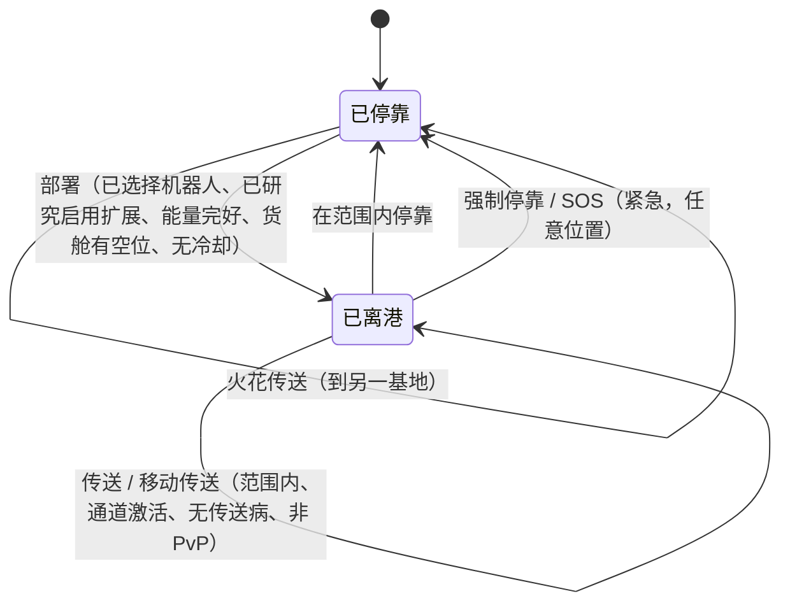

# 移动与区域

你始终处于两种状态之一：**停靠**在基地，或**离港**在区域中远程操控你的活跃机器人。本页所有内容都涉及在这两种状态之间以及各区域之间的移动。

> UI 位置遵循[客户端 UI 概览](/zh-CN/features/ui/)：**部署/停靠按钮**是顶部栏中央的切换按钮。以下机制已对照服务器确认。

## 停靠与离港

- **停靠** — 你在基地中。你的机器人和物品在容器内。你不能操控机器人、使用传送或扫描，但可以制造、交易、研究和使用基地设施。
- **离港** — 你在区域中，操控着你的活跃机器人。你可以移动、扫描、战斗并与区域物体互动，但大多数仅限基地的活动被锁定。

## 离港

按下**部署**（顶部栏中央）。服务器随后检查以下所有条件：

1. 你已选择一台**活跃机器人**。
2. 该机器人职业所需的**启用扩展**已在你的角色上研究完成（参见[研究](/zh-CN/features/research/)）。
3. 机器人的**能量系统完好**。
4. 机器人的**容器有空余容量**。
5. 你不处于**离港冷却**中（某些事件后的短暂计时器）。

如果任何检查未通过，离港将被拒绝。

## 返回停靠

- **停靠** — 当你在基地的停靠范围内时，可以停靠。
- **强制停靠** — 紧急操作：立即将你从区域拉出并停靠在主基地（TMA），即使在战斗中也可以。当你正在输掉一场战斗时使用。
- **SOS** — 区域求助操作，将你停靠在当前基地并标记该事件。

## 区域入场队列

某些区域较繁忙，在你离港/进入时使用**入场队列**：

- 查看队列状态（`zoneGetQueueInfo`）。
- 设置你偏好的队列长度（`zoneSetQueueLength`）。
- 改变主意时可取消等待（`zoneCancelEnterQueue`）。

## 传送

**传送**是区域内的结构。使用条件：

- 你必须**在传送范围内**。
- **通道**（目的地）必须**激活**且有效。
- 你**不能**处于*传送病*状态 — 任何传送后的短暂冷却，期间无法再次传送。
- 某些效果（如 *Nox* 否定）或处于 **PvP 战斗中**会阻止传送。

传送通道分为三种类型：

| 类型 | 效果 |
|---|---|
| **区域内** | 将你移动到同一区域的随机位置 |
| **跨区域** | 将你移动到不同区域的随机位置 |
| **训练出口** | 退出训练区域（附带奖励等级选项） |

**移动传送**是*拥有*的传送物品（如移动要塞/世界传送）。额外规则：

- 只有**所有者或所有者帮派的成员**可以使用。
- **PvP 中无法使用**。
- 每次使用都会对该传送施加**冷却**。

你可以列出传送及其通道，并查询全服通道。

## 火花传送

**火花传送**是基地之间的快速旅行系统：

- 你在一个基地**设置**火花目的地，然后（在停靠状态下）**使用**它瞬间跳转到另一个基地。
- 你可以**列出、设置、使用和删除**你的火花传送。
- 目标基地必须**允许你停靠**。
- 到达时服务器会为你选择一台合适的机器人（一台你已研究其启用扩展的机器人）。
- 你**可持有的火花传送数量**受扩展限制（参见[研究](/zh-CN/features/research/)）；超出将被拒绝。

## 传送门

**传送门**是区域结构，可从任意位置使用（不像传送有范围限制）。基地所有者可以**重命名**其传送门。

## 基地信息

你可以查看任何基地：

- **信息** — 它是什么以及在哪里。
- **所有权** — 谁拥有它。
- **设施** — 它提供什么（生产、市场、商店……）。
- **我的物品** — 你存放在该基地的物品。
- **停靠权限** — 基地所有者可以设置谁可以停靠。

## 可能出什么问题

| 症状 | 可能原因 |
|---|---|
| 离港被拒绝 | 无活跃机器人、缺少启用扩展、能量系统损坏、机器人容器已满或离港冷却中 |
| 传送被拒绝 | 超出范围、通道未激活、传送病、Nox 效果或处于 PvP 中 |
| 移动传送被拒绝 | 非所有者/帮派成员，或处于 PvP 中 |
| 火花传送被拒绝 | 目标基地禁止停靠、无有效机器人可选或已达火花传送上限 |
| 卡在区域入口 | 区域队列 — 查看队列状态或取消 |

<!-- TODO(Phase 1): verify client UI flow (dock/undock buttons, teleport screen).
     Developer notes: Dock.cs / Undock.cs / ForceDock.cs (TMA = baseEid 561) /
     ZoneSOS.cs; Zone/TeleportUse.cs (TeleportPlayerValidator, three
     TeleportDescriptionType strategies, mobile-teleport gang/PVP rules);
     Sparks/SparkTeleportUse.cs (docked-only, extension-count limit);
     Zone/ZoneCancelEnterQueue.cs + ZoneEnterQueueService; GateSetName.cs. -->