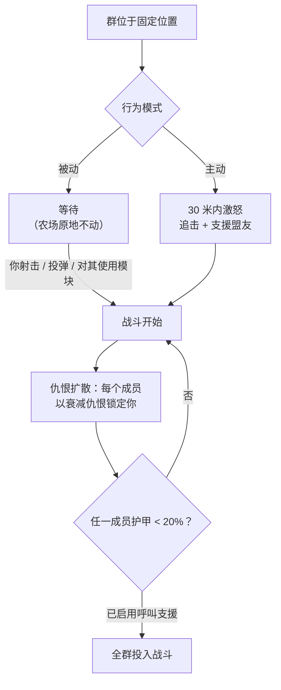

# NPC 与 PVE 狩猎

NPC 是游戏中获取[反应堆等离子体](/content/ores/)、
[内核](/zh-CN/features/research/)和模块的主要来源，也是任何等级下稳定赚取扩展点数
的途径。它们以**群**的形式存在：一群共享固定位置、活动范围、刷新时间和行为
模式的个体。

## 有哪些种类

NPC 分为四个种族——**Nuimqol、Pelistal、Thelodica 和 Industrial**——
每个种族下有多个机器人类别（跑者、爬行者、机甲、重型机甲）以及 1–5 级，
等级越高，属性和战利品越好。除了常规等级外：

- **哥布林** — 受保护岛屿上的 EWar 守卫。脆弱，但其锁定修正极其夸张
  （锁定速度约为正常的 5 倍，锁定距离约为 2 倍）：哥布林营地会让附近的
  战斗或采矿变得非常痛苦。
- **精英** — 稀有变体，基础属性约为同等级 NPC 的两倍，战利品也更优。
- **观察者** — 游荡型、主动攻击型 NPC（弩手、巴风特、黄蜂、暴龙、
  阿尔忒弥斯、凯因、格罗福、塞克尔、赛斯、魅惑者……）。它们巡逻岛屿的
  大部分区域，难度远高于同类别的等级制 NPC——受保护岛屿上的*大型*
  观察者及其开放岛屿变体是那里最强的常规狩猎目标。
- **Boss** — 稀有、单独配置的 NPC。它们从不逃跑，可以向全服广播自己的
  出现，部分与前哨站绑定（击杀它们会改变[前哨站稳定度](/zh-CN/features/outposts/)）
  或击杀后生成遗迹裂隙。较弱的 Boss 可在受保护岛屿上单挑；最强的
  需要专门的团队。
- **辛迪加刷新** — 一个特殊阵营（辛迪加，拥有自己命名的 NPC），运营
  自己的固定农场，通常位于受保护岛屿和浅层开放岛屿上。

## 被动与主动

- **被动群** 不会主动攻击——你必须先射击、投弹或对它们使用主动模块。
  大多数经典固定农场都是被动的。
- **主动群** 在你进入 **30 米** 范围时自行激怒，追击你，并支援正在
  战斗的盟友。所有观察者、大多数游荡刷新点和前哨站守卫/入侵者都是主动的。

战斗一旦开始，**仇恨会在群内扩散**：每个成员都会以衰减后的仇恨锁定你，
如果任一成员的护甲降至 **20%** 以下，整群都会投入对你（针对已启用呼叫
支援的群）。从第一个机器人开火的那一刻起，就假设你在与整个刷新点作战。

## 刷新与重生

- **固定刷新点** 位于固定位置，有活动范围；成员**各自独立**按自己的
  计时器重生。被频繁刷的群重生更快；刚恢复的群重生更慢。
- **游荡刷新点** 在岛屿上移动——它们是观察者和车队型群，通常都是主动的。
- **矿点增援** — 在资源节点工作的工业 NPC 有预设的增援波次：战斗
  持续越久，后续波次会陆续到达节点。Boss 在受损时也会呼叫增援。
  因此一个"单机器人"农场可能变成团战；投入战斗前请先查看周围区域。

## 掉落物

战利品按 NPC 类型配置：**该岛屿种族的反应堆等离子体**、
**内核**（普通、高科技、工业和种族专属）、模块组件，以及较少见的
封装模块。更高等级和特殊类型掉落更多。

每次击杀还会获得**扩展点数**，按 NPC 类型配置——在开放（Beta 级）
岛屿上翻倍。

## 区域等级加成

岛屿分为三个等级——受保护（Alpha）、开放 PvE（Beta）和开放 PvP
（Gamma）。越深入，狩猎越危险，但回报也越丰厚：

- **死亡爆炸** — 在受保护岛屿上，机器人死亡时*不会*爆炸。在开放岛屿
  （Beta 和 Gamma）上，每个被摧毁的机器人——玩家或 NPC——都会爆炸并
  造成范围伤害。连锁爆炸让刷怪更快，也让伏击点更致命。
- **双倍 EP** — 所有活动的基础 EP 奖励在 Beta 级岛屿上翻倍。
- **更好的任务** — 更高等级的任务位于开放岛屿上，其任务 EP 也翻倍。
- **阵营任务币** — 开放岛屿上的任务奖励该种族的专属任务币（Nuimqol /
  Pelistal / Thelodica 币），而非通用币。阵营币也可以在开放岛屿的终端
  直接兑换，通用币则可在阵营币不可购买的地方购买。

## 实用提示

- **交战前先观察群** — 数一下成员数量，注意等级和刷新点是否主动；
  你走进去的被动农场可能仍有五个机器人。
- **保持距离** — 固定刷新点会留在活动范围内；占据有利位置进行
  远程射击通常是最省资源的获胜方式。
- **资源点是陷阱** — 矿点增援意味着战斗拖得越久，对手就越多。
- **移动中的观察者** — 如果你在探索、寻找遗迹或进行长途运输，
  路径上的主动观察者意味着一场战斗或一次绕路。

<!--
Written from scratch against the server backend, 2026-09-27:
Zones/NpcSystem/Flocks/ (Flock.cs, NormalFlock.cs — group respawns, adaptive
respawn multiplier), AI/Behaviors/ (Passive vs Aggressive; threat spread at
50%, call-for-help at 20% armor in SmartCreature.cs), AI/BodyPullThreatHelper.cs
(30 m aggro range, aggressive-only body-pull), Reinforcements/ + npcreinforcements
(mining-site and boss waves at HP thresholds), NpcSpecialType + npcbossinfo
(boss respawn noise, outpost stability links, server-wide announce),
entitydefaults (rank1-5 + dps/interceptor/scout/miniboss/elite variants, 30
elite definitions with ~2x modifiers; 13 def_npc_roaming_* observers; goblin
lancer/shark with 5x lock-time / 2x lock-range modifiers),
npcloot (26k rows: race plasma, common/hitech/industrial/race kernels,
modules), NpcEp.cs + GetNpcKillEp (EP per NPC, x2 on beta),
Unit.DoExplosion (death AoE suppressed on protected zones, active on
beta/gamma; radius from signature, damage from remaining core),
MissionLocation.cs (race-specific mission coins; universal coin on protected
zones), ZoneConfiguration (IsAlpha/IsBeta/IsGamma).
An earlier version of this page was adapted from the Open Perpetuum
community wiki (perpetuum.miraheze.org) and has been fully rewritten from
backend sources; no text was reused.
The ingested "TAP" section was dropped: no teleport-attractor concept exists
in this backend (no definition, code or table).
-->