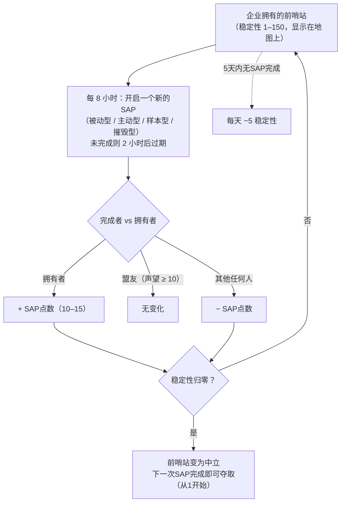

# 前哨站与SAP

在开放PvP岛屿上，**前哨站可以由玩家企业拥有**。
控制权通过一个**稳定性**计量器（0–150）来衡量，显示在地图视图中前哨站的上方。**SAP**（服务接入点）系统就是该计量器的变动方式——也是前哨站易主的方式。

## 规则

- 当**拥有者**企业完成一个SAP时，稳定性**上升**该SAP的点数。
- 当**与拥有者结盟的企业**（相互声望达到+10或以上）完成时，稳定性**不变**。
- 当**其他任何人**完成时，稳定性**下降**相同的数值。
- 当稳定性降至**零**时，前哨站失去所有权并变为中立。在中立前哨站上完成任何SAP即可**夺取**它（完成的企业成为拥有者，稳定性从1开始）。
- **衰减**：如果**5天内**没有SAP被完成，前哨站将开始**每天损失5点稳定性**，直到有SAP被完成（或前哨站被失去）。

## 四种SAP类型

每8小时，前哨站会开启一个新的SAP——四种类型之一。每种类型有自己的点数和完成方式：

| 类型 | 完成方式 | 点数 | 奖励类型 |
|---|---|---|---|
| **被动型** | 在SAP光束内站立**8分钟**。进度为个人计算（每位玩家在光束中的连续时间）；个人进度最高者完成。 | +10 | 阵营等离子体（随稳定性缩放）、研究套件、EP加速器。 |
| **主动型** | 锁定SAP并持续运行**SAP破解模块**——约120个模块周期（每个5秒），即约10分钟。停止或离开后进度保留；个人计算。 | +15 | 等离子体、内核、研究套件，以及**反应堆核心**（机器人生产）。 |
| **样本型** | 携带**样本物品**到SAP处（7米范围内）并提交其要求的5–6件。每次提交有90秒冷却；进度为个人计算。 | +15 | 等离子体、内核、研究套件。 |
| **摧毁型** | 将其击毁：**30,000护甲**和**对四种伤害类型各150点抗性**（60%减伤），**6米信号**——小型武器对其效果最佳。伤害进度为**企业计算，非个人计算**，因此整个舰队可以同时输出；SAP被摧毁时，造成伤害最多的企业适用结果。 | ±15 | 阵营**PvP弹药**、等离子体、内核。 |

所有四种SAP都会**向附近所有人广播当前最高分**（前10名），如果未在**2小时内**完成则**过期**。

### 阻止敌方

由于摧毁型的进度是企业计算的，且稳定性变化的方向取决于谁获胜，一种常见战术是**造成足够多的伤害登上排行榜，但不足以完成SAP**：如果拥有者自己的船员随后完成了它，*你的*企业仍然是获胜者，稳定性变化将作用于拥有者一方。

## 观察与预测

- 地质扫描仪中的**入侵扫描充能**，在前哨站附近激活后，会报告范围内前哨站的**距下一个SAP的时间**（在开放PvP岛屿上，同一充能报告的是NPC增援状态）。
- SAP在开启前会向附近玩家发出公告。
- SAP的最高分广播意味着你可以**实时观察一个争夺中的SAP**，并决定是否参与争夺。

## 其他影响稳定性的方式

- **SAP遗迹**——生成在前哨站90–350米处的遗迹物体（4小时重生，最长存活12小时）。拾取一个会**立即施加±1稳定性**（对你的企业），标记你为PvP状态，并奖励EP和一个等离子体容器。
- **守卫与入侵者**——前哨站的NPC首领：
  - **守卫**NPC在前哨站附近（约35米）驻守。击杀一个**始终降低**稳定性3点，无论谁击杀；约6小时重生。
  - **入侵者**NPC在约300米范围内巡逻。击杀一个为击杀企业**提升**稳定性2点；约6小时重生。

## 前哨站为何重要

拥有前哨站为企业提供其加成（生产、防御设施、效果），是开放PvP领土玩法的支柱——参见[PBS](/zh-CN/features/pbs/)了解使前哨站成为实际作战基地的建筑结构。

<!--
Written from scratch against the server backend, 2026-09-27:
Zones/Intrusion/Outpost.cs (stability 0-150, capture at 1, ally threshold
+10, EP to participants), OutpostDecay.cs (5-day grace, -5/day), SAP.cs +
PassiveHackingSAP.cs / ActiveHackingSAP.cs / SpecimenProcessingSAP.cs /
DestructionSAP.cs (8-min passive, 120x5s active, 5-6 specimen items with 90s
cooldown, corporate destruction score, 2h expiry, top-10 broadcast),
entitydefaults options (#increase=n10/n15), siegeitems (def_specimen_sap_item
2-3 x 5-6), def_sap_destruction stats (30k armor, 150 res all types, 6m
signature), def_siege_hack_module (5s cycle), intrusionsitestabilitythreshold
+ intrusionsaps, intrusionloot (plasma/kernels/research kits/cores/PvP ammo
by stability tier), npcbossinfo + npcflock (guard -3 @ ~35m, invader +2 @
~300m, 6h respawn), OutpostRelicManager.cs + SAPRelic.cs (90-350m spawn,
4h respawn, 12h lifespan, +1 stability, PvP flag), Scanner.Intrusion.cs
(next-SAP-time scan), EntitiesModule.cs (8h SAP interval).
An earlier version of this page was adapted from the Open Perpetuum
community wiki (perpetuum.miraheze.org) and has been fully rewritten from
backend sources; no text was reused.
Note: the ingested text had several numbers this server contradicts (3-day
decay vs 5-day, 10-min passive vs 8-min, "no resistances" vs 150 all types,
3 km invader range vs 300 m).
-->