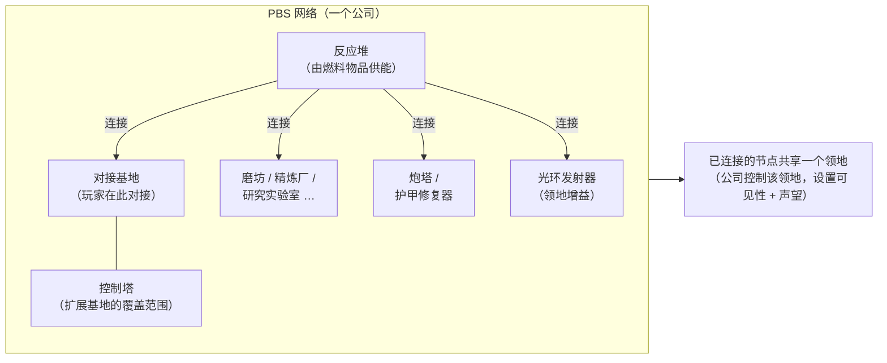
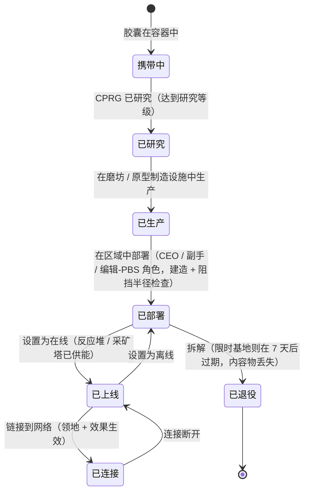

# 动力基站（PBS）

**PBS**（动力基站，Power Base Station）是一种可放置在区域中的结构。PBS 对象可以**连接**成一个**网络**，该网络定义了**领地**并启用**效果**。
这是一项公司/结构活动——大多数操作需要正确的公司角色。

> UI 位置参见[客户端 UI 概览](/zh-CN/features/ui/)。"PBS"在客户端中的名称应予以确认。以下机制已对照服务器确认。

## PBS 的功能

- 它是 PBS **网络**中的一个**节点**。
- 已连接的节点形成一个由所属公司控制的共享**领地**。
- 一个网络可以在其领地上投射**效果**（增益/控制）。
- 某些 PBS 结构可以被**供能**（投入燃料）以运行。

## 结构家族

每种 PBS 结构都有**小型 / 中型 / 大型**等级。你携带**胶囊**，研究该物品（CPRG），然后**部署**该对象——部署受权限限制（见下文）。各家族如下：

| 家族 | 结构 | 作用 |
|---|---|---|
| 动力 | 反应堆、能量井、核心电池、核心发射器 | 生成、存储和分配一切运行所依赖的**核心能量** |
| 对接 | 对接基地、限时对接基地、控制塔 | 玩家对接的位置；控制塔扩展基地的覆盖范围 |
| 生产 | 磨坊、精炼厂、再处理器、修复站、原型制造器、研究实验室、校准（CPRG）熔炉、研究套件熔炉、生产升级 | 区域中的[生产](/zh-CN/features/production/)设施，而非位于主基地 |
| 防御 | 炮塔（激光 / 轨道 / 导弹 / 电子战）、护甲修复器 | 领地的自动防御 |
| 效果 | 光环发射器、效果供应器、Maskertower、采矿塔 | 投射领地的效果加成；采矿塔自动提取矿石 |
| 运输 | 高速公路节点 | 连接到区域的**高速公路**（快速旅行线路） |
| 建造 | 建造模块 | 放置其他结构的建造器 |

### 光环发射器效果

光环发射器是主要的领地增益。每个等级投射三种**按等级缩放的基礎加成**之一：

- **小型** — 传感器 lvl1 / 工程 lvl1 / 工业 lvl1
- **中型** — 上述三项均为 lvl2
- **大型** — 上述三项均为 lvl3

传感器扩展扫描/侦察范围，工程加速建造，工业加速生产。

### 限时对接基地

一种特殊的 PBS 基地，具有固定的**7 天寿命**（内容中为 168 小时）。它**无法被拆解**——要么**过期或被摧毁**。剩余寿命由游戏内播报器通知（基地频道主题、邮件和 MOTD）；当寿命耗尽时，基地被销毁，其内容物丢失。这是 PBS 对接的"租赁"模式：你不需要支付租金，而是获得一个时间盒。

## 部署

- **检查部署** — 在放置之前，验证 PBS 是否可以在某个位置部署（坡度、阻挡和权限检查）。这需要公司角色（**CEO / 副手 / 编辑-PBS**）。
- 部署使用结构的**建造半径**和**阻挡半径**。

## 网络与连接

- **获取网络** — 查看你所在的 PBS 网络。
- **节点信息** — PBS 节点的详细信息。
- **重命名节点**。
- **创建连接** — 连接两个 PBS 节点。（连接到一个已有对接基地的网络会触发特定的所有权转移情况。）
- **断开连接** — 取消两个节点之间的连接。
- **设置连接权重** — 调整连接的强度/优先级。

## 控制与状态

- **设置在线** — 将节点设为在线/离线。
- **设置效果** — 配置节点投射的效果。
- **设置基地拆解** — 标记基地为待拆解状态。

## 领地

- **获取领地** — 列出你的网络所控制的领地。
- **设置领地可见性** — 控制领地是否对其他人可见。
- **设置声望限制** — 通过声望限制访问。
- **设置强化偏移** — 调整强化行为。

## 供能

- **可供能信息** — PBS 需要什么及其当前供能状态。
- **投入物品** — 提交物品以为 PBS 供能/运行。

可供能的结构是**反应堆**和**采矿塔**。供能将具有能量值的物品（每件的 `corecalories`）转换为节点的核心能量缓冲区，直至其最大值——范围内任何玩家都可以为节点供能。你可以燃烧的物品：

| 燃料 | 每件核心能量 |
|---|---|
| C 级反应堆增强剂 | 8,000,000 |
| B 级反应堆增强剂 | 4,000,000 |
| A 级反应堆增强剂 | 2,000,000 |
| SAP 样本（入侵） | 600,000（通量变体：28,000） |
| 伽马能量块 | 2,000 |
| 核心增强剂弹药 | 1,000 |
| 原始矿石（Espitium） | 400 |
| 原始矿石（Vitricyl / Prilumium / Chollonin） | 300 |
| 原始矿石（Axicol） | 40 |

增强剂是高效的燃料；原始矿石是廉价的替代方案。

## 报销

- **获取 / 设置报销信息** — 配置 PBS 相关费用的报销。

## 日志

- **PBS 日志** — 查看 PBS 活动（连接、部署等）。

## 实用提示

- **这是一项军官活动** — 部署和大多数控制操作需要公司角色。
- **连接定义领地** — 你构建的网络就是你控制的范围。
- **先检查部署** — 它会在你确认之前告诉你放置为何会失败（坡度、阻挡、权限）。
- **供能维持运行** — 反应堆和采矿塔燃烧燃料物品（增强剂或原始矿石）以维持其核心缓冲区。
- **限时基地是你的时间盒** — 7 天，不可拆解；为销毁做好规划。
- **领地可见性与声望**让你可以开放或关闭你的区域供他人使用。

## 防御炮塔

不可由玩家操控——作为 PBS 防御结构部署。炮塔与其他机器人一样由部件组装而成，但它们被锁定在 PBS 基座上，无法被驾驶。

| 炮塔 | 作用 |
|---|---|
| PBS 炮塔 | 通用 PBS 防御 |
| PBS 电子战炮塔 | 能量战（护盾/护甲干扰） |
| PBS 激光炮塔 | 光束武器防御 |
| PBS 导弹炮塔 | 导弹防御 |
| PBS 轨道炮塔 | 弹丸（电磁）防御 |
| 警察守卫塔 | 区域 NPC 警察防御 |

部件级详情参见[机器人参考](/content/robots/)。

<!-- TODO: 仅剩 PBS 的客户端内名称和 UI（结构列表、网络编辑器、供能界面）待确认。
     已确认：416 个 def_pbs_* 定义，S/M/L 等级含 capsule/cprg/pr/object 变体；光环发射器 #effect=N93..101 = pbs 传感器/工程/工业 lvl1-3
     （EffectType 枚举）；可供能 = 反应堆 + 采矿塔（IPBSFeedable），燃料 =
     definitionconfig.corecalories（增强剂 A/B/C 2/4/8M，SAP 600k/28k，伽马块
     2k，矿石 espitium 400 / vitricyl+prilumium+chollonin 300 / axicol 40）；
     ExpiringPBSDockingBase：寿命 168 h 来自 definitionconfig.lifetime，不可
     拆解，播报器频道主题 + 邮件，过期时销毁。 -->
     开发者备注：Zone/PBS/PBSCheckDeployment.cs（建造/阻挡半径，
     CEO/副手/editPBS 角色），PBSMakeConnection.cs / PBSBreakConnection.cs，
     PBSSetConnectionWeight.cs，PBSSetOnline.cs，PBSSetEffect.cs，PBSSetBaseDeconstruct.cs，
     PBSGetNetwork.cs，PBSNodeInfo.cs，PBSRenameNode.cs，PBSGetTerritories.cs，
     PBSSetTerritoryVisibility.cs，PBSSetStandingLimit.cs，PBSSetReinforceOffset.cs，
     PBSFeedableInfo.cs / PBSFeedItemsHander.cs，PBSGetReimburseInfo.cs /
     PBSSetReimburseInfo.cs，PbsGetLog.cs；Zones/PBS/*（IPBSObject，ConnectionHandler）。 -->