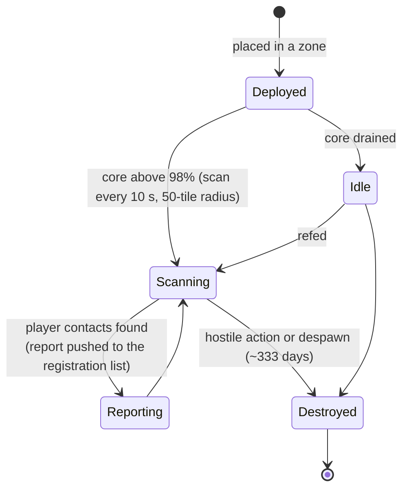

# 近距探测器

探测器分为两大类：

- **可见性（近距）探测器** — 部署在区域中的小型设备，用于**监视一片区域**。通电状态下，它会扫描周围的玩家单位，并向已注册的角色推送报告。这是一种监控/侦察工具。
- **采矿探测器** — 安装在机器人上的一个**模块**（等级从 *新手* 到 *标准*、*工业*、*命名*、*精英* 再到 *神器*），外加**按矿石区分的探测弹药**（每种矿石有地块 / 方向 / 区域变体）。发射后会在该区域生成对应矿石的扫描结果，按角色存储（参见
  [采集 → 扫描](/zh-CN/features/gathering/)）。

> 界面位置参见[客户端界面概览](/zh-CN/features/ui/)。以下机制已对照服务器确认。

## 管理你的探测器

- **列表** — 查看你拥有的探测器。
- **注册信息** — 查看探测器的注册状态/信息。
- **设置注册** — 将角色绑定到探测器的报告列表。
- **设置名称** — 为探测器添加标签。
- **移除**探测器的注册（在区域内）— 停止其监视 / 清除注册。

### 可见性探测器的工作原理

- 它由**核心**驱动：只有当核心接近满值（超过 `core_max` 的 98%）时才会扫描；核心耗尽的探测器处于空闲状态。
- 激活状态下，它**每 10 秒**扫描一次**探测半径（50 格）**内的玩家机器人，并将报告（每个接触目标的字符 ID 和坐标）推送给注册列表上的所有人。
- **注册**是公会活动：你只能注册**自己公会的成员**，且**CEO 和副 CEO 会自动加入列表**。列表有最大容量限制。
- **寿命**：已部署的探测器在其内容定义的 `despawn_time`（可见性探测器设为约 333 天）后消失，或被摧毁。

## 生命周期事件

服务器会在事件发生时报告探测器的生命周期事件：
- **created**（已创建）、**updated**（已更新）、**dead**（已销毁）— 探测器被部署、上报或被摧毁。

这些事件以推送方式到达；你不需要发送它们，只需对它们做出响应。

## 实用提示

- **先注册再读取** — 探测器只会向其已注册的角色报告。
- **探测器会失效** — 敌对行为或到期都会导致探测器失效；关注生命周期事件。
- **给它们命名** — 当野外有多个探测器时，标签能帮你保持清醒。
- **侦察而非战斗** — 探测器用于收集信息，不具备战斗能力。

<!-- TODO: only the UI remains (probe list, registration picker).
     Confirmed: visibility probe (def_visibility_probe): core_max 50, active only at
     core>98%, 10 s scan interval (ProximityDevice.cs _probingInterval), detection via
     blob_emission 10 / blob_emission_radius 50, report = characterID + x/y per contact
     pushed to registered characters (ProximityProbe.OnUnitsFound); registration =
     own-corp members only, CEO+Deputy always included, max count
     (ProximityProbeRegisterSet.cs); despawn_time 28,800,000 s (~333 d) on the capsule;
     stealth_strength 275 / detection_strength 45. Mining probes: tiered modules
     (noob/standard/industrial1-2/named1-3/elite t2-t4/artifact) + per-ore tile/
     direction/area ammo (79 def_*probe* definitions).
     Developer notes: ProximityProbeList.cs / ProximityProbeGetRegistrationInfo.cs /
     ProximityProbeRegisterSet.cs / ProximityProbeSetName.cs; Zone/ProximityProbeRemove.cs;
     Zones/ProximityProbes/ProximityProbe.cs + ProximityProbeDeployer.cs +
     ProximityDevice.cs; Zones/Blobs/* (blob emission/stealth); lifecycle events via
     ProximityProbeCreated/Update/Dead/Info commands. -->
     Developer notes: ProximityProbeList.cs / ProximityProbeGetRegistrationInfo.cs /
     ProximityProbeRegisterSet.cs / ProximityProbeSetName.cs; Zone/ProximityProbeRemove.cs;
     Zones/ProximityProbes/ProximityProbe.cs + ProximityProbeDeployer.cs; lifecycle
     events via ProximityProbeCreated/Update/Dead/Info commands. -->