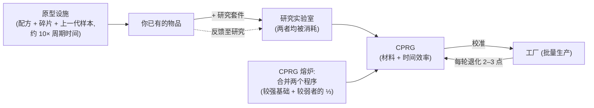

# 生产

生产是将原始资源和组件转化为可用物品的方式。它发生在你停泊基地的**生产设施**（"工厂"）中。此处所有内容均为**仅限停泊**操作。

> 界面位置遵循[客户端界面概览](/zh-CN/features/ui/)（顶栏的**精炼 / 回收 / 维修 / 保险**分类）。以下机制已对照服务器确认。

## 生产线

**生产线**是一个已保存的配方：它定义了你生产什么以及用什么来生产。所有可制作物品的完整组件列表（含研究等级）在[配方](/content/recipes/)中生成。你按**轮次**运行一条生产线。

- **查看生产线列表** — 查看你可用的生产线。
- **启动生产线** — 在设施中运行指定轮次（最少 1 轮）。
  - 你可以从**个人钱包**或**公司钱包**支付。
  - 源组件可以从你的**物品栏**或你的**机器人**中搜索。
- **校准生产线** — 调整生产线的设置。
- **设置轮次** — 选择运行多少轮。
- **查询下一轮** — 预览下一轮将消耗/产出什么。
- **取消** — 停止正在运行的生产。
- **删除生产线** — 移除一条已保存的生产线。

运行生产线会消耗组件（和信用点），并在各轮次中产出目标物品。

## 单次操作

这些是单次操作而非多轮生产线。每种操作都有一个**查询**变体，可在你确认前预览成本/产出。

- **精炼** — 原材料 → 商品，使用物品的配方（参见[配方](/content/recipes/)）。
  你选择要制作多少目标物品；配方的标称输入量按材料乘数 `1 + 50/(bonus + 100)` 缩放，其中 *bonus* 是你的精炼技能
  （扩展 + 设施点数 + 声望点数）。无加成时消耗标称配方的 **150%**；最大加成时降至接近 **100%**。
- **回收 / 再加工** — 将物品分解回其配方组件（反向配方）。产出为 `标称值 × (1 − 75/(bonus + 100)) × 物品健康比率` —
  无技能加成时基础为 **25%**，随加成提升至 100%，且**受损物品产出按比例减少**（如果物品有价值，先修复再回收）。
  只有完整的"批次"（完整默认数量）会被回收；剩余部分保留。任务物品会被删除，而非回收。
- **维修** — 将受损物品/机器人恢复至满血。价格为
  `(缺失健康百分比) × 物品材料价值 × 75/(bonus + 100)`。"材料
  价值"通过递归计算得出：物品的配方被分解为原材料，并按**世界市场均价**定价，因此维修成本随市场浮动。
  技能乘数无加成时起始为 **75%**，最大加成时趋近于 0。
- **研究组件** — 生产研究组件（查询 + 运行）。

## 物品生命周期（循环流程）

物品创建是一个由三个关联设施组成的循环：

1. **研究（逆向工程）** — 将你想要生产的物品放入研究实验室，外加一个等级达到该物品研究等级的**研究套件**
   （套件等级为 0–10）。两个输入均被**消耗**，任务产出该物品的一个 **CPRG**。
   所得程序的效率起始于物品的逐项基础值（大多数物品为 50，弹药更高，炮塔最高 90），
   并由*套件等级超出所需等级的差值 × 5*加上你的研究技能加成（最高 +50）提升。
   因此，一个比物品高几级的套件——加上不错的生产扩展——是将一个全新的 50/50 程序
   变为有竞争力的程序的关键。这是新物品进入你生产 repertoire 的方式。
2. **工厂（批量生产）** — 从程序进行批量生产。每轮**退化**生产线的效率
   （每轮 2–3 点，按物品类别；参见[CPRG](#cprg-xiao-zhun-cheng-xu)）— 当浪费过高时，
   将新程序校准到生产线上。原型物品还需要**上一代样本**作为组件
   （制作 T2 原型需要一个标准模块，制作 T3 需要一个 T2），该样本在过程中被消耗。
3. **原型设施** — 直接生产物品的**原型**：
   配方的材料加上机器人碎片*以及*上一代样本，耗时约为**工厂周期时间的 10 倍**
   （加上通常的时间乘数）。你只能原型化科技树中已解锁的物品。
   原型的成本远高于其标准对应物；其主要用途是**被研究为高质量程序**
   （研究原型物品是解锁下一层级的条件）— 或在物品太稀有无法掉落且市场上太贵时用于机器人。

## 层级进阶

大多数模块和机器人分为 **T1 → T4 层级**（客户端的层级徽章；
`standard → named1 → named2 → named3` 定义行，然后是 `elitet4`/
`artifact` 特殊行）。规则如下：

- **每个层级是独立物品，拥有自己的科技树节点。** 解锁一个
  节点需要研究点数（从内核中研究获得），并且需要**父节点** — 因此层级必须按顺序解锁。
  你只能**原型化**（或批量生产）节点已解锁的物品：
  没有研究就无法制作更高层级。
- **每个更高层级消耗一个上一层级的样本**作为
  组件（加上材料和机器人碎片）。因此 T1 物品永远不能"兑换"为 T3 —
  T3 原型需要一个 **T2** 物品，且样本被**消耗**而非转化：
  输出是一个全新的物品。
- 每个物品页面显示其**层级链** — 完整的 `T1 → T2 → T3 → T4`
  链接链 — 以及[科技树节点页面](/content/techtree/)显示
  每个层级的父/下一节点和点数价格。

示例，小型采矿模块线：[标准小型采矿器 (T1)](/content/items/standard-small-driller/) →
[Biroter 5050 小型采矿模块 (T2)](/content/items/named1-small-driller/) →
[Sublimator Low-D 小型采矿模块 (T3)](/content/items/named2-small-driller/) →
[Scraper-990 小型采矿模块 (T4)](/content/items/named3-small-driller/) —
每个模块/机器人家族都遵循相同的模式。

## 原型与研究套件

- **原型** — 生产原型物品（启动 + 查询）。每个槽位一个原型；
  更多并行原型任务来自生产扩展。
- **合并研究套件** — 将多个研究套件合并为更高级的
  （运行 + 查询）。更高级的套件既缩短研究时间，又提升
  所得程序的效率。

## CPRG（校准程序）

**CPRG**（校准程序）是生产线运行的对象 — 每个物品一个程序，
包含**材料效率**和**时间效率**点数（各 0–100）。你通过
**在研究实验室研究该物品**获得一个（研究等级决定了你能生产哪些物品），
或通过激活**校准胶囊**获得。

- 新研究的 CPRG 起始为 **50/50** 点。
- **熔炼 CPRG**：在校准程序熔炉中合并同一物品的两个 CPRG；
  结果保留较强程序的点数作为基础，并加上较弱者的三分之一。熔炼需要时间并消耗信用点（时间 × 设施每秒价格）。
- **用 CPRG 校准生产线**以设置其效率。每个生产轮次
  **退化**生产线的效率（按物品的去校准值），因此生产线随时间
  逐渐下降 — 长时间运行前重新校准。

效率值代入工厂的公式（每个生产周期）：

- **消耗材料** = 配方 × `1 + 50/(材料点数 + 技能 + 100 + 工厂加成)`
  — 无技能且无科技树批量生产加成的新 50 点 CPRG 消耗
  约 **133%** 的标称配方。
- **生产时间** = 设施基础时间（工厂每周期 3,600 秒）×
  `1 + 100/(时间点数 + 技能 + 100)` × 物品持续时间修正 — 无技能的新 CPRG
  每件物品约需 **1 小时 40 分钟**。
- **价格** = 生产时间 × 设施每秒价格（PBS 工厂 7 信用点/秒，大型/中型 PBS 研究实验室 3 信用点/秒）× 物品价格修正（1–10）。
- 任务相关 CPRG 免费且固定为 10 秒。

## 保险

保险设施为你的**机器人**投保，而非你的生产产出：

- **购买**机器人保单（机器人必须未受损、未打包且非新手机器人），
  **查看**你的保单列表，**查询**保单，**删除**保单。
- 保险期限**15 天**（+ 扩展奖励天数）；你可以为
  1 +（扩展奖励）个机器人持有保单。
- 每个机器人有内容定义的**费用**和**赔付**（`insuranceprices` 表，
  67 个机器人定义）；费用按费用扩展奖励折扣，可从公司钱包支付。
- 如果投保机器人被摧毁，**赔付以信用点支付**（机器人仍然丢失）— 参见[战斗](/zh-CN/features/combat/)。

## 设施与状态

- **设施信息 / 描述** — 生产设施提供什么。
- **进行中（个人 / 公司）** — 当前正在生产什么。
- **生产历史** — 你过去的生产记录。
- **组件列表** — 可用的生产组件。
- **服务器信息** — 生产服务器状态。

## 实用提示

- **你必须停泊在拥有生产设施的基地。**
- **运行前先查询** — 查询变体显示成本和产出，避免在错误上浪费组件。
- **公司钱包** — 如果允许，你可以使用公司资金进行生产。
- **组件也可以来自机器人** — 生产线可以从你装备的机器人中获取源组件，而不仅仅是你的物品栏。
- **满血时回收** — 受损物品产出更少；在再加工前修复贵重物品。
- **技能乘数才是真正的经济杠杆** — 精炼/回收/维修/工厂
  加成都以相同方式缩放；投资生产扩展在每次运行中都能节省材料。
- **保险是机器人的安全网** — 在深空 PvP 前为昂贵配置购买保险。
- **研究套件是门槛** — 物品的研究等级（1–9）决定了哪些
  套件可以解码它，而运行比物品高几级的套件是
  提升所得程序效率最经济的方式。

<!--
开发者备注：2026 年根据后端源码重写；未复用社区 wiki 文本。
已对照以下来源验证：
- refine = 每单位 1 个输出，输入 = 标称值 x (1+50/(bonus+100)) (Refinery.cs)；
- recycle = 反向配方 x (1-75/(bonus+100)) x healthRatio，仅整批，
  任务物品删除 (ReprocessSessionMember.cs)；
- repair price = (1-healthRatio) x PriceCalculator 世界市场价值 x
  75/(bonus+100) (Repair.cs + PriceCalculator.cs)；
- ResearchLab.cs (StartResearch/EndResearch: 源物品 + 研究套件均
  被消耗；套件等级必须 >= itemresearchlevels.researchlevel (1-9)；
  efficiency = 逐项基础值 + levelDifference*5 + (1-100/(100+skill))*50)；
- itemresearchlevels (1101 行，等级 1-9)，研究套件 def_research_kit_0..10
  (#level 选项)，RandomResearchKit (任务套件，虚假 100/100)；
- calibrationdefaults (每 CPRG 基础效率 50-90；默认回退 50/50；
  CalibrationProgram.OnInsertToDb 设置 50/50)；
- PBSFacilities.cs CalculateResultingPoints (熔炉 = 较强基础 + 较弱/3 +
  (1-100/(100+skill))*25)；
- productiondecalibration (每轮每类别减少 2-3 点，
  偏差 0.5-1%)；
- Prototyper.cs (StartPrototype: 组件包含上一代样本，通过
  components 表 — 例如 T2 NEXUS 消耗 1x 标准模块，T3 消耗 1x T2；
  time = 10x 周期 x 乘数；科技树解锁检查在
  ProductionPrototypeStart.cs 中)；
- prototypes 表 (339 行，standard->prototype 映射)；
- Mill.cs (CalculateFinalMaterialMultiplier 1+50/(pts+skill+100+millBonus) 含
  科技树批量生产加成；CalculateFinalTimeMultiplier；
  productionduration 表)；
- Insurance: InsuraceFacility.cs (15天 + 时间扩展奖励，1+槽位扩展
  保单，新手机器人排除，必须为单个+未打包)，InsuranceDescription.cs
  (赔付通过中央银行以信用点支付)，insuranceprices (67 个机器人定义，
  赔付 = 80x 费用，除新手/arkhe2 为 4x)。
- 设施选项 (entitydefaults): def_pbs_facility_mill #perSecondPrice=7
  #productionTime=3600; refinery #materialEfficiency=0.95;
  calibration_program_forge #perSecondPrice=7; def_production_public_factory
  #materialEfficiency=0.6 #manufactureTime=3600 #perSecondPrice=3.
开发者文件：Production/ProductionLineStart.cs (PrepareProductionForPublicContainer,
LineStartInMill, 公司钱包, 机器人中搜索, 轮次); Production/ProductionLine*.cs;
Production/ProductionRefine*.cs, ProductionReprocess*.cs, ProductionRepair*.cs,
ProductionResearch*.cs (查询+运行对); Production/ProductionPrototype*.cs,
ProductionMergeResearchKitsMulti*.cs; Production/ProductionCPRG*.cs,
ProductionGetCPRGFromLine*.cs; Production/ProductionInsurance*.cs;
Production/ProductionFacility*.cs, ProductionInProgress*.cs, ProductionHistory.cs;
Services/ProductionEngine/Facilities/*.cs; Services/ProductionEngine/PBSFacilities.cs;
Services/ProductionEngine/ResearchKits/*.cs; Services/ProductionEngine/CalibrationPrograms/*;
Services/Insurance/InsuranceHelper.cs; Items/PriceCalculator.cs。
与已摄入页面的更正：不存在"解码器"物品（研究套件是
等级门槛输入）；"研究至 100%"的说法是错误的（科技树解锁是
门槛；研究等级为 1-9）；原型时间是工厂周期的 10 倍；样本
消耗已从 components 表验证；保险赔付为费用的 80 倍。
-->