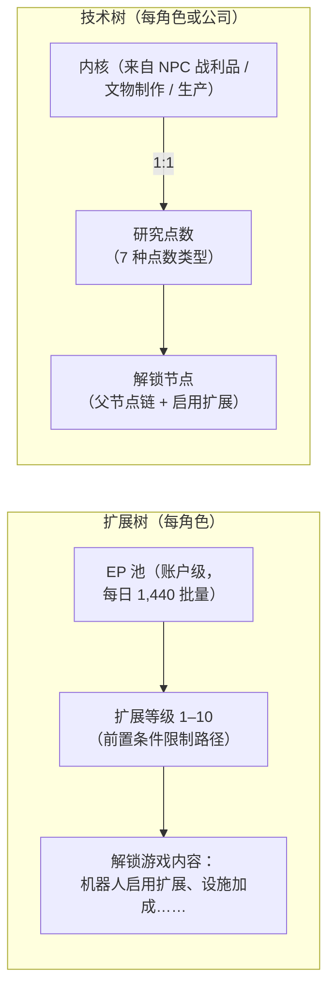

# 研究

存在**两套独立的成长系统**。两者都要求**停泊**状态。

> UI 位置参见[客户端 UI 概览](/zh-CN/features/ui/)（角色窗口 → 扩展；技术树有独立窗口）。以下机制已与服务器端确认。

## 扩展树（角色技能）

扩展是每角色的技能等级，用于解锁游戏内容——最重要的是**启用扩展**，它让你能够驾驶机器人类别（停泊和选择机器人时必须具备，参见[移动](/zh-CN/features/movement/)和[机器人](/zh-CN/features/robots/)）。

### 学习机制

- 必须处于**停泊**状态才能学习。
- 每个扩展可提升至**1–10 级**（10 级为上限）。
- **1 级消耗信用点**（扩展的 `price`），从你的钱包中扣除。
- **每一级消耗扩展点数（EP）**，按照固定的等级 × 级别表计算——
  1–5 级的费用为 `60 × 等级 × 级别`；6–10 级跳升至
  `等级 × (1440, 2520, 3840, 5400, 12000)`。一个 1 级扩展的十级费用为
  60 → 6,000 EP，总计 13,500；一个 10 级扩展每级费用为其十倍。
- **前置条件**必须已经学习后才能学习某个扩展
  （"prerequire" 列表）。
- EP 是**账户级池**：在你的角色之间共享，随时间积累
  （参见下方"EP 来源"）。

### 扩展管理

- **分类列表 / 获取全部 / 已学习列表 / 前置条件列表** — 浏览扩展树和你已有的内容。
- **可用点数** — 查看当前 EP 池。
- **移除一级** — 降低某个扩展的一个等级。
- **重置角色扩展** — 重置某个角色的整棵扩展树。
- **释放锁定 EP** — 释放被锁定的 EP（例如移除等级后）。
- **购买 EP 加速** — 付费加速器，增加 EP 获取量。
- **EP 活动日志** — 查看你从游戏中获得的 EP 明细。

### EP 来源

EP 不是可以购买的消耗货币——它以**每日批量**方式积累：

- 每个账户每天获得 **1,440 EP**（每天发放一次，在服务器时间 08:00 至
  11:00 之间，由 `extensionPointsAdd` 过程执行）。代码中还定义了一个
  翻倍的 **2,880 EP** 批量用于付费订阅账户，但当前过程向所有账户发放基础批量。
- **付费加速**（EP 加速购买）在此基础上叠加。
- 你的**可用 EP** = 所有已接收的每日批量 − 惩罚 − 游戏中已花费的 EP。
  （EP 活动日志显示每日收入明细。）

**完整目录** — 所有扩展（等级、1 级价格、加成、前置条件）在
[扩展](/content/extensions/)中，所有技术树节点（解锁物品、启用
扩展、点数价格）在[技术树](/content/techtree/)中。

## 技术树（解锁）

技术树是一个由**节点**组成的图，通过花费**研究点数**来解锁。与
EP（账户池）不同，技术树点数是**通过消耗"内核"**获得的——你研究后提交
的物品。

### 运作方式

- **研究内核** — 从容器中提交内核物品。每个内核按
  **1:1** 转换为特定**点数类型**的研究点数；内核会被消耗。
  共有七种内核类型，每种对应一种点数类型：Theodica、Pelistal、Nüimqol、
  Industrial、Common、HiTech 和 NewTech。
- **解锁节点** — 花费所需的研究点数。节点只有在以下条件满足时才能解锁：
  - 其所有**父节点**已经解锁，且
  - 你的角色已学习该节点的**启用扩展**。
- **公司解锁** — 拥有正确的公司角色时，节点可以**为公司**解锁
  （共享）。公司解锁费用更高（适用公司价格乘数），从公司点数中支付。
- **捐赠** — 捐赠研究点数（例如捐赠给你的公司）。
- **信息 / 日志** — 查看节点详情和你的解锁/研究历史。

### 为什么重要

已解锁的技术树节点控制着更高级内容和功能的访问。在花费点数之前，
请检查节点的前置条件（父节点链 + 启用扩展）。

## 实用提示

- **启用扩展限制机器人** — 你无法驾驶未研究的机器人类别（这与阻止
  停泊/选择的检查相同）。
- **1 级是扩展树中唯一的信用点费用**；之后全部使用 EP。
- **技术树不可逆** — 用于解锁的点数一旦花费即不可恢复；请规划好路径。
- **公司技术是团队协作** — 使用共享点数和价格乘数。

<!-- TODO: 仅剩研究 UI 部分（窗口布局、点数显示）。
     已确认：EP 获取 = 每日固定 1440，通过 dbo.extensionPointsAdd（08:00-11:00 窗口，
     每天一次；GiveExtensionPointsService 中存在 2880 奖励常量用于付费
     订阅，但当前存储过程向所有账户发放基础值）；可用 = 批量 -
     惩罚 - 已花费（extensionPointsAvailable 函数）；EP 费用表在
     Services/ExtensionService/ExtensionPoints.cs（1-5 级为 60*等级*级别，之后为
     等级*(1440,2520,3840,5400,12000)）；内核按 1:1 转换（TechTreeResearch.cs），7
     种内核定义 -> 点数类型 n1..n7（Theodica/Pelistal/Nuimqol/Industrial/
     Common/HiTech/NewTech）。
     开发者笔记：Extensions/ExtensionBuyForPoints.cs（停泊、前置条件、等级上限 10、
     1 级信用点价格、EP 按等级/级别、账户池、训练角色免费）；
     Extensions/ExtensionGetAvailablePoints.cs；Extensions/ExtensionBuyEpBoost.cs,
     ExtensionFreeLockedEp.cs, ExtensionRemoveLevel.cs, ExtensionResetCharacter.cs；
     EpForActivityDailyLog.cs；TechTree/TechTreeResearch.cs（内核 → 点数）；
     TechTree/TechTreeUnlock.cs（父节点链 + 启用扩展，公司乘数）；
     TechTree/TechTreeDonate.cs；Services/ExtensionService/GiveExtensionPointsService.cs；
     Services/ExtensionService/ExtensionPoints.cs. -->
     开发者笔记：Extensions/ExtensionBuyForPoints.cs（停泊、前置条件、等级上限 10、
     1 级信用点价格、EP 按等级/级别、账户池、训练角色免费）；
     Extensions/ExtensionGetAvailablePoints.cs；Extensions/ExtensionBuyEpBoost.cs,
     ExtensionFreeLockedEp.cs, ExtensionRemoveLevel.cs, ExtensionResetCharacter.cs；
     EpForActivityDailyLog.cs；TechTree/TechTreeResearch.cs（内核 → 点数）；
     TechTree/TechTreeUnlock.cs（父节点链 + 启用扩展，公司乘数）；
     TechTree/TechTreeDonate.cs. -->