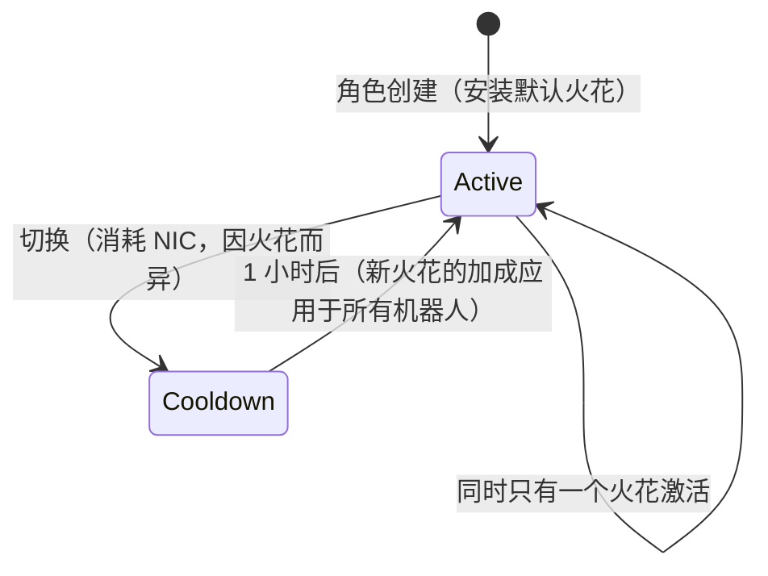

# 火花

**火花**是安装在角色上的纳米机器人特化模块。当它处于激活状态时，其加成会应用于你操控的所有机器人——例如，某阵营战斗线的火花会逐级提升武器伤害和暴击等级，而工业线则提升核心容量和采矿产出。

每个角色在创建时都会获得一个**默认火花**。除此之外，火花按家族划分——基础默认线、各阵营的战斗/工业/社交线（各三级）、付费辛迪加线，以及特殊限定线——而每个火花的具体加成只是一组固定的技能等级，你可以在[扩展页面](/content/extensions/)上查看。[下方的家族概览](#huo-hua-jia-zu)可直接跳转到各家族的火花。

## 解锁（授权）火花

安装你尚未拥有的火花需要先**解锁**（仅限停泊状态）。根据火花类型不同，服务器会检查以下条件：

- **价格**（以 NIC 计价——付费线，例如辛迪加实用火花和限定特殊火花），
- 与开发该火花的**巨型企业的声望**（各阵营线需要与该阵营巨型企业达到最低声望，通过完成其[任务](/zh-CN/features/missions/)积累），
- 或从你的**物品栏**中消耗一个**物品**（某些特殊火花需要钥匙物品来解锁）。

解锁是一次性的：一旦解锁，该火花将永久保留在你的收藏中。

## 切换火花

- 同一时间只能有**一个激活的火花**；安装另一个会替换当前火花。
- 每次切换**消耗 NIC**——金额因火花而异（普通线 10k，付费特殊线最高可达 100 万）。
- 切换之间有**一小时冷却时间**：服务器会记录当前火花的激活时间，在该分钟数结束前拒绝新的切换请求。

由于切换始终消耗 NIC 且需要一小时冷却，请选择与你花费最多时间的活动相匹配的火花，并将重新特化视为偶尔的决策，而非每次会话都要做的事。
<!-- sparkfamilies:generated -->

## 火花家族

6 个家族共 47 个火花一览：每个家族一个方框（火花数量、解锁方式），按添加顺序排列（从左到右，从上到下）。**点击方框可跳转到下方对应家族的火花。** **在图表上滚动可缩放**，拖拽可平移，使用 ⟲ 按钮可重置。

<button type="button" class="zoommap-reset" title="重置缩放">⟲</button>
<svg class="zoommap" xmlns="http://www.w3.org/2000/svg" viewBox="0 0 1008 278" width="960" height="264" role="img" aria-label="火花家族：6 个家族，47 个火花；点击家族可跳转到下方对应火花">
  <rect x="0" y="0" width="1008" height="278" fill="#10151f" stroke="#39445a" stroke-width="1"/>
  <g><title>活动与特殊：9 个火花，免费解锁</title><a href="#family-special"><rect x="24" y="40" width="300" height="84" rx="10" fill="#10151f" stroke="#c8d2e0" stroke-width="1.5"/><text x="174" y="68" text-anchor="middle" fill="#e8eefc" font-size="15" font-weight="700">活动与特殊</text><text x="174" y="92" text-anchor="middle" fill="#c8d2e0" font-size="12">9 个火花 · 免费</text></a></g>
  <g><title>TM (Truhold-Markson)：9 个火花，需 TM 声望解锁</title><a href="#family-tm"><rect x="354" y="40" width="300" height="84" rx="10" fill="#10151f" stroke="#41d3ff" stroke-width="1.5"/><text x="504" y="68" text-anchor="middle" fill="#e8eefc" font-size="15" font-weight="700">TM (Truhold-Markson)</text><text x="504" y="92" text-anchor="middle" fill="#41d3ff" font-size="12">9 个火花 · TM 声望</text></a></g>
  <g><title>ICS：9 个火花，需 ICS 声望解锁</title><a href="#family-ics"><rect x="684" y="40" width="300" height="84" rx="10" fill="#10151f" stroke="#6ee7a0" stroke-width="1.5"/><text x="834" y="68" text-anchor="middle" fill="#e8eefc" font-size="15" font-weight="700">ICS</text><text x="834" y="92" text-anchor="middle" fill="#6ee7a0" font-size="12">9 个火花 · ICS 声望</text></a></g>
  <g><title>ASI：9 个火花，需 ASI 声望解锁</title><a href="#family-asi"><rect x="24" y="154" width="300" height="84" rx="10" fill="#10151f" stroke="#f5a05a" stroke-width="1.5"/><text x="174" y="182" text-anchor="middle" fill="#e8eefc" font-size="15" font-weight="700">ASI</text><text x="174" y="206" text-anchor="middle" fill="#f5a05a" font-size="12">9 个火花 · ASI 声望</text></a></g>
  <g><title>辛迪加 (NIC)：5 个火花，需 NIC 价格解锁</title><a href="#family-syndicate"><rect x="354" y="154" width="300" height="84" rx="10" fill="#10151f" stroke="#a78bfa" stroke-width="1.5"/><text x="504" y="182" text-anchor="middle" fill="#e8eefc" font-size="15" font-weight="700">辛迪加 (NIC)</text><text x="504" y="206" text-anchor="middle" fill="#a78bfa" font-size="12">5 个火花 · NIC 价格</text></a></g>
  <g><title>限定：6 个火花，需 NIC 价格解锁</title><a href="#family-limited"><rect x="684" y="154" width="300" height="84" rx="10" fill="#10151f" stroke="#f472b6" stroke-width="1.5"/><text x="834" y="182" text-anchor="middle" fill="#e8eefc" font-size="15" font-weight="700">限定</text><text x="834" y="206" text-anchor="middle" fill="#f472b6" font-size="12">6 个火花 · NIC 价格</text></a></g>
</svg>

### 活动与特殊（9）

解锁：无——这些是基础默认线。每次切换消耗 NIC（金额因火花而异，见卡片），并有一小时冷却时间——见上方[切换火花](#qie-huan-huo-hua)。

ww

解锁 免费 · 切换 10k NIC

默认火花——角色创建时安装

wi

解锁 免费 · 切换 10k NIC

默认火花——角色创建时安装

ws

解锁 免费 · 切换 10k NIC

默认火花——角色创建时安装

iw

解锁 免费 · 切换 10k NIC

默认火花——角色创建时安装

ii

解锁 免费 · 切换 10k NIC

默认火花——角色创建时安装

is

解锁 免费 · 切换 10k NIC

默认火花——角色创建时安装

sw

解锁 免费 · 切换 10k NIC

默认火花——角色创建时安装

si

解锁 免费 · 切换 10k NIC

默认火花——角色创建时安装

ss

解锁 免费 · 切换 10k NIC

默认火花——角色创建时安装

### TM (Truhold-Markson)（9）

解锁：与 TM 巨型企业的声望（按等级 2 → 4 → 6）。每次切换消耗 NIC（金额因火花而异，见卡片），并有一小时冷却时间——见上方[切换火花](#qie-huan-huo-hua)。

Combat Lvl1

解锁 TM 声望 2 · 切换 10k NIC

包含 2 级扩展

Combat Lvl2

解锁 TM 声望 4 · 切换 100k NIC

包含 3 级扩展

Combat Lvl3

解锁 TM 声望 6 · 切换 1M NIC

包含 3 级扩展

Indy Lvl1

解锁 TM 声望 2 · 切换 10k NIC

包含 2 级扩展

Indy Lvl2

解锁 TM 声望 4 · 切换 100k NIC

包含 3 级扩展

Indy Lvl3

解锁 TM 声望 6 · 切换 1M NIC

包含 3 级扩展

Social Lvl1

解锁 TM 声望 2 · 切换 10k NIC

包含 2 级扩展

Social Lvl2

解锁 TM 声望 4 · 切换 100k NIC

包含 3 级扩展

Social Lvl3

解锁 TM 声望 6 · 切换 1M NIC

包含 3 级扩展

### ICS（9）

解锁：与 ICS 巨型企业的声望（按等级 2 → 4 → 6）。每次切换消耗 NIC（金额因火花而异，见卡片），并有一小时冷却时间——见上方[切换火花](#qie-huan-huo-hua)。

Combat Lvl1

解锁 ICS 声望 2 · 切换 10k NIC

包含 2 级扩展

Combat Lvl2

解锁 ICS 声望 4 · 切换 100k NIC

包含 3 级扩展

Combat Lvl3

解锁 ICS 声望 6 · 切换 1M NIC

包含 3 级扩展

Indy Lvl1

解锁 ICS 声望 2 · 切换 10k NIC

包含 2 级扩展

Indy Lvl2

解锁 ICS 声望 4 · 切换 100k NIC

包含 3 级扩展

Indy Lvl3

解锁 ICS 声望 6 · 切换 1M NIC

包含 3 级扩展

Social Lvl1

解锁 ICS 声望 2 · 切换 10k NIC

包含 2 级扩展

Social Lvl2

解锁 ICS 声望 4 · 切换 100k NIC

包含 3 级扩展

Social Lvl3

解锁 ICS 声望 6 · 切换 1M NIC

包含 3 级扩展

### ASI（9）

解锁：与 ASI 巨型企业的声望（按等级 2 → 4 → 6）。每次切换消耗 NIC（金额因火花而异，见卡片），并有一小时冷却时间——见上方[切换火花](#qie-huan-huo-hua)。

Combat Lvl1

解锁 ASI 声望 2 · 切换 10k NIC

包含 2 级扩展

Combat Lvl2

解锁 ASI 声望 4 · 切换 100k NIC

包含 3 级扩展

Combat Lvl3

解锁 ASI 声望 6 · 切换 1M NIC

包含 3 级扩展

Indy Lvl1

解锁 ASI 声望 2 · 切换 10k NIC

包含 2 级扩展

Indy Lvl2

解锁 ASI 声望 4 · 切换 100k NIC

包含 3 级扩展

Indy Lvl3

解锁 ASI 声望 6 · 切换 1M NIC

包含 3 级扩展

Social Lvl1

解锁 ASI 声望 2 · 切换 10k NIC

包含 5 级扩展

Social Lvl2

解锁 ASI 声望 4 · 切换 100k NIC

包含 6 级扩展

Social Lvl3

解锁 ASI 声望 6 · 切换 1M NIC

包含 6 级扩展

### 辛迪加 (NIC)（5）

解锁：NIC 价格（每个火花 1M）。每次切换消耗 NIC（金额因火花而异，见卡片），并有一小时冷却时间——见上方[切换火花](#qie-huan-huo-hua)。

Syndicate Nic Combat

解锁 1M NIC · 切换 100k NIC

包含 2 级扩展

Syndicate Nic Scout

解锁 1M NIC · 切换 100k NIC

包含 2 级扩展

Syndicate Nic Coreboost

解锁 1M NIC · 切换 100k NIC

包含 2 级扩展

Syndicate Nic Allresist

解锁 1M NIC · 切换 100k NIC

包含 4 级扩展

Syndicate Nic Fitboost

解锁 1M NIC · 切换 100k NIC

包含 2 级扩展

### 限定（6）

解锁：NIC 价格（每个火花 25–50M）。每次切换消耗 NIC（金额因火花而异，见卡片），并有一小时冷却时间——见上方[切换火花](#qie-huan-huo-hua)。

Anniversary Combat

解锁 25M NIC · 切换 1M NIC

包含 6 级扩展

Anniversary Logistic

解锁 25M NIC · 切换 1M NIC

包含 6 级扩展

Amazon c1 Combat

解锁 25M NIC · 切换 1M NIC

包含 2 级扩展

Amazon c1 Indy

解锁 25M NIC · 切换 1M NIC

包含 2 级扩展

Steam a

解锁 50M NIC · 切换 1M NIC

包含 2 级扩展

Steam b

解锁 50M NIC · 切换 1M NIC

包含 2 级扩展

<!--
Written from scratch against the server backend, 2026-09-27:
RequestHandlers/Sparks/SparkUnlock.cs (unlock rules: price, standing, item),
RequestHandlers/Sparks/SparkChange.cs + Services/Sparks/SparkHelper.cs
(60-minute switch cooldown, per-spark change price),
Services/Sparks/Spark.cs, sparks + sparkextensions tables (47 sparks, per-line
bonus bundles).
An earlier version of this page was adapted from the Open Perpetuum
community wiki (perpetuum.miraheze.org) and has been fully rewritten from
backend sources; no text was reused.
-->