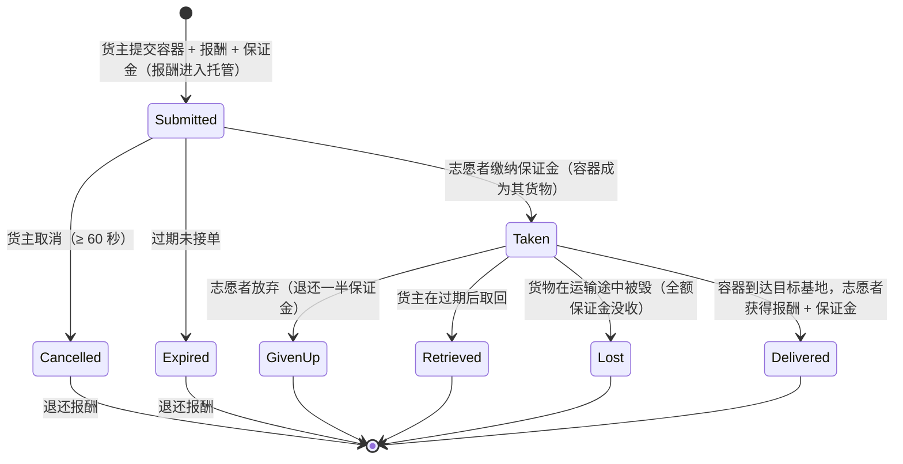

# 运输（物品运输）

**运输任务**将一箱物品从一个基地运送到另一个基地，由一名**志愿承运人**执行并获得报酬。这是一个双边市场：**货主**发布运输订单，**志愿者**接单并交付。

> UI 位置参见[客户端 UI 概览](/zh-CN/features/ui/)（顶栏的**任务**类别）。以下机制已与服务器端确认。

## 双方角色

- **货主（委托方）** — 发布运输订单：指定一个**容器**从**源基地**运往**目标基地**，设定**报酬**、**保证金**和**有效期**。
- **志愿者（承运人）** — 接单、携带容器并完成交付。

## 发布运输（货主）

**提交运输任务**时需指定：
- 要运输的**容器**（体积包装器），
- 交付时支付的**报酬**，
- **保证金**（承运人需缴纳的押金），
- **源基地**和**目标基地**，
- **有效期**（天数），即任务保持开放的时间。

提交时，**报酬从你的钱包中冻结**（托管）。

## 接单（志愿者）

- **接单** — 缴纳**保证金**作为押金，容器即成为你负责携带的货物。

## 交付与取回

- **交付** — 将容器送达目标基地。交付时，**志愿者获得报酬 + 保证金**，货主收到货物。
- **取回** — 货主（或相关情况下由志愿者）将容器取回至某基地；取回时**保证金退还**，**报酬退回**货主。

## 取消 / 放弃

- **取消** — 取消该任务。
- **放弃** — 志愿者放弃该任务。放弃会触发**保证金罚则**：仅退还**一半**保证金（其余被没收）— 罚则常量为 0.5，定义在 `TransportAssignment.cs` 中。

## 查看信息

- **列表**查看运输任务、**查看内容**、**容器信息**、**是否运行中？**，以及**运输日志**。

## 资金流向（概览）

**报酬**是货主的付款，提交时托管，仅在交付时支付。**保证金**是志愿者的押金：接单时支付给货主，运输途中由货主持有，交付时（连同报酬）退还给志愿者。

| 事件 | 条件 | 货主 | 志愿者 | 容器 |
|---|---|---|---|---|
| 提交 | — | 报酬进入托管 | — | 移入运输存储 |
| 接单 | 未被接受 | 收到保证金押金 | 缴纳保证金 | 成为志愿者的货物 |
| 交付 | 到达目标基地 | 收到货物 | 获得**报酬 + 保证金** | 已交付 |
| 取消 | 未被接受，提交后 ≥ 60 秒 | 退还报酬 | — | 返回源基地 |
| 放弃 | 已被接受 | 退还报酬 | 退还**一半**保证金（0.5 罚则） | 返回源基地 |
| 过期 | 未被接受，超过有效期 | 退还报酬 | — | 返回源基地 |
| 取回 | 已被接受**且**超过有效期 | 退还报酬 | — | 返回源基地（若已停靠则立即执行，否则在志愿者下次停靠时执行） |
| 货物被毁 | 运输途中 | 退还报酬 **+ 全额保证金** | 全额保证金被没收 | 丢失 |

## 实用说明

- **无手续费** — 唯一流动的资金是报酬和保证金。
- **报酬处于托管状态** — 在运输任务解决之前，货主无法使用该笔资金。
- **保证金是承运人的押金** — 缴纳保证金是你接单的前提；若货物在运输途中丢失，**全额**保证金将被没收。
- **放弃有代价** — 放弃运输任务将没收你一半的保证金。
- **有效期仅在未被接受时生效** — 提交时设定的过期时间只会自动关闭无人接取的任务（服务器每小时清理一次过期的未接单任务）。**已被接受**的任务不会自行过期；货主的退出机制是**取回**，当有效期过后即可用，将货物（和报酬）召回源基地 — 若承运人已停靠则立即执行，否则在承运人下次停靠时自动执行。
- **接单前检查内容** — 查看容器内的物品和路线。

<!-- TODO: only the client UI remains (assignments screen layout).
     Money model confirmed: reward escrowed at submit (CashInOnSubmit), collateral paid
     by the volunteer on take (TakeCollateral -> PayCollateralToPrincipal), delivery pays
     volunteer reward+collateral (PayOutReward); cancel needs 60s after creation;
     expiry = submit time + client duration days (<=0 -> 1), cleaned hourly by
     MissionProcessor (_transportAssignmentInterval 1h), taken=0 only; retrieve requires
     expiry passed + taken, auto-completes on next dock; destroyed cargo refunds reward
     and forfeits full collateral to the owner.
     Developer notes: TransportAssignments/TransportAssignmentSubmit.cs;
     Services/MissionEngine/TransportAssignments/TransportAssignment.cs (reward/collateral
     escrow, PayOutReward = reward+collateral, PaybackCollateral, PaybackHalfCollateral
     = COLLATERAL_PENALTY on give-up, RetrieveToBasePublicContainer, expiry);
     TransportAssignmentTake/Deliver/Retrieve/Cancel/GiveUp/List/ListContent/
     ContainerInfo/Running/Log. -->