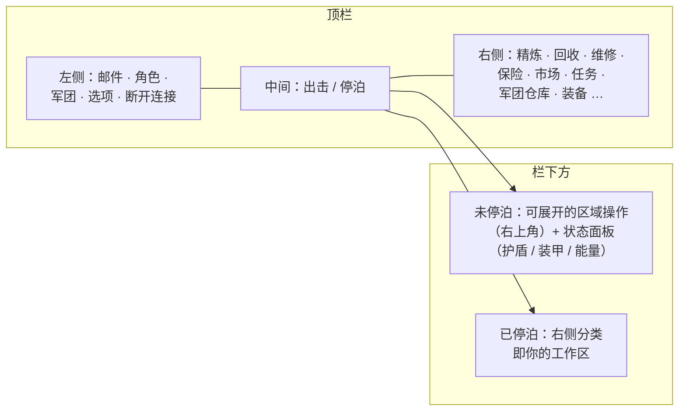

# 客户端界面概览

客户端采用 **EVE Online 风格**的界面：全屏太空/区域视图，配有可**调整大小和移动**的浮动窗口，可随时**关闭和重新打开**。各系统的接线方式详见下方链接的页面。

> 此布局是项目提供的工作模型，用于描述各操作所在的位置。具体屏幕名称可能略有不同，但结构是参考标准。

## 顶栏

屏幕顶部的一条持久栏。

| 区域 | 内容 |
|---|---|
| **左侧** | 主要按钮：**邮件**、**角色**、**军团**、其他**选项**，以及**断开连接** |
| **中间** | **出击 / 停泊**按钮 — 主要的已停泊⇄未停泊切换按钮（参见[移动](/zh-CN/features/movement/)） |
| **右侧** | 操作分类按钮：**精炼**、**回收**、**维修**、**保险**、**市场**、**任务**（运输）、**军团仓库**、**装备**、… |

右侧分类按钮会打开对应的系统窗口：

| 按钮 | 功能 | 维基页面 |
|---|---|---|
| 精炼 | 将原始资源加工为组件 | [生产](/zh-CN/features/production/) |
| 回收 | 将物品分解为基础材料 | [生产](/zh-CN/features/production/) |
| 维修 | 维修受损的机器人/模块 | [生产](/zh-CN/features/production/) |
| 保险 | 生产/机器人保险单 | [生产](/zh-CN/features/production/) |
| 市场 | 市场订单和直接购买 | [市场](/zh-CN/features/market/) |
| 任务 | 运输任务（货运） | [运输](/zh-CN/features/transport/) |
| 军团仓库 | 军团机库/仓库 | [群组](/zh-CN/features/groups/) |
| 装备 | 为你的活动机器人装配模块和弹药 | [机器人](/zh-CN/features/robots/) |

## 已停泊状态

**已停泊**时，右侧操作分类是主要工作区：你可以在不离开基地的情况下进行加工、交易、装配和管理仓库。出击按钮会带你离开基地进入区域（参见[移动](/zh-CN/features/movement/)了解未停泊的前置条件）。

## 未停泊状态

**未停泊**时（驾驶你的活动机器人在区域内）：

- **右上角**区域会出现一个**可展开的操作按钮**：点击后，额外的区域操作列表向下展开（扫描、采集/交互操作、区域工具 — 即[采集](/zh-CN/features/gathering/)和[战斗](/zh-CN/features/combat/)中记录的操作）。
- **主状态面板**显示你机器人的状态：**护盾、装甲/船体、能量**，以及相关的战斗状态 — 与[战斗](/zh-CN/features/combat/)页面引用的数据相同（例如"能量系统完好"的停泊检查）。
- 仅限基地的分类（精炼、市场等）在重新停泊前不可用。

## 通用窗口

大多数系统在标准浮动窗口中打开：标题栏、关闭按钮、可调整大小的边缘、标签页或列表内容。重复出现的系统（物品栏/容器、市场、生产线）可以同时打开多个窗口。

- **物品栏 / 容器** — 列出容器内容、移动/堆叠/打包物品、重命名、丢弃 — 参见[物品](/zh-CN/features/items/)。
- **角色窗口**（左上角按钮） — 个人资料、扩展（研究）、设置、信用点 — 参见[入门](/zh-CN/features/getting-started/)和[研究](/zh-CN/features/research/)。
- **军团窗口**（左上角按钮） — 军团信息、机库、文件、投票、公告 — 参见[群组](/zh-CN/features/groups/)。
- **邮件窗口**（左上角按钮） — 个人邮件和群发邮件 — 参见[社交](/zh-CN/features/social/)。

## 本维基使用的约定

- **"顶栏 → X"** = 顶栏上名为 X 的按钮。
- **"未停泊操作"** = 在区域内时右上角的可展开列表。
- **出击/停泊按钮** = 顶栏中间的切换按钮。

<!-- Note: this page is the agreed UI model (project-provided). If the real client
     differs in button names or placement, update this page first — every other
     features/ page references the conventions defined here. -->