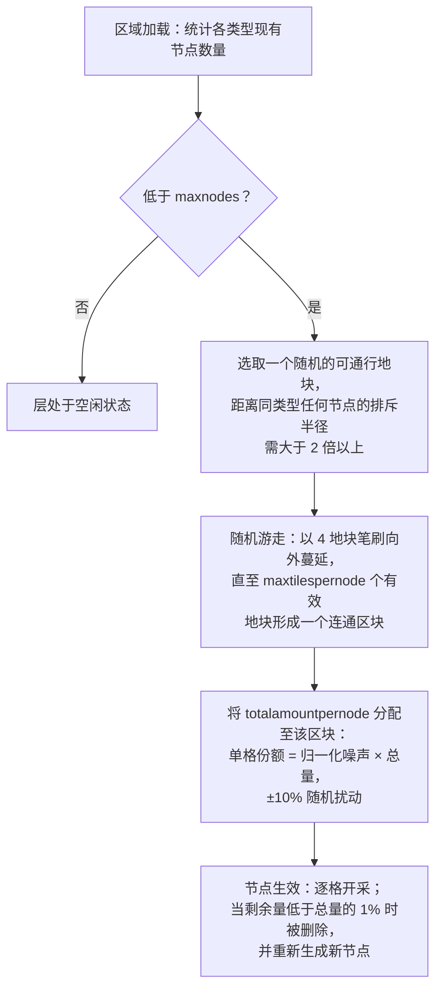

# 区域资源生成机制

本页面详细说明服务器如何维持区域内的资源储量。当区域被加载到内存中时，这两大资源生态
系统会在后台持续运行；它们的周期性运转无需玩家进行任何操作触发。

## 区域资源配置

每个区域在数据库中都通过两个独立的配置列表进行定义：

- **矿石配置** (`mineralconfigs`) — 区域内存在的每种矿石对应一行记录，包含四个控制参数：
  | 列名 | 含义 |
  |---|---|
  | `maxnodes` | 区域维持该类型矿石的节点数量 |
  | `maxtilespernode` | 单个矿石节点最多可覆盖的地块数量 |
  | `totalamountpernode` | 新生矿点中分布在其所有地块上的资源总量 |
  | `minthreshold` | 最低单格填充比例（0–1）；开采后低于该比例的地块将被丢弃 |
- **植物配置** (`zones.fertility` + 植物规则集) — 区域的目标植物覆盖率（百分比）以及允许在该区域生长的植物物种列表（每个物种的行为定义在规则文件中，详见[植物](/zh-CN/content/plants/)）。

未配置矿石的区域（竞技场、新手训练区、要塞以及部分 Gamma 区域）完全不存在矿石层。

## 矿石节点

### 节点的生成与放置

当一个区域加载时，每种矿石类型的图层会统计其现有节点数量（持久化存储在 `mineralnodes`
表中），并不断生成新节点，直至达到 `maxnodes`。新节点的放置采用**随机游走** (random walk)
算法：

1. 随机选取一个可通行的地块。
2. 该地块必须远离同类型最近的现有节点 — 排斥半径根据 `maxtilespernode` 计算得出
   （`√(maxtilespernode/π) × 2`，起始点到现有节点的距离必须至少达到该半径的 2 倍），
   以确保节点不会融合成超大型矿脉。
3. 从起始地块开始，随机向外扩散游走（每次以 4 个地块大小的笔刷进行扩散），收集最多
   `maxtilespernode` 个有效通行地块，组成一个连通的区块。
4. 节点的 `totalamountpernode` 资源储量被分散到该区块的所有地块上：每个地块分配到的份额
   等于其（归一化）噪声值乘以总量，并带有 ±10% 的随机扰动，因此同类型的两个节点外观绝不会完全相同。

地块只有在满足以下条件时才被视为节点的有效放置地：位于区域边界内、非岛屿、未受到
PBS 地形改造保护且可通行。两种稀有矿石在停靠基地和跃迁裂隙门周围设有**隔离禁区**：
**epriton** 保持最小安全距离，而 **flux 矿**保持该距离的两倍 — 因此 flux 矿绝对不会出现在基地正旁边。

### 节点的消耗机制

- 采矿作业逐格提取地块中的资源材料。
- 当节点的剩余量低于其**配置总量的 1%** 时，该节点将被删除，并重新生成一个全新的节点
  （返回步骤 1），从而使区域始终维持 `maxnodes` 的数量。
- 此外，开采 flux 矿节点还会触发 **NPC 生成** — 正在被开采（或删除）的节点会向 NPC 系统
  发布事件广播，这也是 flux 矿区总是引来大量敌对 NPC 围攻的原因。

## 植物生态

### 植物扫描机制

区域被划分为 **32×32 地块**的逻辑区域。植物处理模块会按顺序遍历这些地块，每 tick 处理一块，
其扫描速率经过专门调配，使得**遍历整个区域大约需要 8 小时**（各区域可独立覆盖此时间）。
每个 32×32 的“数据立方” (cube) 都会经过固定的流水线处理：

1. **验证** — 清理无效植物（地面类型错误、死亡、错位）。
2. **生长** — 推进每株植物的生长阶段（关于 `growRate` 与结果机制，请参阅[资源采集](/zh-CN/features/gathering/)）。
3. **生成** — 在立方内植物密度未达肥沃度目标值的位置生成新植物。
4. **阻挡衰减** — 植物的阻挡碰撞高度随时间衰减。
5. **间距剔除** — 强制执行同物种间距限制 (`killDistance`)。
6. **果实再生** — 恢复少量的可采摘果实资源。

### 新植物的选择与生成

地块只有在区域文件中包含**生成潜能**（区域植物图层中硬编码的单格字节数据；0 表示该地块永远不会发芽）
时才能长出新植物。在每个 tick 中，对于每个符合条件的地块：

- **优先进行区域肥沃度检测**：若该立方内的阻挡植物覆盖率已达到其陆地地块的 `fertility%`，则不再生成任何新植物。
- **单格触发几率**：随机抽签点数必须超过地块的生成潜能值。
- **物种筛选**：
  - 若该地块**周围没有相邻植物**，则按权重随机抽取物种，各允许物种的权重为其 `fertility` 参数（玩家人工播种的物种被排除在自然生成之外）。
  - 若该地块**周围已有植物**，则进行抛硬币二选一：50% 几率直接复制当前*占主导地位*的邻近物种（周边数量最多的物种），50% 几率按各物种的 `(邻近数量 × spreading)` 进行**扩散**加权抽取 — 这正是同种植物倾向于形成大片聚集斑块的原因。
- **上限与间距限制**：若某个物种已达到其 `maxAmount` 区域上限，则跳过该物种；若地块处于另一株同类植物的 `killDistance` 范围内，同样予以跳过。

### 对玩家的意义

- 植被密度受区域肥沃度严格限制 — 肥沃度为 20 的区域，植被覆盖率绝不会达到 100%。
- 植物呈群落聚集分布是常态：扩散机制促使各物种扩展自身领地，因此区域生态表现为明显的物种聚落，而非均匀散布。
- 具有 `killDistance` 属性的物种（如特定高价值植物）间距均匀，一旦发现一株，便能推测出其他植株的大致分布。
- 新矿点由随机游走落点决定 — 区域中没有固定不变的“富矿点”；寻找矿脉必须使用地球物理扫描（参见[资源采集](/zh-CN/features/gathering/)）。

<!-- Developer notes: TerrainsModule.cs (per-zone layer construction: OreLayer for
     Solid, LiquidLayer for Liquid, GravelLayer for TrainingZone; LoadMineralNodes
     top-up); MineralLayer.cs (LoadMineralNodes: delete <1% nodes, generate to
     maxnodes; FluxOre -> OreNpcSpawnMessage on decrease/expiry);
     Generators/MineralNodeGeneratorBase.cs (FindStartPosition keep-out + spacing,
     NormalizeNoise, CreateMineralNode jitter); RandomWalkMineralNodeGenerator.cs
     (flood-fill brush 4, 50k step cap); MineralNodeRepository.cs (mineralnodes table,
     compressed per-tile values); PlantHandler.cs (32x32 areas, 8h full pass,
     PlantsGrowthTimerOverrideMin, scanner modes); NatureCube.cs (ProcessAll pipeline,
     SpawnPlants fertility/spawn/killDistance logic, GetNewPlantRule 50/50 ruling vs
     spreading); PlantRuleExtensions.cs (fertility-weighted + spreading-weighted
     draws); PlantInfo.cs (per-tile spawn byte comes from the zone's plant layer
     file, never assigned by server code). -->
