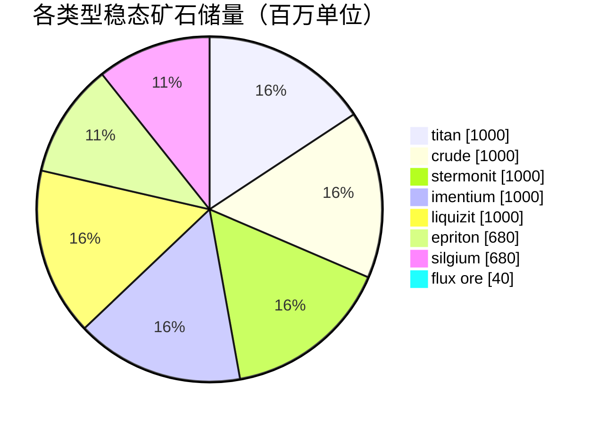

# Daoden (zone_ASI) — 案例分析

  <a href="/zh-CN/zones/map/">
    
    <strong>世界地图</strong> — 该区域在全局中的位置及跃迁裂隙门连接。点击打开完整地图。
  </a>

图示标明了该区域跃迁裂隙柱的分布位置（圆点，标注目标终点；柱体当前关闭时显示为灰色）、
从其他区域跃迁抵达的降落点（虚线圆圈）以及出口闸门（菱形，若存在）。标绘位置均为
服务器记录的地块坐标。
虚线连接了区域内成对的本地跃迁裂隙柱。

Alpha 等级**开放 PvP** 区域 — 拥有全游戏最丰富的矿产配置，也是稀有资源的发源地。
New Virginia 拥有的一切这里应有尽有，此外还孕育着 epriton、silgium 以及会招致 NPC
疯狂袭击的 flux 矿区。

| 项目 | 属性值 |
|---|---|
| 区域 ID | 2 |
| 类型 | PvP（开放） |
| 安全等级 | [Beta](/zh-CN/zones/protection/) — 开放 PvP，标准地形 |
| 尺寸 | 2048 × 2048 地块 |
| 肥沃度 | 20 |
| 植物规则集 | 2 — 19 种（含高阶可采伐植物） |
| 矿石类型 | 8 种（titan, crude, stermonit, imentium, liquizit, epriton, silgium, flux ore） |
| 矿点总数 | 64（每种 8 个） |

## 矿物配置

| 矿物材料 | 节点数 | 最大地块/节点 | 每节点总量 | 最低阈值 |
|---|---|---|---|---|
| [titan](/zh-CN/content/ores/titan/) | 8 | 500 | 125,000,000 | 0.5 |
| [crude](/zh-CN/content/ores/crude/) | 8 | 1257 | 125,000,000 | 0.5 |
| [stermonit](/zh-CN/content/ores/stermonit/) | 8 | 500 | 125,000,000 | 0.5 |
| [imentium](/zh-CN/content/ores/imentium/) | 8 | 500 | 125,000,000 | 0.5 |
| [liquizit](/zh-CN/content/ores/liquizit/) | 8 | 500 | 125,000,000 | 0.5 |
| [epriton](/zh-CN/content/ores/epriton/) | 8 | 500 | 85,000,000 | 0.5 |
| [silgium](/zh-CN/content/ores/silgium/) | 8 | 500 | 85,000,000 | 0.5 |
| [fluxore](/zh-CN/content/ores/fluxore/) | 8 | 300 | 5,000,000 | 0.5 |

显著特征：

- **节点总数是 New Virginia 的 8 倍**，但单节点规模更小（500 地块对比 1000 地块）：
  标准矿石的游走半径从 34 降至 24 地块。在此处地球物理扫描更加重要 — 矿点储层更薄且更加零散。
- **Epriton 与 silgium** 单节点总量缩减（8500 万对比 1.25 亿） — 价值更高，分布更稀少。
  此外，epriton 与基地和跃迁裂隙门保持**最小安全隔离距离**，因此其矿点绝不会出现在出生点旁。
- **Flux 矿属于极端特例**：300 地块内单节点仅有 500 万总量（每格约 16,600 单位 — 细如溪流而非矿脉），
  全图 8 个节点，且与基地保持 **2 倍于 epriton** 的隔离禁区。开采 flux 节点会向 NPC 系统发布
  事件广播 — flux 矿点从设计之初就是兵家必争之地（请参阅[入侵与 NPC 系统](/zh-CN/features/intrusion/)）。
- 稳态矿石储量：全区域总量约 64 亿单位。

## 植物生态组合

规则集 2 允许 19 种植物物种 — 具备完整的 Alpha 级生态构成：基础植物，加上 **devrinol**、
**wall**、**titanplant** 以及**高阶可采伐经济植物**（高阶 electroplant、高阶 iron tree、
高阶 rustbush、高阶 slimeroot）。肥沃度依然是 20，因此整体植被密度与 New Virginia 相同 — 
不同之处在于*哪些*物种能够赢得肥沃度抽取。高阶采伐植物自带的 `fertility` 权重决定了它们在与野草
竞争出苗时的胜率。

各物种规则详见[植物](/zh-CN/content/plants/)；各矿石产出数据详见[矿石](/zh-CN/content/ores/)。

## 对玩家的意义

- 开放完整的矿产进阶链，包括 flux 矿经济 — 但此处为开放 PvP 环境，你开采的一切财富都可能被掠夺
  （关于基地间安全调配物资的指南，请参阅[运输](/zh-CN/features/transport/)）。
- 在 flux 矿节点附近需做好应对 NPC 压迫的准备；生成系统时刻监视这些矿节点的开采事件。
- 此处的植物采伐重点在于高阶变种，其果实产出品质显著优于初始区域的低阶物种。

<!-- Developer notes: zones row id 2 (zonetype 2 = PvP, protected 0, fertility 20,
     plantruleset 2); mineralconfigs 8 rows (7 standard + fluxore 8/300/5M);
     MineralNodeGeneratorBase.KeepOutDist: Epriton = MINERAL_DISTANCE_FROM_BASE_MIN,
     FluxOre = 2x; MineralLayer.OnNodeDecrease/OnNodeExpired -> OreNpcSpawnMessage for
     FluxOre; plantrules rulesetid 2 = 19 files (4 harvestable, incl. devrinol and
     wall). -->
