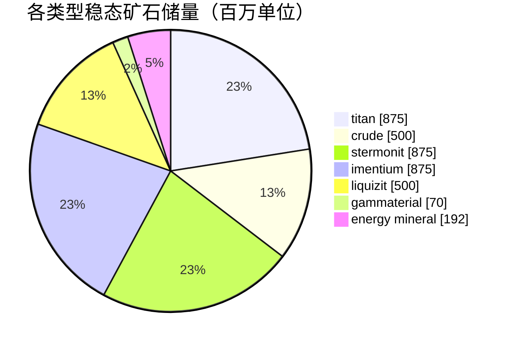

# zone_gamma_z106 — 案例分析

  <a href="/zh-CN/zones/map/">
    
    <strong>世界地图</strong> — 该区域在全局中的位置及跃迁裂隙门连接。点击打开完整地图。
  </a>

图示标明了该区域跃迁裂隙柱的分布位置（圆点，标注目标终点；柱体当前关闭时显示为灰色）、
从其他区域跃迁抵达的降落点（虚线圆圈）以及出口闸门（菱形，若存在）。标绘位置均为
服务器记录的地块坐标。

高等级**开放 PvP** 区域：可进行地形改造、低肥沃度、二阶植物变种以及更紧缩的矿业生态。
这代表了区域的“大后期”形态 — 资源更少，争夺更加白热化。

| 项目 | 属性值 |
|---|---|
| 区域 ID | 106 |
| 类型 | PvP（开放） |
| 安全等级 | [Gamma](/zh-CN/zones/protection/) — 开放 PvP，可地形改造 |
| 尺寸 | 2048 × 2048 地块 |
| 肥沃度 | 15 |
| 可地形改造 | 是（PBS 科技限制 2） |
| 植物规则集 | 22 — 17 种（"Gamma Plant Rules"，二阶组合） |
| 矿石类型 | 7 种（titan, crude, stermonit, imentium, liquizit, gammaterial, energy mineral） |
| 矿点总数 | 44 |

## 矿物配置

| 矿物材料 | 节点数 | 最大地块/节点 | 每节点总量 | 最低阈值 |
|---|---|---|---|---|
| [titan](/zh-CN/content/ores/titan/) | 7 | 600 | 125,000,000 | 0.5 |
| [crude](/zh-CN/content/ores/crude/) | 4 | 600 | 125,000,000 | 0.5 |
| [stermonit](/zh-CN/content/ores/stermonit/) | 7 | 600 | 125,000,000 | 0.5 |
| [imentium](/zh-CN/content/ores/imentium/) | 7 | 600 | 125,000,000 | 0.5 |
| [liquizit](/zh-CN/content/ores/liquizit/) | 4 | 600 | 125,000,000 | 0.5 |
| [gammaterial](/zh-CN/content/ores/gammaterial/) | 7 | 100 | 10,000,000 | 0.5 |
| [energymineral](/zh-CN/content/ores/energymineral/) | 8 | 300 | 24,000,000 | 0.5 |

显著特征：

- **矿点数少于 Alpha 区域**（全图 44 个节点对比 Daoden 的 64 个）：crude 与 liquizit 锐减
  至各自仅 4 个节点。单节点总量与 Alpha 标准矿石相同，因此稳态总储量（约 39 亿单位）更为紧缺，
  且再生周期更长。
- **两种特异矿石**：极小型的 100 地块 **gammaterial** 矿点（游走半径仅 10 地块 — 规模小且极易被发现，
  单节点储量约 140 万）以及单节点储量 2400 万的 **energy mineral**。
- 无 epriton，无 flux 矿 — 稀有经济矿石仍保留在 Alpha 等级区域中。

## 植物生态组合

规则集 22 允许 17 种植物物种：包含基础植物，加上**二阶变种** — 野生可采伐的高阶 iron tree t2
与高阶 rustbush t2，以及**二阶播种植物**（高阶 electroplant t2、高阶 slimeroot t2）。播种植物
带有 `playerSeeded` 标记 — 它们**绝不会**自然生成；仅存在于玩家培育的苗圃园林中
（请参阅[资源采集 → 植物](/zh-CN/features/gathering/)）。

肥沃度为 **15**（而非 20）：一个 32×32 的立方体内最多容纳约 15% 的阻挡植物，因此植被覆盖率
明显比 Alpha 区域稀疏，在立方体达到“饱和”前，肥沃度抽取可填补的生长空间也更小。

各物种规则（包括二阶果实产出量）详见[植物](/zh-CN/content/plants/)；各矿石产出数据详见[矿石](/zh-CN/content/ores/)。

## 对玩家的意义

- 更加紧缺、周转更慢的经济体系：常规矿石节点数量更少意味着采矿压力会更快显现 — 采空的 crude
  油田需要区域花费更长时间才能补充再生。
- 植被更加稀疏：在 15% 肥沃度下，开阔平原是常态，植物斑块反而属于特例。
- 此处的高价值采集为野生的二阶 iron tree / rustbush，以及玩家在私家园林中种植培育的二阶 electroplant 与 slimeroot。
- 地形改造（PBS 科技限制 2）意味着地貌本身可以被玩家重塑改变（请参阅[能量基站 (PBS)](/zh-CN/features/pbs/)）。

<!-- Developer notes: zones row id 106 (zonetype 2 = PvP, protected 0, fertility 15,
     terraformable 1, pbsTechLimit 2, plantruleset 22); mineralconfigs 7 rows (crude
     and liquizit 4 nodes each); plantrules rulesetid 22 = 17 files, note "Gamma
     Plant Rules"; electroplant_seeded_t2.txt / slimeroot_seeded_t2.txt set
     playerSeeded=n1 (inherited via source= from electroplant_hi.txt /
     slimeroot_hi.txt) -> excluded from natural spawns in
     PlantRuleExtensions.GetWinnerPlantTypeBasedOnFertility. -->
