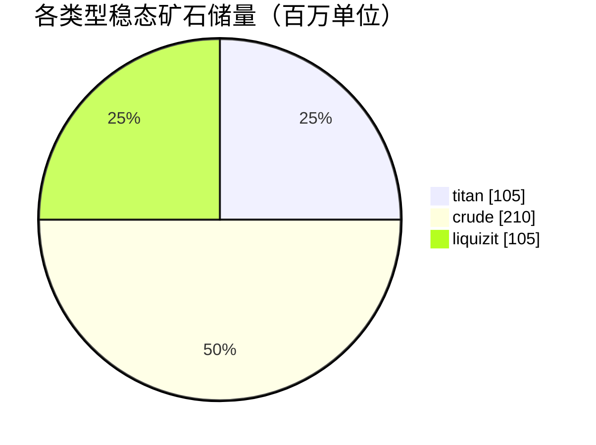

# New Virginia (zone_TM) — 案例分析

  <a href="/zh-CN/zones/map/">
    
    <strong>世界地图</strong> — 该区域在全局中的位置及跃迁裂隙门连接。点击打开完整地图。
  </a>

图示标明了该区域跃迁裂隙柱的分布位置（圆点，标注目标终点；柱体当前关闭时显示为灰色）、
从其他区域跃迁抵达的降落点（虚线圆圈）以及出口闸门（菱形，若存在）。标绘位置均为
服务器记录的地块坐标。
虚线连接了区域内成对的本地跃迁裂隙柱。

低等级**受保护 PvE** 区域 — 供新角色采集资源的避风港。其配置展现了整个体系中最简练的一端：
矿石种类少、矿点规模大、基础植物组合。

| 项目 | 属性值 |
|---|---|
| 区域 ID | 0 |
| 类型 | PvE（受保护） |
| 安全等级 | [Alpha](/zh-CN/zones/protection/) — 受保护，已禁用 PvP |
| 尺寸 | 2048 × 2048 地块 |
| 肥沃度 | 20 |
| 植物规则集 | 0 — 15 种（基础 "tm pve" 组合） |
| 矿石类型 | 3 种（titan, crude, liquizit） |
| 矿点总数 | 21（每种 7 个） |

## 矿物配置

| 矿物材料 | 节点数 | 最大地块/节点 | 每节点总量 | 最低阈值 |
|---|---|---|---|---|
| [titan](/zh-CN/content/ores/titan/) | 7 | 1000 | 15,000,000 | 0.5 |
| [crude](/zh-CN/content/ores/crude/) | 7 | 1257 | 30,000,000 | 0.5 |
| [liquizit](/zh-CN/content/ores/liquizit/) | 7 | 1000 | 15,000,000 | 0.5 |

显著特征：

- **矿点庞大而稀疏** — 每个节点覆盖 1000–1257 个地块（游走半径 `(int)√(tiles/π)×2` = 34–40 个地块），
  因此每个节点都是大片矿斑，且全区域每种矿石仅维持 7 个节点。稳态矿石储量总计约 4.2 亿单位
  （1.05 亿 titan + 2.1 亿 crude + 1.05 亿 liquizit）。
- **无稀有矿石** — 无 epriton，无 flux 矿，因此基地区域周围没有隔离禁区，也不会有引来 NPC 围攻的矿点。
- `minthreshold` 为 0.5 意味着只有当节点在该处的噪声填充量达到最大值的至少一半时，地块才具备开采价值 — 每个矿斑边缘均较为稀薄。

各类矿石的提炼产出（单位矿石精炼所得产物以及上述数据背后的节点生成公式）请参阅[矿石](/zh-CN/content/ores/)。

## 植物生态组合

规则集 0 允许 15 种植物物种 — 属于基础初始生态配置：草 (a/b)、松树、灌木 (a/b)、
rango、铜树、芦苇、纳米小麦、低阶 rustbush / slimeroot / electroplant、盆景以及低阶铁树。
不含墙体、不含 devrinol，也不含高阶可采伐经济植物。

在肥沃度为 20 的设定下，一个 32×32 的立方体内最多容纳约 20% 的阻挡植物；在整张 2048×2048
的地图上，理论上限大约为 838,000 个植物地块（实际数量更少，因为水域与岛屿不属于陆地）。
物种筛选按照各规则的 `fertility` 属性进行加权，因此基础野草和灌木占据绝对主导地位，而低阶可采伐经济植物非常罕见。

每个物种的完整属性规则（growRate、果实产出、生命值）请参阅[植物](/zh-CN/content/plants/)。

## 对玩家的意义

- 安全的新手经济圈：三种常见矿石形成巨大且易于扫描探查的矿斑。
- 此处的可采伐植物均为低阶变种 — 高价值植物（高阶 electroplant / iron tree / rustbush / slimeroot）仅在后续高级区域出现。
- 由于该区域处于保护之下，采集循环中完全没有 PvP 风险（关于进入区域的相关规则，请参阅[移动与导航](/zh-CN/features/movement/)）。

<!-- Developer notes: zones row id 0 (zonetype 1 = PvE, protected 1, fertility 20,
     plantruleset 0); mineralconfigs 3 rows (titan/crude/liquizit, 7 nodes each);
     plantrules rulesetid 0 = 15 files, note "tm pve". Node radius formula and
     threshold semantics: see generation.md. -->
