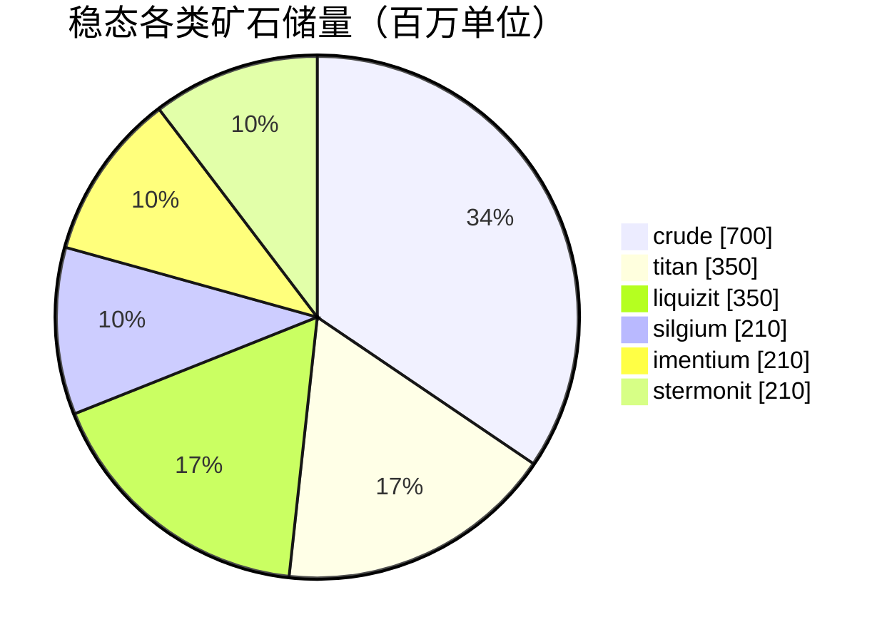

<!-- Generated by tools/generate from the live database (source: zones, mineralconfigs, plantrules, teleportdescriptions, strongholdexitconfig).
     Do not edit by hand; regenerate instead. -->
# Hershfield (zone_TM_pve)

  <a href="/zh-CN/zones/map/">
    
    <strong>世界地图</strong> — 该区域在所有区域中的位置及传送连接。打开完整地图。
  </a>

本区域传送柱位置（带目标标记的点 — 当前关闭的柱子呈暗淡显示）、来自其他区域的传送着陆点（虚线圆圈）以及出口通道（菱形）。坐标为服务器记录的网格坐标。 虚线连接本地（区域内）传送柱对。

New Virginia (TM)的受保护（Alpha）区域 — 免受玩家攻击，是New Virginia (TM)星系的标准资源采集地。 维持6种矿石类型。

| 项目 | 数值 |
|---|---|
| 区域ID | 8 |
| 类型 | PvE |
| 保护 | [Alpha](/zh-CN/zones/protection/) — 受保护，禁用PvP |
| 尺寸 | 2048×2048 格 |
| 肥沃度 | 20 |
| 植物物种 | 15 (规则集 0) |
| 矿石类型 | 6 |
| 矿石节点总数 | 42 |
| 最大停靠基地数 | 无 |

## 矿石配置

该区域维持的矿石节点生成。每种矿石的产出和生成公式请参阅[矿石](/zh-CN/content/ores/)（该区域的对应部分见下方链接）。

| 材料 | 节点 | 最大格数/节点 | 单节点总量 | 最小阈值 |
|---|---|---|---|---|
| [titan](/zh-CN/content/ores/titan/) | 7 | 750 | 50M | 0.5 |
| [crude](/zh-CN/content/ores/crude/) | 7 | 750 | 100M | 0.5 |
| [stermonit](/zh-CN/content/ores/stermonit/) | 7 | 750 | 30M | 0.5 |
| [imentium](/zh-CN/content/ores/imentium/) | 7 | 750 | 30M | 0.5 |
| [liquizit](/zh-CN/content/ores/liquizit/) | 7 | 750 | 50M | 0.5 |
| [silgium](/zh-CN/content/ores/silgium/) | 7 | 750 | 30M | 0.5 |

[区域索引](/zh-CN/zones/zone-index/) · [世界地图](/zh-CN/zones/map/#alpha) · [保护级别](/zh-CN/zones/protection/)
